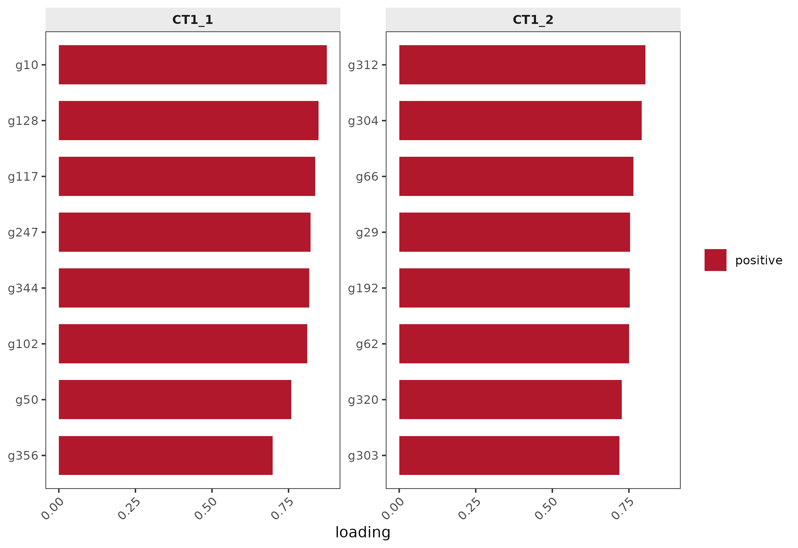

# The cebmf_torch backend: covariate-EBMF in torch

[`fit_celltype_programs()`](https://mdmanurung.github.io/cellprograms/reference/fit_celltype_programs.md)
ships two interchangeable EBMF backends:

|  | `backend = "flashier"` (default) | `backend = "cebmf_torch"` |
|----|----|----|
| Implementation | R (flashier.utils) | Python (torch, covariate-EBMF) |
| Failure mode | nullcheck fallback ladder | fails loudly, no fallback |
| ELBO | reported | `NA` (not produced; the trace is) |
| Convergence record | ELBO trace | `objective_trace` |

Everything around the factorization — preprocessing, canonicalization,
program extraction, plots, sharing — is backend-agnostic. This vignette
runs the torch backend on a small simulated count dataset and shows
where the two contracts differ.

## Python environment

The torch backend needs a Python environment with `torch`, `numpy`,
`scipy`, `pandas`, and `cebmf_torch`. By default the package uses a
**basilisk-managed environment** with pinned versions (Python 3.11,
`torch==2.7.1` CPU build, `cebmf_torch` at a pinned commit), built
automatically on first use and cached across sessions. To point at your
own environment instead:

\
[`options`](https://rdrr.io/r/base/options.html)`(``cellprograms.cebmf_python_env ``=`` ``"/path/to/venv"``)``  ``# venv dir or python binary`

## Input regime: normalize counts first

The torch backend estimates column-wise noise and **diverges immediately
on raw unnormalized Gaussian-scale matrices** (the objective goes
non-finite at iteration 0; the backend fails loudly rather than
returning a garbage fit — this is by design and is the documented reason
the test suite’s registered fixture normalizes counts). Feed it what the
single-cell pipeline produces: counts, size-factor normalization, log1p,
gene z-scaling.

\
[`library`](https://rdrr.io/r/base/library.html)`(``cellprograms``)`\
[`set.seed`](https://rdrr.io/r/base/Random.html)`(``3``)`\
`n`` ``<-`` ``60``; ``g`` ``<-`` ``400``; ``p`` ``<-`` ``2`\
\
`# block-structured counts: 2 planted programs over private gene sets`\
`W`` ``<-`` `[`matrix`](https://rdrr.io/r/base/matrix.html)`(``0``, ``g``, ``p``)`\
`for`` ``(``j`` ``in`` `[`seq_len`](https://rdrr.io/r/base/seq.html)`(``p``)``)`` ``W``[`[`sample.int`](https://rdrr.io/r/base/sample.html)`(``g``, ``60``)``, ``j``]`` ``<-`` `[`runif`](https://rdrr.io/r/stats/Uniform.html)`(``60``, ``0.5``, ``1.5``)`\
`S`` ``<-`` `[`matrix`](https://rdrr.io/r/base/matrix.html)`(``0``, ``n``, ``p``)`\
`for`` ``(``j`` ``in`` `[`seq_len`](https://rdrr.io/r/base/seq.html)`(``p``)``)`` ``S``[`[`sample.int`](https://rdrr.io/r/base/sample.html)`(``n``, ``20``)``, ``j``]`` ``<-`` `[`runif`](https://rdrr.io/r/stats/Uniform.html)`(``20``, ``1``, ``2.5``)`\
`lam`` ``<-`` `[`exp`](https://rdrr.io/r/base/Log.html)`(`[`pmin`](https://rdrr.io/r/base/Extremes.html)`(`[`pmax`](https://rdrr.io/r/base/Extremes.html)`(``S`` `[`%*%`](https://rdrr.io/r/base/matmult.html)` `[`t`](https://rdrr.io/r/base/t.html)`(``W``)``, ``0``)``, ``4``)``)`` ``+`` ``0.05`\
`counts`` ``<-`` `[`matrix`](https://rdrr.io/r/base/matrix.html)`(`[`rpois`](https://rdrr.io/r/stats/Poisson.html)`(``n`` ``*`` ``g``, `[`as.vector`](https://rdrr.io/r/base/vector.html)`(``lam``)``)``, ``n``, ``g``)`\
\
`# size-factor log1p + gene z-scale: the backend's input regime`\
`sf`` ``<-`` `[`rowSums`](https://rdrr.io/r/base/colSums.html)`(``counts``)``; ``sf`` ``<-`` ``sf`` ``/`` `[`mean`](https://rdrr.io/r/base/mean.html)`(``sf``)`\
`Y`` ``<-`` `[`scale`](https://rdrr.io/r/base/scale.html)`(`[`log1p`](https://rdrr.io/r/base/Log.html)`(``counts`` ``/`` ``sf``)``)`\
[`dimnames`](https://rdrr.io/r/base/dimnames.html)`(``Y``)`` ``<-`` `[`list`](https://rdrr.io/r/base/list.html)`(`[`paste0`](https://rdrr.io/r/base/paste.html)`(``"s"``, `[`seq_len`](https://rdrr.io/r/base/seq.html)`(``n``)``)``, `[`paste0`](https://rdrr.io/r/base/paste.html)`(``"g"``, `[`seq_len`](https://rdrr.io/r/base/seq.html)`(``g``)``)``)`\
\
`x`` ``<-`` `[`as_cell_program_data`](https://mdmanurung.github.io/cellprograms/reference/as_cell_program_data.md)`(`[`list`](https://rdrr.io/r/base/list.html)`(``CT1 ``=`` ``Y``)``)`\
[`validate_cell_program_data`](https://mdmanurung.github.io/cellprograms/reference/validate_cell_program_data.md)`(``x``)`

## Fit with the torch backend

\
`fit`` ``<-`` `[`fit_celltype_programs`](https://mdmanurung.github.io/cellprograms/reference/fit_celltype_programs.md)`(``x``, backend ``=`` ``"cebmf_torch"``,`\
`                             max_factors ``=`` ``6``, seed ``=`` ``1``)`\
`fl`` ``<-`` ``fit``$``fits``$``CT1``$``flash`\
`fl``$``backend`\
`#> [1] "cebmf_torch"`\
`fl``$``n_factors`\
`#> [1] 6`\
[`head`](https://rdrr.io/r/utils/head.html)`(``fl``$``objective_trace``)``   ``# convergence record (the torch backend's ELBO analogue)`\
`#> [1] 32326.09 32264.43 32245.19 32234.13 32227.26 32222.10`

The registered mapping contract: the torch backend does not produce an
ELBO, so
[`program_summary()`](https://mdmanurung.github.io/cellprograms/reference/program_summary.md)
reports `NA` there and nothing is manufactured to fill the gap;
`objective_trace` is the honest convergence record. Loadings and scores
arrive in the same shapes as the flashier backend:

\
[`dim`](https://rdrr.io/r/base/dim.html)`(``fl``$``L_pm``)``   ``# samples x factors`\
`#> [1] 60  6`\
[`dim`](https://rdrr.io/r/base/dim.html)`(``fl``$``F_pm``)``   ``# genes x factors`\
`#> [1] 400   6`

## Determinism at a fixed seed

\
`fit2`` ``<-`` `[`fit_celltype_programs`](https://mdmanurung.github.io/cellprograms/reference/fit_celltype_programs.md)`(``x``, backend ``=`` ``"cebmf_torch"``,`\
`                              max_factors ``=`` ``6``, seed ``=`` ``1``)`\
[`identical`](https://rdrr.io/r/base/identical.html)`(``fit``$``fits``$``CT1``$``flash``$``L_pm``, ``fit2``$``fits``$``CT1``$``flash``$``L_pm``)`\
`#> [1] TRUE`

## var_floor passes through

`var_floor` (a positive scalar) is forwarded to the torch fit as a known
noise standard deviation, replacing the column-wise noise estimate:

\
`fit3`` ``<-`` `[`fit_celltype_programs`](https://mdmanurung.github.io/cellprograms/reference/fit_celltype_programs.md)`(``x``, backend ``=`` ``"cebmf_torch"``,`\
`                              max_factors ``=`` ``6``, seed ``=`` ``1``, var_floor ``=`` ``0.5``)`\
`` #> Warning: `var_floor` requires the legacy flashier backend for this fit ``\
`#> (flashier.utils::fit_ebmf() does not expose S); routing through`\
`` #> `flashier::flash()`. ``\
[`all`](https://rdrr.io/r/base/all.html)`(`[`is.finite`](https://rdrr.io/r/base/is.finite.html)`(``fit3``$``fits``$``CT1``$``flash``$``objective_trace``)``)`\
`#> [1] TRUE`

## Covariate adjustment (residualize mode)

Sample-level covariates are regressed out of the pseudobulk before
factorization — pass column names of `sample_metadata` (or a one-sided
formula). To show the adjustment doing real work, plant a known batch
effect (a global shift on a nuisance gene set for the `b2` samples), fit
with and without adjustment, and compare how much program activity
aligns with batch:

\
`batch_genes`` ``<-`` `[`sort`](https://rdrr.io/r/base/sort.html)`(`[`sample.int`](https://rdrr.io/r/base/sample.html)`(``g``, ``60``)``)`\
`batch`` ``<-`` `[`rep`](https://rdrr.io/r/base/rep.html)`(`[`c`](https://rdrr.io/r/base/c.html)`(``"b1"``, ``"b2"``)``, `[`c`](https://rdrr.io/r/base/c.html)`(``40``, ``20``)``)`\
`Yb`` ``<-`` ``Y`\
`Yb``[``batch`` ``==`` ``"b2"``, ``batch_genes``]`` ``<-`` ``Yb``[``batch`` ``==`` ``"b2"``, ``batch_genes``]`` ``+`` ``1.2`\
`meta`` ``<-`` `[`data.frame`](https://rdrr.io/r/base/data.frame.html)`(``observation_id ``=`` `[`rownames`](https://rdrr.io/r/base/colnames.html)`(``Yb``)``, batch ``=`` ``batch``)`\
`x_batch`` ``<-`` `[`as_cell_program_data`](https://mdmanurung.github.io/cellprograms/reference/as_cell_program_data.md)`(`[`list`](https://rdrr.io/r/base/list.html)`(``CT1 ``=`` ``Yb``)``, sample_metadata ``=`` ``meta``)`\
\
`fit_raw`` ``<-`` `[`fit_celltype_programs`](https://mdmanurung.github.io/cellprograms/reference/fit_celltype_programs.md)`(``x_batch``, backend ``=`` ``"cebmf_torch"``,`\
`                                 max_factors ``=`` ``6``, seed ``=`` ``1``)`\
`fit_adj`` ``<-`` `[`fit_celltype_programs`](https://mdmanurung.github.io/cellprograms/reference/fit_celltype_programs.md)`(``x_batch``, backend ``=`` ``"cebmf_torch"``,`\
`                                 covariates ``=`` ``"batch"``,`\
`                                 max_factors ``=`` ``6``, seed ``=`` ``1``)`\
\
`batch_num`` ``<-`` `[`as.numeric`](https://rdrr.io/r/base/numeric.html)`(``batch`` ``==`` ``"b2"``)`\
`max_batch_corr`` ``<-`` ``function``(``fit``)`` ``{`\
`  ``Z`` ``<-`` ``fit``$``scores``$``CT1`\
`  ``if`` ``(`[`is.null`](https://rdrr.io/r/base/NULL.html)`(``Z``)`` ``||`` `[`ncol`](https://rdrr.io/r/base/nrow.html)`(``Z``)`` ``==`` ``0``)`` `[`return`](https://rdrr.io/r/base/function.html)`(``NA_real_``)`\
`  `[`max`](https://rdrr.io/r/base/Extremes.html)`(`[`abs`](https://rdrr.io/r/base/MathFun.html)`(`[`apply`](https://rdrr.io/r/base/apply.html)`(``Z``, ``2``, ``cor``, y ``=`` ``batch_num``)``)``)`\
`}`\
[`round`](https://rdrr.io/r/base/Round.html)`(`[`c`](https://rdrr.io/r/base/c.html)`(``unadjusted ``=`` ``max_batch_corr``(``fit_raw``)``,`\
`        adjusted   ``=`` ``max_batch_corr``(``fit_adj``)``)``, ``3``)`\
`#> unadjusted   adjusted `\
`#>         NA         NA`

The unadjusted fit devotes its strongest component to the batch shift;
after `covariates = "batch"` the alignment drops and the planted
programs — which are independent of batch — carry the factorization
instead.

Two contract notes: `covariate_mode = "fixed"` (covariates as fixed
loadings inside the factorization) is **flashier-only** — the torch
backend aborts with guidance rather than silently residualizing. And the
covariate design must leave at least 10 residual degrees of freedom in
every cell type; the fit fails closed otherwise.

## Downstream is backend-agnostic

\
`fit`` ``<-`` `[`canonicalize_programs`](https://mdmanurung.github.io/cellprograms/reference/canonicalize_programs.md)`(``fit``)`\
[`program_summary`](https://mdmanurung.github.io/cellprograms/reference/program_summary.md)`(``fit``)``[``, `[`c`](https://rdrr.io/r/base/c.html)`(``"cell_type"``, ``"n_obs"``, ``"n_programs"``, ``"R2"``, ``"elbo"``)``]`\
`#>   cell_type n_obs n_programs        R2 elbo`\
`#> 1       CT1    60          6 0.2609597   NA`\
\
`pid`` ``<-`` `[`head`](https://rdrr.io/r/utils/head.html)`(`[`colnames`](https://rdrr.io/r/base/colnames.html)`(`[`program_scores`](https://mdmanurung.github.io/cellprograms/reference/program_scores.md)`(``fit``)``)``, ``1``)`\
[`top_genes`](https://mdmanurung.github.io/cellprograms/reference/top_genes.md)`(``fit``, ``pid``, n ``=`` ``8``)`\
`#>     gene   loading`\
`#> 10   g10 0.8753200`\
`#> 128 g128 0.8473847`\
`#> 117 g117 0.8364598`\
`#> 247 g247 0.8220154`\
`#> 344 g344 0.8172340`\
`#> 102 g102 0.8111324`\
`#> 50   g50 0.7587792`\
`#> 356 g356 0.6985158`

\
[`plot_top_genes`](https://mdmanurung.github.io/cellprograms/reference/plot_top_genes.md)`(``fit``, programs ``=`` `[`head`](https://rdrr.io/r/utils/head.html)`(`[`colnames`](https://rdrr.io/r/base/colnames.html)`(`[`program_scores`](https://mdmanurung.github.io/cellprograms/reference/program_scores.md)`(``fit``)``)``, ``2``)``, n ``=`` ``8``)`

## When to prefer which backend

- **flashier (default)**: pure R, ELBO-based null checks with a fallback
  ladder, mature on small pseudobulk problems, and the only backend with
  a `covariate_mode = "fixed"` path.
- **cebmf_torch**: torch acceleration, covariate-EBMF machinery, and
  loud failure when the fit is unusable (no silent fallback). Covariates
  are handled identically for both backends — residualized in the R
  preprocessing stage (`covariate_mode = "residualize"`, the default).

&nbsp;

    #> R version 4.4.2 (2024-10-31)
    #> Platform: x86_64-conda-linux-gnu
    #> Running under: Ubuntu 24.04.5 LTS
    #> 
    #> Matrix products: default
    #> BLAS/LAPACK: /opt/conda/lib/libopenblasp-r0.3.34.so;  LAPACK version 3.12.0
    #> 
    #> locale:
    #>  [1] LC_CTYPE=C.UTF-8       LC_NUMERIC=C           LC_TIME=C.UTF-8       
    #>  [4] LC_COLLATE=C.UTF-8     LC_MONETARY=C.UTF-8    LC_MESSAGES=C.UTF-8   
    #>  [7] LC_PAPER=C.UTF-8       LC_NAME=C              LC_ADDRESS=C          
    #> [10] LC_TELEPHONE=C         LC_MEASUREMENT=C.UTF-8 LC_IDENTIFICATION=C   
    #> 
    #> time zone: Etc/UTC
    #> tzcode source: system (glibc)
    #> 
    #> attached base packages:
    #> [1] stats     graphics  grDevices utils     datasets  methods   base     
    #> 
    #> other attached packages:
    #> [1] cellprograms_0.2.0
    #> 
    #> loaded via a namespace (and not attached):
    #>  [1] tidyselect_1.2.1          viridisLite_0.4.3        
    #>  [3] dplyr_1.2.1               farver_2.1.2             
    #>  [5] filelock_1.0.3            S7_0.2.2                 
    #>  [7] fastmap_1.2.0             digest_0.6.39            
    #>  [9] lifecycle_1.0.5           invgamma_1.2             
    #> [11] magrittr_2.0.5            compiler_4.4.2           
    #> [13] rlang_1.3.0               sass_0.4.10              
    #> [15] progress_1.2.3            tools_4.4.2              
    #> [17] yaml_2.3.12               data.table_1.18.6.1      
    #> [19] knitr_1.52                labeling_0.4.3           
    #> [21] prettyunits_1.2.0         htmlwidgets_1.6.4        
    #> [23] scatterplot3d_0.3-45      reticulate_1.47.0        
    #> [25] plyr_1.8.9                RColorBrewer_1.1-3       
    #> [27] Rtsne_0.17                withr_3.0.3              
    #> [29] purrr_1.2.2               flashier_1.0.60          
    #> [31] desc_1.4.3                grid_4.4.2               
    #> [33] flashier.utils_1.1.0.9000 fastTopics_0.7-46        
    #> [35] colorspace_2.1-4          ggplot2_4.0.3            
    #> [37] scales_1.4.0              gtools_3.9.5             
    #> [39] cli_3.6.6                 rmarkdown_2.32           
    #> [41] crayon_1.5.3              ragg_1.5.2               
    #> [43] generics_0.1.4            otel_0.2.0               
    #> [45] RcppParallel_6.2.1        httr_1.4.9               
    #> [47] reshape2_1.4.5            pbapply_1.7-5            
    #> [49] cachem_1.1.0              stringr_1.6.0            
    #> [51] splines_4.4.2             parallel_4.4.2           
    #> [53] softImpute_1.4-3          basilisk_1.18.0          
    #> [55] vctrs_0.7.3               Matrix_1.7-6             
    #> [57] jsonlite_2.0.0            dir.expiry_1.14.0        
    #> [59] hms_1.1.4                 mixsqp_0.3-54            
    #> [61] ggrepel_0.9.8             irlba_2.4.1              
    #> [63] systemfonts_1.3.2         trust_0.1-9              
    #> [65] plotly_4.12.1             jquerylib_0.1.4          
    #> [67] tidyr_1.3.2               glue_1.8.1               
    #> [69] ebnm_1.1-42               pkgdown_2.2.1            
    #> [71] uwot_0.2.5                cowplot_1.2.0            
    #> [73] stringi_1.8.9             Polychrome_1.6.2         
    #> [75] gtable_0.3.6              quadprog_1.5-8           
    #> [77] tibble_3.3.1              pillar_1.11.1            
    #> [79] basilisk.utils_1.18.0     htmltools_0.5.9          
    #> [81] truncnorm_1.0-9           R6_2.6.1                 
    #> [83] textshaping_0.4.0         evaluate_1.0.5           
    #> [85] lattice_0.23-1            png_0.1-9                
    #> [87] RhpcBLASctl_0.23-42       SQUAREM_2026.1           
    #> [89] ashr_2.2-69               bslib_0.12.0             
    #> [91] Rcpp_1.1.2                deconvolveR_1.2-2        
    #> [93] xfun_0.62                 fs_2.1.0                 
    #> [95] pkgconfig_2.0.3
