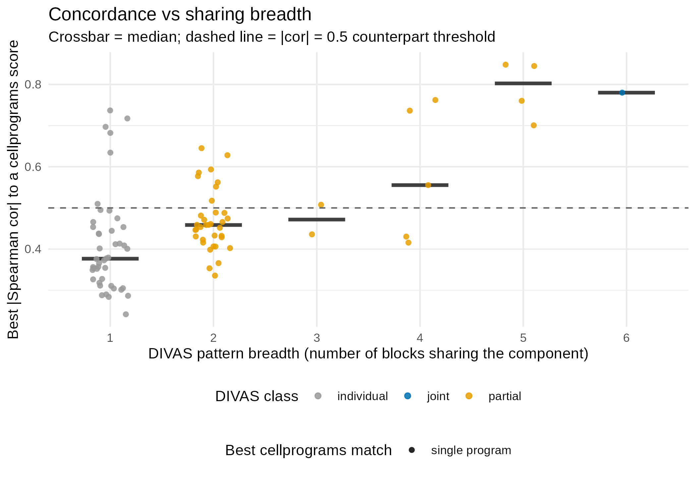
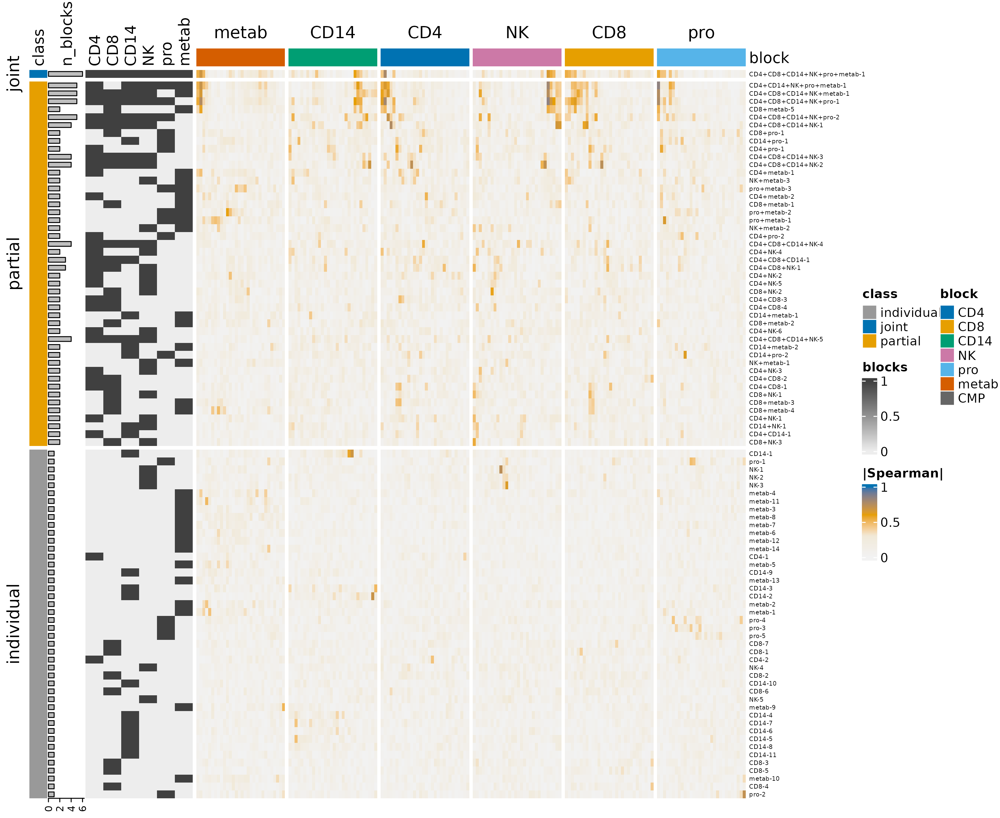
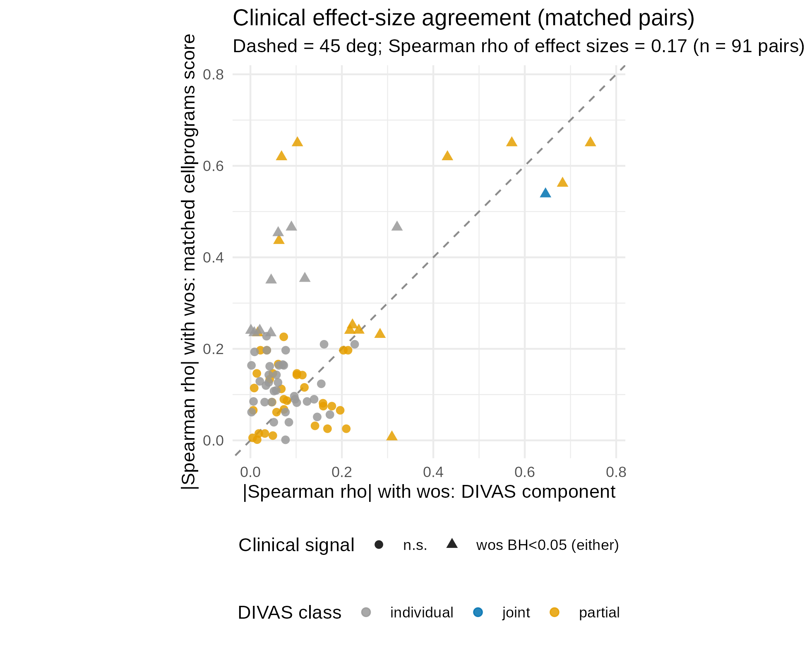

# Historical case study: DIVAS COVID-19 multi-omics

`divas_case_study.Rmd`

**Historical, not current acceptance evidence.** The cached analyses below have not been regenerated under the corrected software and source contracts. Prediction and the patient-pairing inferential claims are withdrawn. The source is processed mean expression with unresolved upstream transformation and selection limitations, not verified raw UMI. Reproduction requires approved source/units/rights and independent T1 refits for every retained method.

This article historically reanalysed the DIVAS COVID-19 case study (<a href="https://github.com/ByronSyun/DIVAS_COVID19_CaseStudy" class="external-link uri">https://github.com/ByronSyun/DIVAS_COVID19_CaseStudy</a>) with `cellprograms` and compares the two pipelines’ outputs program by program. DIVAS jointly decomposes 6 data blocks (4 scRNA-seq cell types + proteomics + metabolomics) into components tagged by which blocks they span; the cellprograms workflow fits each block separately, then recovers cross-block structure with coordination (CMPs) and cross-cell-type sharing. All numbers and figures are precomputed; the code chunks show exactly how each result was produced. The full scripts live in `benchmarks/divas_comparison/scripts/` in the package repository.

## Data

114 samples (85 patients: 29 with paired T1/T2 samples, 56 with a single timepoint), 40 mild / 40 moderate / 34 severe COVID-19, outcome = WHO ordinal score (`wos`). Six blocks: CD4 T, CD8 T, CD14 monocytes, and NK gene blocks (8,634 shared genes each), proteomics (481 proteins), and metabolomics (763 metabolites).

DIVAS was run by the original authors (`DIVASmain(nsim = 500, colCent = FALSE, rowCent = TRUE, seed = 123)`); its precomputed results (Zenodo record 17430294) yield 91 components: 44 individual (1 block), 46 partial (2-5 blocks), 1 joint (all 6 blocks).

## Fitting at DIVAS parity

\
`# each block CSV: features x samples -> transpose to samples x features`\
`read_block`` ``<-`` ``function``(``path``)`` ``{`\
`  `<a href="https://rdrr.io/r/base/t.html" class="external-link"><code class="sourceCode r R">t</code></a>`(`<a href="https://rdrr.io/r/base/matrix.html" class="external-link"><code class="sourceCode r R">as.matrix</code></a>`(`<a href="https://rdrr.io/r/utils/read.table.html" class="external-link"><code class="sourceCode r R">read.csv</code></a>`(``path``, row.names ``=`` ``1``, check.names ``=`` ``FALSE``)``)``)`\
`}`\
`blocks`` ``<-`` `<a href="https://rdrr.io/r/base/c.html" class="external-link"><code class="sourceCode r R">c</code></a>`(``"CD4"``, ``"CD8"``, ``"CD14"``, ``"NK"``, ``"proteomics"``, ``"metabolomics"``)`\
`pseudobulk`` ``<-`` `<a href="https://rdrr.io/r/base/lapply.html" class="external-link"><code class="sourceCode r R">lapply</code></a>`(``blocks``, ``function``(``b``)`\
`  ``read_block``(`<a href="https://rdrr.io/r/base/file.path.html" class="external-link"><code class="sourceCode r R">file.path</code></a>`(``data_dir``, ``"input"``, `<a href="https://rdrr.io/r/base/paste.html" class="external-link"><code class="sourceCode r R">paste0</code></a>`(``"Combined_"``, ``b``, ``".csv"``)``)``)``)`\
<a href="https://rdrr.io/r/base/names.html" class="external-link"><code class="sourceCode r R">names</code></a>`(``pseudobulk``)`` ``<-`` `<a href="https://rdrr.io/r/base/c.html" class="external-link"><code class="sourceCode r R">c</code></a>`(``"CD4_T"``, ``"CD8_T"``, ``"CD14_Monocyte"``, ``"NK"``,`\
`                       ``"proteomics"``, ``"metabolomics"``)`\
`x`` ``<-`` `[`as_cell_program_data`](../reference/as_cell_program_data.html)`(``pseudobulk``, sample_metadata ``=`` ``sample_metadata``)`\
`fit`` ``<-`` `[`fit_celltype_programs`](../reference/fit_celltype_programs.html)`(``x``, loading_prior ``=`` ``"point_laplace"``,`\
`                             max_factors ``=`` ``30``, center ``=`` ``TRUE``, scale ``=`` ``FALSE``,`\
`                             var_type ``=`` ``1``, backfit ``=`` ``TRUE``, nullcheck ``=`` ``TRUE``,`\
`                             seed ``=`` ``1``)`\
`fit`` ``<-`` `[`canonicalize_programs`](../reference/canonicalize_programs.html)`(``fit``)`

All 6 blocks retain K = 30 programs (180 scores total).

## Coordination and sharing

\
`cmp`` ``<-`` `[`find_coordinated_programs`](../reference/find_coordinated_programs.html)`(``fit``, n_perm ``=`` ``999``, seed ``=`` ``1``, min_donors ``=`` ``20``)`\
`cmp_within`` ``<-`` `[`find_coordinated_programs`](../reference/find_coordinated_programs.html)`(``fit``, mode ``=`` ``"within"``,`\
`                                        context ``=`` ``"severity"``,`\
`                                        n_perm ``=`` ``999``, seed ``=`` ``1``)`\
`gene_fit`` ``<-`` ``fit``; ``gene_fit``$``cell_types`` ``<-`` `<a href="https://rdrr.io/r/base/c.html" class="external-link"><code class="sourceCode r R">c</code></a>`(``"CD4_T"``, ``"CD8_T"``, ``"CD14_Monocyte"``, ``"NK"``)`\
`sharing`` ``<-`` `[`program_sharing`](../reference/program_sharing.html)`(``gene_fit``, n_perm ``=`` ``199``, seed ``=`` ``1``, z_thresh ``=`` ``1.5``)`

- Marginal coordination: 148 significant cross-block edges collapse into 6 coordinated program modules (CMPs); within-severity: 123 edges, 6 CMPs - the structure is not a severity-composition artifact.
- Program sharing: 120 gene-block programs in 31 groups (27 groups span all 4 cell types); all 120 classify as shared (`frac_top_shared >= 0.98`). This is more permissive than DIVAS’s taxonomy (44/46/1 individual/partial/joint): the 4 immune cell types are strongly correlated in this cohort, and the dominant severity axis is present in every cell type, so mash’s lfsr-based classification attributes essentially all structure to shared programs.

## Concordance with DIVAS

\
`# score concordance: |Spearman| between each DIVAS component and each`\
`# cellprograms score across the 114 samples`

23 of 91 DIVAS components have a cellprograms counterpart at \|Spearman\| \> 0.5 (51/180 in the reverse direction); 42 component-program pairs are mutual best matches (19 above 0.5). All 120 gene-block programs are classified **shared** across cell types, and their best-matching DIVAS components span all taxonomy classes (96 partial, 18 individual, 6 joint). The single DIVAS joint component has a strong best match (CD4_5, \|rho\| = 0.78) but is not mutual-best. Score-level agreement does not extend to loadings: median top-100 loading Jaccard for the 40 mutual-best gene-block pairs is 0.16 (IQR 0.14-0.22).

Concordance rises with DIVAS pattern breadth - the median best-match correlation increases from 0.38 (components private to 1 block) to 0.80 (components spanning 5 blocks):

\
`knitr``::`<a href="https://rdrr.io/pkg/knitr/man/include_graphics.html" class="external-link"><code class="sourceCode r R">include_graphics</code></a>`(``"figures/fig_breadth_concordance.png"``)`

Best-match concordance by DIVAS pattern breadth.

The full concordance landscape (DIVAS components x cellprograms scores, row-split by DIVAS taxonomy class):

\
`knitr``::`<a href="https://rdrr.io/pkg/knitr/man/include_graphics.html" class="external-link"><code class="sourceCode r R">include_graphics</code></a>`(``"figures/fig_concordance_heatmap.png"``)`

DIVAS component patterns vs cellprograms score concordance.

## Historical clinical association — prediction withdrawn

The prediction table below is retained solely as an invalid historical result: unsupervised representations and upstream selection were not learned entirely inside patient-held-out folds. These values do not establish predictive performance or superiority. The current benchmark disables that prediction path; no replacement clinical prediction claim is made.

At BH \< 0.05, 44/180 cellprograms scores associate with `wos` versus 8/91 DIVAS components. Cross-validated ridge prediction of `wos`:

| Predictors             | n   | R2   | RMSE |
|------------------------|-----|------|------|
| DIVAS components       | 91  | 0.42 | 1.66 |
| cellprograms scores    | 180 | 0.64 | 1.28 |
| severity-only baseline | 2   | 0.90 | 0.62 |

The historical severity association is not a leakage-free prediction result; the earlier claim that one representation captures more predictive variance is withdrawn. Historical effect-size agreement across the 91 matched pairs is weak overall (Spearman rho = 0.17), but pairs where either method is significant sit mostly above the diagonal - the cellprograms counterpart carries as much or more `wos` signal:

\
`knitr``::`<a href="https://rdrr.io/pkg/knitr/man/include_graphics.html" class="external-link"><code class="sourceCode r R">include_graphics</code></a>`(``"figures/fig_effect_agreement.png"``)`

Clinical effect-size agreement for matched pairs.

## Historical pairing check — inferential conclusion withdrawn

The old workflow reported the following check because 29 patients contribute two timepoints. These are historical numbers, not accepted robustness evidence: it checked the headline coordination calls with (i) a T1-only refit (57 samples, no repeated measures): 50/148 full-cohort edges reproduce and both runs find 6 CMPs; and (ii) a patient-blocked permutation null (all samples of a patient permuted together, 999 permutations): 121/148 edges (82%) remain significant at p \< 0.05. **The earlier robustness conclusion is withdrawn.** This was not a valid general patient-cluster permutation design, and a target T1-only refit is not an independent all-method comparison. Even corrected T1 refits cannot undo upstream outcome-balanced/all-visit filtering.

## Reproducing

The historical script order was `01_download_data.sh`, `02_fit_cellprograms.R`, `03_cmp_sharing.R`, `04_extract_divas.R`, `05_compare.R`, `06_figures_extra.R`, `07_sensitivity_pairing.R` (all under `benchmarks/divas_comparison/scripts/`). The maintained workflow and its explicit pending/blocking source decisions live in cellprograms-reproducibility. The old script list is not a claim of current end-to-end reproduction.

