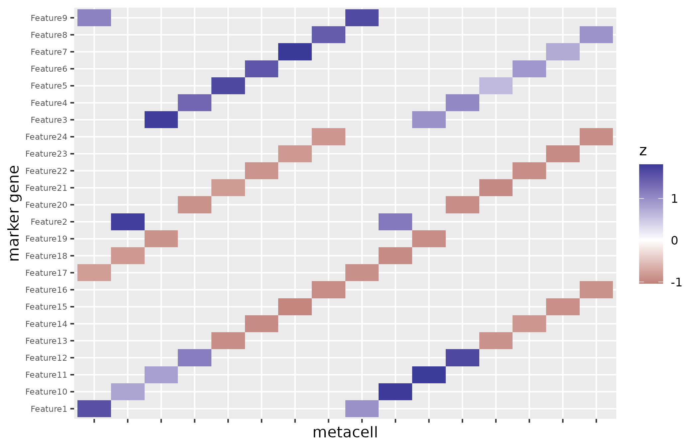

# Metacells with SEACells and mcRigor gamma optimization

When the starting point is single-cell data, `cellprograms` can
aggregate cells into **metacells** — transcriptomically homogeneous
small groups — before pseudobulk factorization. Metacells are built with
[SEACells](https://github.com/dpeerlab/SEACells) (run in an isolated,
pinned basilisk Python environment built on first use) and QC’d with
mcRigor, stratified so that **metacells never cross the grouping
variables** (donor x cell type by default).

This vignette runs the full workflow on a simulated dataset with planted
cell-type identity, then feeds the metacell counts into
[`fit_celltype_programs()`](https://mdmanurung.github.io/cellprograms/reference/fit_celltype_programs.md).

## Simulate a small single-cell dataset

Two donors x two cell types, 80 cells each, 200 genes. Each cell type
gets a private marker block; everything else is background Poisson
noise.

\
[`library`](https://rdrr.io/r/base/library.html)`(``cellprograms``)`\
[`set.seed`](https://rdrr.io/r/base/Random.html)`(``11``)`\
\
`n_per`` ``<-`` ``80`\
`types`` ``<-`` `[`c`](https://rdrr.io/r/base/c.html)`(``"Tcells"``, ``"Bcells"``)`\
`donors`` ``<-`` `[`c`](https://rdrr.io/r/base/c.html)`(``"donor1"``, ``"donor2"``)`\
`groups`` ``<-`` `[`rep`](https://rdrr.io/r/base/rep.html)`(`[`paste0`](https://rdrr.io/r/base/paste.html)`(`[`rep`](https://rdrr.io/r/base/rep.html)`(``donors``, each ``=`` `[`length`](https://rdrr.io/r/base/length.html)`(``types``)``)``, ``"_"``, `[`rep`](https://rdrr.io/r/base/rep.html)`(``types``, `[`length`](https://rdrr.io/r/base/length.html)`(``donors``)``)``)``,`\
`              each ``=`` ``n_per``)`\
\
`lam`` ``<-`` `[`matrix`](https://rdrr.io/r/base/matrix.html)`(``0.5``, nrow ``=`` ``200``, ncol ``=`` `[`length`](https://rdrr.io/r/base/length.html)`(``groups``)``)`\
`markers`` ``<-`` `[`list`](https://rdrr.io/r/base/list.html)`(``Tcells ``=`` ``1``:``12``, Bcells ``=`` ``13``:``24``)`\
`for`` ``(``g`` ``in`` `[`unique`](https://rdrr.io/r/base/unique.html)`(``groups``)``)`` ``{`\
`  ``type`` ``<-`` `[`sub`](https://rdrr.io/r/base/grep.html)`(``".*_"``, ``""``, ``g``)`\
`  ``cols`` ``<-`` `[`which`](https://rdrr.io/r/base/which.html)`(``groups`` ``==`` ``g``)`\
`  ``lam``[``markers``[[``type``]``]``, ``cols``]`` ``<-`` ``8`\
`}`\
`counts`` ``<-`` ``Matrix``::`[`Matrix`](https://rdrr.io/pkg/Matrix/man/Matrix.html)`(`[`rpois`](https://rdrr.io/r/stats/Poisson.html)`(``200`` ``*`` `[`length`](https://rdrr.io/r/base/length.html)`(``groups``)``, `[`as.vector`](https://rdrr.io/r/base/vector.html)`(``lam``)``)``,`\
`                         nrow ``=`` ``200``, ncol ``=`` `[`length`](https://rdrr.io/r/base/length.html)`(``groups``)``, sparse ``=`` ``TRUE``)`\
[`rownames`](https://rdrr.io/r/base/colnames.html)`(``counts``)`` ``<-`` `[`paste0`](https://rdrr.io/r/base/paste.html)`(``"gene"``, `[`seq_len`](https://rdrr.io/r/base/seq.html)`(``200``)``)`\
[`colnames`](https://rdrr.io/r/base/colnames.html)`(``counts``)`` ``<-`` `[`paste0`](https://rdrr.io/r/base/paste.html)`(``"cell"``, `[`seq_len`](https://rdrr.io/r/base/seq.html)`(`[`length`](https://rdrr.io/r/base/length.html)`(``groups``)``)``)`\
\
`meta`` ``<-`` `[`data.frame`](https://rdrr.io/r/base/data.frame.html)`(`\
`  donor ``=`` `[`sub`](https://rdrr.io/r/base/grep.html)`(``"_.*"``, ``""``, ``groups``)``,`\
`  celltype ``=`` `[`sub`](https://rdrr.io/r/base/grep.html)`(``".*_"``, ``""``, ``groups``)``,`\
`  row.names ``=`` `[`colnames`](https://rdrr.io/r/base/colnames.html)`(``counts``)`\
`)`\
\
`obj`` ``<-`` ``Seurat``::`[`CreateSeuratObject`](https://satijalab.github.io/seurat-object/reference/CreateSeuratObject.html)`(``counts ``=`` ``counts``, meta.data ``=`` ``meta``)`\
`obj`` ``<-`` ``Seurat``::`[`NormalizeData`](https://satijalab.org/seurat/reference/NormalizeData.html)`(``obj``, verbose ``=`` ``FALSE``)`\
`obj`` ``<-`` ``Seurat``::`[`FindVariableFeatures`](https://satijalab.org/seurat/reference/FindVariableFeatures.html)`(``obj``, nfeatures ``=`` ``60``, verbose ``=`` ``FALSE``)`\
`obj`` ``<-`` ``Seurat``::`[`ScaleData`](https://satijalab.org/seurat/reference/ScaleData.html)`(``obj``, verbose ``=`` ``FALSE``)`\
`obj`` ``<-`` ``Seurat``::`[`RunPCA`](https://satijalab.org/seurat/reference/RunPCA.html)`(``obj``, npcs ``=`` ``10``, verbose ``=`` ``FALSE``)`

## Build metacells per group

[`MetacellsByGroupsSEACells()`](https://mdmanurung.github.io/cellprograms/reference/MetacellsByGroupsSEACells.md)
fits SEACells separately within each `group.by` stratum and stores
everything under the Seurat object’s `misc`:

\
`obj`` ``<-`` `[`MetacellsByGroupsSEACells`](https://mdmanurung.github.io/cellprograms/reference/MetacellsByGroupsSEACells.md)`(``obj``,`\
`                                 group.by ``=`` `[`c`](https://rdrr.io/r/base/c.html)`(``"donor"``, ``"celltype"``)``,`\
`                                 cells_per_metacell ``=`` ``20``,`\
`                                 min_cells ``=`` ``50``,`\
`                                 n_top_genes ``=`` ``60``,`\
`                                 n_pc ``=`` ``10``,`\
`                                 seed ``=`` ``11``, verbose ``=`` ``FALSE``)`\
`#> Welcome to SEACells!`\
`#> Computing kNN graph using scanpy NN ...`\
`#> Computing radius for adaptive bandwidth kernel...`\
`#>   0%|          | 0/80 [00:00<?, ?it/s]`\
`#> Making graph symmetric...`\
`#> Parameter graph_construction = union being used to build KNN graph...`\
`#> Computing RBF kernel...`\
`#>   0%|          | 0/80 [00:00<?, ?it/s]`\
`#> Building similarity LIL matrix...`\
`#>   0%|          | 0/80 [00:00<?, ?it/s]`\
`#> Constructing CSR matrix...`\
`#> Building kernel on X_pca`\
`#> Computing diffusion components from X_pca for waypoint initialization ... `\
`#> Done.`\
`#> Sampling waypoints ...`\
`#> Done.`\
`#> Selecting 7 cells from waypoint initialization.`\
`#> Initializing residual matrix using greedy column selection`\
`#> Initializing f and g...`\
`#> Selecting -3 cells from greedy initialization.`\
`#> Randomly initialized A matrix.`\
`#> Setting convergence threshold at 0.00014`\
`#> Starting iteration 1.`\
`#> Completed iteration 1.`\
`#> Starting iteration 10.`\
`#> Completed iteration 10.`\
`#> Starting iteration 20.`\
`#> Completed iteration 20.`\
`#> SEACells fit did not converge: Warning: Algorithm has not converged - you may need to increase the maximum number of iterations`\
`#> Normalizing data...`\
`` #> First group.by variable `Metacell` starts with a number, appending `g` to ensure valid variable names ``\
`#> ``This message is displayed once every 8 hours.`\
`#> gamma = 1 `\
`#>   |                                                                              |                                                                      |   0%  |                                                                              |==================                                                    |  25%  |                                                                              |===================================                                   |  50%  |                                                                              |====================================================                  |  75%  |                                                                              |======================================================================| 100%`\
`#> `\
`#> trustworthy `\
`#>           4 `\
`#> Welcome to SEACells!`\
`#> Computing kNN graph using scanpy NN ...`\
`#> Computing radius for adaptive bandwidth kernel...`\
`#>   0%|          | 0/80 [00:00<?, ?it/s]`\
`#> Making graph symmetric...`\
`#> Parameter graph_construction = union being used to build KNN graph...`\
`#> Computing RBF kernel...`\
`#>   0%|          | 0/80 [00:00<?, ?it/s]`\
`#> Building similarity LIL matrix...`\
`#>   0%|          | 0/80 [00:00<?, ?it/s]`\
`#> Constructing CSR matrix...`\
`#> Building kernel on X_pca`\
`#> Computing diffusion components from X_pca for waypoint initialization ... `\
`#> Done.`\
`#> Sampling waypoints ...`\
`#> Done.`\
`#> Selecting 7 cells from waypoint initialization.`\
`#> Initializing residual matrix using greedy column selection`\
`#> Initializing f and g...`\
`#> Selecting -3 cells from greedy initialization.`\
`#> Randomly initialized A matrix.`\
`#> Setting convergence threshold at 0.00014`\
`#> Starting iteration 1.`\
`#> Completed iteration 1.`\
`#> Starting iteration 10.`\
`#> Completed iteration 10.`\
`#> Starting iteration 20.`\
`#> Completed iteration 20.`\
`#> SEACells fit did not converge: Warning: Algorithm has not converged - you may need to increase the maximum number of iterations`\
`#> Normalizing data...`\
`#> gamma = 1 `\
`#>   |                                                                              |                                                                      |   0%  |                                                                              |==================                                                    |  25%  |                                                                              |===================================                                   |  50%  |                                                                              |====================================================                  |  75%  |                                                                              |======================================================================| 100%`\
`#> `\
`#> trustworthy `\
`#>           4 `\
`#> Welcome to SEACells!`\
`#> Computing kNN graph using scanpy NN ...`\
`#> Computing radius for adaptive bandwidth kernel...`\
`#>   0%|          | 0/80 [00:00<?, ?it/s]`\
`#> Making graph symmetric...`\
`#> Parameter graph_construction = union being used to build KNN graph...`\
`#> Computing RBF kernel...`\
`#>   0%|          | 0/80 [00:00<?, ?it/s]`\
`#> Building similarity LIL matrix...`\
`#>   0%|          | 0/80 [00:00<?, ?it/s]`\
`#> Constructing CSR matrix...`\
`#> Building kernel on X_pca`\
`#> Computing diffusion components from X_pca for waypoint initialization ... `\
`#> Done.`\
`#> Sampling waypoints ...`\
`#> Done.`\
`#> Selecting 7 cells from waypoint initialization.`\
`#> Initializing residual matrix using greedy column selection`\
`#> Initializing f and g...`\
`#> Selecting -3 cells from greedy initialization.`\
`#> Randomly initialized A matrix.`\
`#> Setting convergence threshold at 0.00014`\
`#> Starting iteration 1.`\
`#> Completed iteration 1.`\
`#> Starting iteration 10.`\
`#> Completed iteration 10.`\
`#> Converged after 17 iterations.`\
`#> Normalizing data...`\
`#> gamma = 1 `\
`#>   |                                                                              |                                                                      |   0%  |                                                                              |==================                                                    |  25%  |                                                                              |===================================                                   |  50%  |                                                                              |====================================================                  |  75%  |                                                                              |======================================================================| 100%`\
`#> `\
`#> trustworthy `\
`#>           4 `\
`#> Welcome to SEACells!`\
`#> Computing kNN graph using scanpy NN ...`\
`#> Computing radius for adaptive bandwidth kernel...`\
`#>   0%|          | 0/80 [00:00<?, ?it/s]`\
`#> Making graph symmetric...`\
`#> Parameter graph_construction = union being used to build KNN graph...`\
`#> Computing RBF kernel...`\
`#>   0%|          | 0/80 [00:00<?, ?it/s]`\
`#> Building similarity LIL matrix...`\
`#>   0%|          | 0/80 [00:00<?, ?it/s]`\
`#> Constructing CSR matrix...`\
`#> Building kernel on X_pca`\
`#> Computing diffusion components from X_pca for waypoint initialization ... `\
`#> Done.`\
`#> Sampling waypoints ...`\
`#> Done.`\
`#> Selecting 7 cells from waypoint initialization.`\
`#> Initializing residual matrix using greedy column selection`\
`#> Initializing f and g...`\
`#> Selecting -3 cells from greedy initialization.`\
`#> Randomly initialized A matrix.`\
`#> Setting convergence threshold at 0.00015`\
`#> Starting iteration 1.`\
`#> Completed iteration 1.`\
`#> Starting iteration 10.`\
`#> Completed iteration 10.`\
`#> Starting iteration 20.`\
`#> Completed iteration 20.`\
`#> SEACells fit did not converge: Warning: Algorithm has not converged - you may need to increase the maximum number of iterations`\
`#> Normalizing data...`\
`#> gamma = 1 `\
`#>   |                                                                              |                                                                      |   0%  |                                                                              |==================                                                    |  25%  |                                                                              |===================================                                   |  50%  |                                                                              |====================================================                  |  75%  |                                                                              |======================================================================| 100%`\
`#> `\
`#> trustworthy `\
`#>           4`\
`res`` ``<-`` `[`GetMetacellSEACells`](https://mdmanurung.github.io/cellprograms/reference/GetMetacellSEACells.md)`(``obj``)`\
[`names`](https://rdrr.io/r/base/names.html)`(``res``)`\
`#>  [1] "metacell_object"  "soft_assignments" "qc"               "fit_stats"       `\
`#>  [5] "zerorate_overall" "dubrate_overall"  "score_overall"    "params"          `\
`#>  [9] "skipped_groups"   "call"`

The result carries the metacell Seurat object, the soft (cells x
archetypes) assignment matrix, per-metacell mcRigor QC, fit statistics,
the parameters used, and any skipped groups:

\
[`head`](https://rdrr.io/r/utils/head.html)`(``res``$``qc``)``                 ``# mcDiv, dubious flag, ZeroRate per metacell`\
`#>                                       metacell         Group     mcDiv`\
`#> donor1_Bcells.1 donor_celltype_donor1_Bcells_1 donor1_Bcells 0.2183076`\
`#> donor1_Bcells.2 donor_celltype_donor1_Bcells_2 donor1_Bcells 0.2113657`\
`#> donor1_Bcells.3 donor_celltype_donor1_Bcells_3 donor1_Bcells 0.2407715`\
`#> donor1_Bcells.4 donor_celltype_donor1_Bcells_4 donor1_Bcells 0.2486250`\
`#> donor1_Tcells.1 donor_celltype_donor1_Tcells_1 donor1_Tcells 0.1986494`\
`#> donor1_Tcells.2 donor_celltype_donor1_Tcells_2 donor1_Tcells 0.2436692`\
`#>                 mcDiv_threshold dubious n_cells zerorate_mc`\
`#> donor1_Bcells.1        1.012731   FALSE      23       0.000`\
`#> donor1_Bcells.2        1.015679   FALSE      18       0.010`\
`#> donor1_Bcells.3        1.013817   FALSE      22       0.005`\
`#> donor1_Bcells.4        1.017314   FALSE      17       0.005`\
`#> donor1_Tcells.1        1.009874   FALSE      18       0.000`\
`#> donor1_Tcells.2        1.008547   FALSE      19       0.000`\
`res``$``skipped_groups``           ``# groups dropped (e.g. too few cells) - usually empty`\
`#> [1] group   n_cells reason `\
`#> <0 rows> (or 0-length row.names)`

Groups with too few cells (below `min_cells`) are skipped with a warning
rather than failing the call, and degenerate SEACells fits (all hard
assignments collapsing to one archetype) drop that group’s soft
assignments gracefully — check `skipped_groups` when working with small
strata.

## Optimize the number of metacells (gamma)

SEACells’ `gamma` is the number of archetypes — the granularity.
[`OptimizeGammaSEACells()`](https://mdmanurung.github.io/cellprograms/reference/OptimizeGammaSEACells.md)
refits SEACells across candidate gammas per group and picks the winner
by the mcRigor optimization score:

\
`opt`` ``<-`` `[`OptimizeGammaSEACells`](https://mdmanurung.github.io/cellprograms/reference/OptimizeGammaSEACells.md)`(``obj``,`\
`                             group.by ``=`` ``"donor"``,`\
`                             gammas ``=`` `[`c`](https://rdrr.io/r/base/c.html)`(``10``, ``20``)``,`\
`                             n_top_genes ``=`` ``60``,`\
`                             n_pc ``=`` ``10``,`\
`                             min_cells ``=`` ``50``,`\
`                             mcrigor_args ``=`` `[`list`](https://rdrr.io/r/base/list.html)`(``Nrep ``=`` ``5``)``,`\
`                             seed ``=`` ``11``, verbose ``=`` ``FALSE``)`\
`#> Welcome to SEACells!`\
`#> Computing kNN graph using scanpy NN ...`\
`#> Computing radius for adaptive bandwidth kernel...`\
`#>   0%|          | 0/160 [00:00<?, ?it/s]`\
`#> Making graph symmetric...`\
`#> Parameter graph_construction = union being used to build KNN graph...`\
`#> Computing RBF kernel...`\
`#>   0%|          | 0/160 [00:00<?, ?it/s]`\
`#> Building similarity LIL matrix...`\
`#>   0%|          | 0/160 [00:00<?, ?it/s]`\
`#> Constructing CSR matrix...`\
`#> Building kernel on X_pca`\
`#> Computing diffusion components from X_pca for waypoint initialization ... `\
`#> Done.`\
`#> Sampling waypoints ...`\
`#> Done.`\
`#> Selecting 9 cells from waypoint initialization.`\
`#> Initializing residual matrix using greedy column selection`\
`#> Initializing f and g...`\
`#> Selecting 7 cells from greedy initialization.`\
`#> Randomly initialized A matrix.`\
`#> Setting convergence threshold at 0.00018`\
`#> Starting iteration 1.`\
`#> Completed iteration 1.`\
`#> Starting iteration 10.`\
`#> Completed iteration 10.`\
`#> Starting iteration 20.`\
`#> Completed iteration 20.`\
`#> SEACells fit did not converge: Warning: Algorithm has not converged - you may need to increase the maximum number of iterations`\
`#> Welcome to SEACells!`\
`#> Computing kNN graph using scanpy NN ...`\
`#> Computing radius for adaptive bandwidth kernel...`\
`#>   0%|          | 0/160 [00:00<?, ?it/s]`\
`#> Making graph symmetric...`\
`#> Parameter graph_construction = union being used to build KNN graph...`\
`#> Computing RBF kernel...`\
`#>   0%|          | 0/160 [00:00<?, ?it/s]`\
`#> Building similarity LIL matrix...`\
`#>   0%|          | 0/160 [00:00<?, ?it/s]`\
`#> Constructing CSR matrix...`\
`#> Building kernel on X_pca`\
`#> Computing diffusion components from X_pca for waypoint initialization ... `\
`#> Done.`\
`#> Sampling waypoints ...`\
`#> Done.`\
`#> Selecting 9 cells from waypoint initialization.`\
`#> Initializing residual matrix using greedy column selection`\
`#> Initializing f and g...`\
`#> Selecting -1 cells from greedy initialization.`\
`#> Randomly initialized A matrix.`\
`#> Setting convergence threshold at 0.00021`\
`#> Starting iteration 1.`\
`#> Completed iteration 1.`\
`#> Starting iteration 10.`\
`#> Completed iteration 10.`\
`#> Starting iteration 20.`\
`#> Completed iteration 20.`\
`#> SEACells fit did not converge: Warning: Algorithm has not converged - you may need to increase the maximum number of iterations`\
`#> Normalizing data...`\
`#> gamma = 10 `\
`#>   |                                                                              |                                                                      |   0%  |                                                                              |====                                                                  |   6%  |                                                                              |=========                                                             |  12%  |                                                                              |=============                                                         |  19%  |                                                                              |==================                                                    |  25%  |                                                                              |======================                                                |  31%  |                                                                              |==========================                                            |  38%  |                                                                              |===============================                                       |  44%  |                                                                              |===================================                                   |  50%  |                                                                              |=======================================                               |  56%  |                                                                              |============================================                          |  62%  |                                                                              |================================================                      |  69%  |                                                                              |====================================================                  |  75%  |                                                                              |=========================================================             |  81%  |                                                                              |=============================================================         |  88%  |                                                                              |==================================================================    |  94%  |                                                                              |======================================================================| 100%`\
`#> gamma = 20 `\
`#>   |                                                                              |                                                                      |   0%  |                                                                              |=========                                                             |  12%  |                                                                              |==================                                                    |  25%  |                                                                              |==========================                                            |  38%  |                                                                              |===================================                                   |  50%  |                                                                              |============================================                          |  62%  |                                                                              |====================================================                  |  75%  |                                                                              |=============================================================         |  88%  |                                                                              |======================================================================| 100%`\
`#> optimal gamma = 10 `\
`#> `\
`#>     dubious trustworthy `\
`#>          10           6 `\
`#> Welcome to SEACells!`\
`#> Computing kNN graph using scanpy NN ...`\
`#> Computing radius for adaptive bandwidth kernel...`\
`#>   0%|          | 0/160 [00:00<?, ?it/s]`\
`#> Making graph symmetric...`\
`#> Parameter graph_construction = union being used to build KNN graph...`\
`#> Computing RBF kernel...`\
`#>   0%|          | 0/160 [00:00<?, ?it/s]`\
`#> Building similarity LIL matrix...`\
`#>   0%|          | 0/160 [00:00<?, ?it/s]`\
`#> Constructing CSR matrix...`\
`#> Building kernel on X_pca`\
`#> Computing diffusion components from X_pca for waypoint initialization ... `\
`#> Done.`\
`#> Sampling waypoints ...`\
`#> Done.`\
`#> Selecting 9 cells from waypoint initialization.`\
`#> Initializing residual matrix using greedy column selection`\
`#> Initializing f and g...`\
`#> Selecting 7 cells from greedy initialization.`\
`#> Randomly initialized A matrix.`\
`#> Setting convergence threshold at 0.00018`\
`#> Starting iteration 1.`\
`#> Completed iteration 1.`\
`#> Starting iteration 10.`\
`#> Completed iteration 10.`\
`#> Starting iteration 20.`\
`#> Completed iteration 20.`\
`#> SEACells fit did not converge: Warning: Algorithm has not converged - you may need to increase the maximum number of iterations`\
`#> Welcome to SEACells!`\
`#> Computing kNN graph using scanpy NN ...`\
`#> Computing radius for adaptive bandwidth kernel...`\
`#>   0%|          | 0/160 [00:00<?, ?it/s]`\
`#> Making graph symmetric...`\
`#> Parameter graph_construction = union being used to build KNN graph...`\
`#> Computing RBF kernel...`\
`#>   0%|          | 0/160 [00:00<?, ?it/s]`\
`#> Building similarity LIL matrix...`\
`#>   0%|          | 0/160 [00:00<?, ?it/s]`\
`#> Constructing CSR matrix...`\
`#> Building kernel on X_pca`\
`#> Computing diffusion components from X_pca for waypoint initialization ... `\
`#> Done.`\
`#> Sampling waypoints ...`\
`#> Done.`\
`#> Selecting 9 cells from waypoint initialization.`\
`#> Initializing residual matrix using greedy column selection`\
`#> Initializing f and g...`\
`#> Selecting -1 cells from greedy initialization.`\
`#> Randomly initialized A matrix.`\
`#> Setting convergence threshold at 0.00021`\
`#> Starting iteration 1.`\
`#> Completed iteration 1.`\
`#> Starting iteration 10.`\
`#> Completed iteration 10.`\
`#> Starting iteration 20.`\
`#> Completed iteration 20.`\
`#> SEACells fit did not converge: Warning: Algorithm has not converged - you may need to increase the maximum number of iterations`\
`#> Normalizing data...`\
`#> gamma = 10 `\
`#>   |                                                                              |                                                                      |   0%  |                                                                              |====                                                                  |   6%  |                                                                              |=========                                                             |  12%  |                                                                              |=============                                                         |  19%  |                                                                              |==================                                                    |  25%  |                                                                              |======================                                                |  31%  |                                                                              |==========================                                            |  38%  |                                                                              |===============================                                       |  44%  |                                                                              |===================================                                   |  50%  |                                                                              |=======================================                               |  56%  |                                                                              |============================================                          |  62%  |                                                                              |================================================                      |  69%  |                                                                              |====================================================                  |  75%  |                                                                              |=========================================================             |  81%  |                                                                              |=============================================================         |  88%  |                                                                              |==================================================================    |  94%  |                                                                              |======================================================================| 100%`\
`#> gamma = 20 `\
`#>   |                                                                              |                                                                      |   0%  |                                                                              |=========                                                             |  12%  |                                                                              |==================                                                    |  25%  |                                                                              |==========================                                            |  38%  |                                                                              |===================================                                   |  50%  |                                                                              |============================================                          |  62%  |                                                                              |====================================================                  |  75%  |                                                                              |=============================================================         |  88%  |                                                                              |======================================================================| 100%`\
`#> optimal gamma = 10 `\
`#> `\
`#>     dubious trustworthy `\
`#>          12           4`\
`opt``$``optimal_gamma``            ``# winning gamma per donor group`\
`#> $donor1`\
`#> [1] 10`\
`#> `\
`#> $donor2`\
`#> [1] 10`\
`opt``$``scores``                   ``# mcRigor score per gamma x group`\
`#>           group gamma     score`\
`#> donor1.1 donor1    10 0.6332813`\
`#> donor1.2 donor1    20 0.4987500`\
`#> donor2.1 donor2    10 0.5868750`\
`#> donor2.2 donor2    20 0.4984375`

Gammas whose membership labels degenerate (fewer than two distinct
labels after Seurat v5 aggregation) are dropped with a warning and
excluded from the pick rather than crashing the run.

## Metacell counts feed the program fit directly

\
`mc`` ``<-`` ``res``$``metacell_object`\
`counts_mc`` ``<-`` ``SeuratObject``::`[`LayerData`](https://satijalab.github.io/seurat-object/reference/Layers.html)`(``mc``[[``"RNA"``]``]``, layer ``=`` ``"counts"``)``  ``# genes x metacells`\
`by_type`` ``<-`` `[`split`](https://rdrr.io/r/base/split.html)`(`[`colnames`](https://rdrr.io/r/base/colnames.html)`(``mc``)``, ``mc``$``celltype``)`\
`pb`` ``<-`` `[`lapply`](https://rdrr.io/r/base/lapply.html)`(``by_type``, ``function``(``cells``)`` `[`t`](https://rdrr.io/r/base/t.html)`(`[`as.matrix`](https://rdrr.io/r/base/matrix.html)`(``counts_mc``[``, ``cells``, drop ``=`` ``FALSE``]``)``)``)`\
\
`x`` ``<-`` `[`as_cell_program_data`](https://mdmanurung.github.io/cellprograms/reference/as_cell_program_data.md)`(``pb``)`\
`fit`` ``<-`` `[`fit_celltype_programs`](https://mdmanurung.github.io/cellprograms/reference/fit_celltype_programs.md)`(``x``, loading_prior ``=`` ``"point_laplace"``,`\
`                             max_factors ``=`` ``4``, features ``=`` ``"variable"``,`\
`                             n_variable_genes ``=`` ``100``)`\
`fit`` ``<-`` `[`canonicalize_programs`](https://mdmanurung.github.io/cellprograms/reference/canonicalize_programs.md)`(``fit``)`\
[`program_summary`](https://mdmanurung.github.io/cellprograms/reference/program_summary.md)`(``fit``)``[``, `[`c`](https://rdrr.io/r/base/c.html)`(``"cell_type"``, ``"n_programs"``, ``"R2"``, ``"elbo"``)``]`\
`#>   cell_type n_programs        R2      elbo`\
`#> 1    Bcells          3 0.8143525 -2631.787`\
`#> 2    Tcells          3 0.8728723 -2619.892`

The planted structure survives the aggregation: each cell type’s
programs are dominated by its private marker block.

\
`marker_expr`` ``<-`` `[`as.matrix`](https://rdrr.io/r/base/matrix.html)`(``counts_mc``[`[`unlist`](https://rdrr.io/r/base/unlist.html)`(``markers``)``, , drop ``=`` ``FALSE``]``)`\
`marker_expr`` ``<-`` `[`t`](https://rdrr.io/r/base/t.html)`(`[`scale`](https://rdrr.io/r/base/scale.html)`(`[`t`](https://rdrr.io/r/base/t.html)`(``marker_expr``)``)``)`\
`df`` ``<-`` `[`data.frame`](https://rdrr.io/r/base/data.frame.html)`(`\
`  metacell ``=`` `[`factor`](https://rdrr.io/r/base/factor.html)`(`[`colnames`](https://rdrr.io/r/base/colnames.html)`(``marker_expr``)``, levels ``=`` `[`colnames`](https://rdrr.io/r/base/colnames.html)`(``marker_expr``)``)``,`\
`  gene ``=`` `[`rep`](https://rdrr.io/r/base/rep.html)`(`[`rownames`](https://rdrr.io/r/base/colnames.html)`(``marker_expr``)``, times ``=`` `[`ncol`](https://rdrr.io/r/base/nrow.html)`(``marker_expr``)``)``,`\
`  z ``=`` `[`as.vector`](https://rdrr.io/r/base/vector.html)`(``marker_expr``)`\
`)`\
`ggplot2``::`[`ggplot`](https://ggplot2.tidyverse.org/reference/ggplot.html)`(``df``, ``ggplot2``::`[`aes`](https://ggplot2.tidyverse.org/reference/aes.html)`(``metacell``, ``gene``, fill ``=`` ``z``)``)`` ``+`\
`  ``ggplot2``::`[`geom_tile`](https://ggplot2.tidyverse.org/reference/geom_tile.html)`(``)`` ``+`\
`  ``ggplot2``::`[`scale_fill_gradient2`](https://ggplot2.tidyverse.org/reference/scale_gradient.html)`(``)`` ``+`\
`  ``ggplot2``::`[`labs`](https://ggplot2.tidyverse.org/reference/labs.html)`(``x ``=`` ``"metacell"``, y ``=`` ``"marker gene"``)`` ``+`\
`  ``ggplot2``::`[`theme`](https://ggplot2.tidyverse.org/reference/theme.html)`(``axis.text.x ``=`` ``ggplot2``::`[`element_blank`](https://ggplot2.tidyverse.org/reference/element.html)`(``)``,`\
`                 axis.text.y ``=`` ``ggplot2``::`[`element_text`](https://ggplot2.tidyverse.org/reference/element.html)`(``size ``=`` ``6``)``)`

## Session info

    #> R version 4.4.2 (2024-10-31)
    #> Platform: x86_64-conda-linux-gnu
    #> Running under: Ubuntu 24.04.5 LTS
    #> 
    #> Matrix products: default
    #> BLAS/LAPACK: /opt/conda/lib/libopenblasp-r0.3.34.so;  LAPACK version 3.12.0
    #> 
    #> locale:
    #>  [1] LC_CTYPE=C.UTF-8       LC_NUMERIC=C           LC_TIME=C.UTF-8       
    #>  [4] LC_COLLATE=C.UTF-8     LC_MONETARY=C.UTF-8    LC_MESSAGES=C.UTF-8   
    #>  [7] LC_PAPER=C.UTF-8       LC_NAME=C              LC_ADDRESS=C          
    #> [10] LC_TELEPHONE=C         LC_MEASUREMENT=C.UTF-8 LC_IDENTIFICATION=C   
    #> 
    #> time zone: Etc/UTC
    #> tzcode source: system (glibc)
    #> 
    #> attached base packages:
    #> [1] stats     graphics  grDevices utils     datasets  methods   base     
    #> 
    #> other attached packages:
    #> [1] cellprograms_0.2.0
    #> 
    #> loaded via a namespace (and not attached):
    #>   [1] RColorBrewer_1.1-3        jsonlite_2.0.0           
    #>   [3] magrittr_2.0.5            spatstat.utils_3.2-5     
    #>   [5] farver_2.1.2              rmarkdown_2.32           
    #>   [7] fs_2.1.0                  ragg_1.5.2               
    #>   [9] vctrs_0.7.3               ROCR_1.0-12              
    #>  [11] spatstat.explore_3.8-3    SQUAREM_2026.1           
    #>  [13] mixsqp_0.3-54             progress_1.2.3           
    #>  [15] htmltools_0.5.9           truncnorm_1.0-9          
    #>  [17] sass_0.4.10               sctransform_0.4.3        
    #>  [19] parallelly_1.48.0         KernSmooth_2.23-27       
    #>  [21] bslib_0.12.0              fastTopics_0.7-46        
    #>  [23] htmlwidgets_1.6.4         basilisk_1.18.0          
    #>  [25] desc_1.4.3                ica_1.0-3                
    #>  [27] plyr_1.8.9                plotly_4.12.1            
    #>  [29] zoo_1.9-1                 cachem_1.1.0             
    #>  [31] igraph_2.3.4              mime_0.13                
    #>  [33] lifecycle_1.0.5           pkgconfig_2.0.3          
    #>  [35] Matrix_1.7-6              R6_2.6.1                 
    #>  [37] fastmap_1.2.0             fitdistrplus_1.2-6       
    #>  [39] future_1.80.0             shiny_1.14.0             
    #>  [41] digest_0.6.39             colorspace_2.1-4         
    #>  [43] patchwork_1.3.2           Seurat_5.6.0             
    #>  [45] tensor_1.5.1              RSpectra_0.16-2          
    #>  [47] irlba_2.4.1               textshaping_0.4.0        
    #>  [49] labeling_0.4.3            invgamma_1.2             
    #>  [51] filelock_1.0.3            progressr_1.0.0          
    #>  [53] spatstat.sparse_3.2-0     deconvolveR_1.2-2        
    #>  [55] httr_1.4.9                polyclip_1.10-7          
    #>  [57] abind_1.4-8               compiler_4.4.2           
    #>  [59] withr_3.0.3               S7_0.2.2                 
    #>  [61] fastDummies_1.7.6         MASS_7.3-66              
    #>  [63] scatterplot3d_0.3-45      gtools_3.9.5             
    #>  [65] tools_4.4.2               trust_0.1-9              
    #>  [67] lmtest_0.9-40             otel_0.2.0               
    #>  [69] httpuv_1.6.17             ebnm_1.1-42              
    #>  [71] future.apply_1.21.0       goftest_1.2-3            
    #>  [73] quadprog_1.5-8            glue_1.8.1               
    #>  [75] nlme_3.1-170              promises_1.5.0           
    #>  [77] grid_4.4.2                Rtsne_0.17               
    #>  [79] cluster_2.1.8.3           reshape2_1.4.5           
    #>  [81] generics_0.1.4            flashier.utils_1.1.0.9000
    #>  [83] gtable_0.3.6              spatstat.data_3.1-9      
    #>  [85] tidyr_1.3.2               hms_1.1.4                
    #>  [87] data.table_1.18.6.1       sp_2.2-4                 
    #>  [89] spatstat.geom_3.8-3       RcppAnnoy_0.0.23         
    #>  [91] ggrepel_0.9.8             RANN_2.6.3               
    #>  [93] pillar_1.11.1             stringr_1.6.0            
    #>  [95] spam_2.11-4               RcppHNSW_0.7.0           
    #>  [97] later_1.4.8               softImpute_1.4-3         
    #>  [99] splines_4.4.2             dplyr_1.2.1              
    #> [101] lattice_0.23-1            survival_3.8-12          
    #> [103] deldir_2.0-4              tidyselect_1.2.1         
    #> [105] miniUI_0.1.2              pbapply_1.7-5            
    #> [107] knitr_1.52                gridExtra_2.3.1          
    #> [109] flashier_1.0.60           scattermore_1.2          
    #> [111] RhpcBLASctl_0.23-42       xfun_0.62                
    #> [113] matrixStats_1.5.0         stringi_1.8.9            
    #> [115] yaml_2.3.12               evaluate_1.0.5           
    #> [117] codetools_0.2-20          tibble_3.3.1             
    #> [119] Polychrome_1.6.2          cli_3.6.6                
    #> [121] RcppParallel_6.2.1        uwot_0.2.5               
    #> [123] xtable_1.8-8              reticulate_1.47.0        
    #> [125] systemfonts_1.3.2         jquerylib_0.1.4          
    #> [127] mcRigor_1.0               Rcpp_1.1.2               
    #> [129] globals_0.20.0            spatstat.random_3.5-2    
    #> [131] dir.expiry_1.14.0         png_0.1-9                
    #> [133] spatstat.univar_3.2-0     parallel_4.4.2           
    #> [135] pkgdown_2.2.1             ggplot2_4.0.3            
    #> [137] prettyunits_1.2.0         basilisk.utils_1.18.0    
    #> [139] dotCall64_1.2             listenv_1.1.0            
    #> [141] viridisLite_0.4.3         scales_1.4.0             
    #> [143] ggridges_0.5.7            crayon_1.5.3             
    #> [145] SeuratObject_5.4.0        purrr_1.2.2              
    #> [147] rlang_1.3.0               ashr_2.2-69              
    #> [149] cowplot_1.2.0
