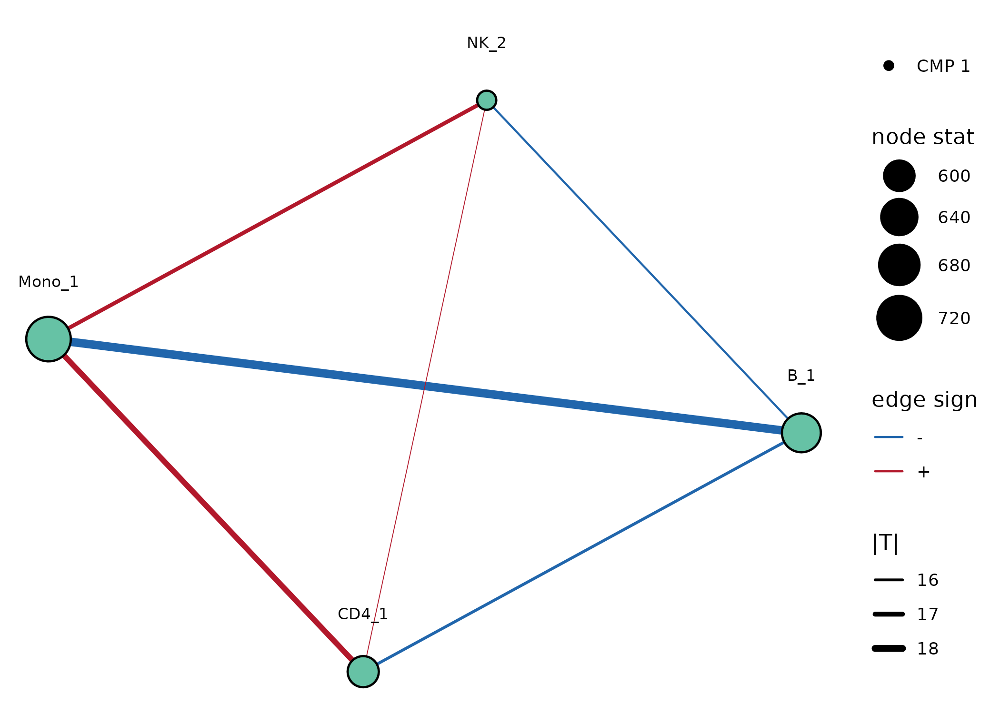
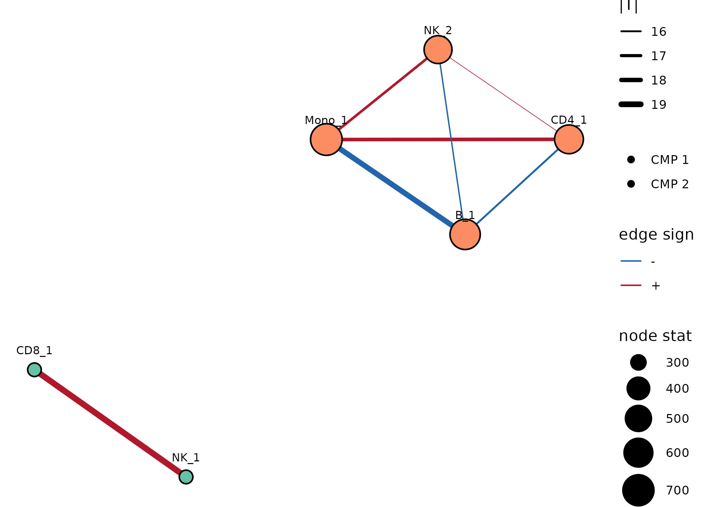
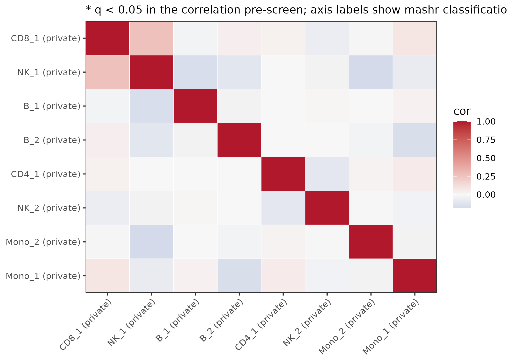
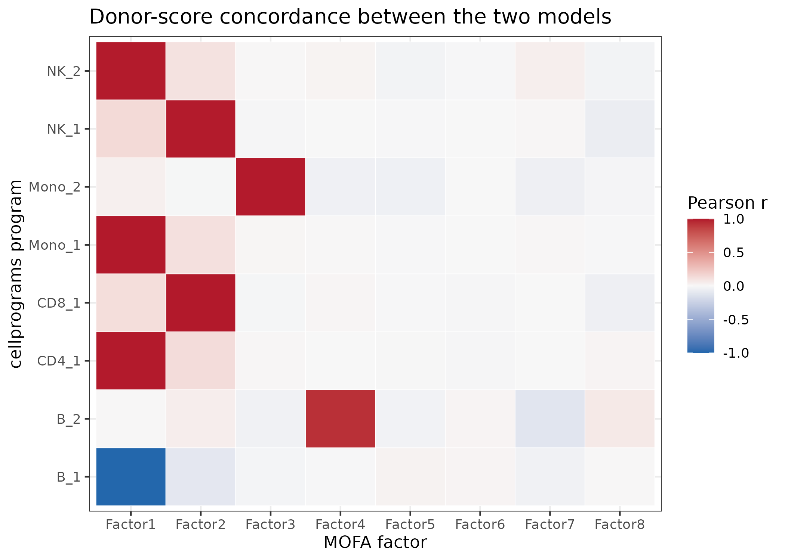

# Compared to MOFAcellulaR: local-first vs joint multicellular factor analysis

[MOFAcellulaR](https://saezlab.github.io/MOFAcellulaR/) fits a **joint**
multicellular factor analysis: the pseudobulk profiles of all cell types
are stacked as MOFA2 views (one per cell type), and MOFA estimates a
single latent space shared across views. Each factor is by construction
a *multicellular* program — a linear combination of gene weights from
every cell type.

`cellprograms` takes the **local-first** route: one empirical-Bayes
matrix factorization per cell type, with cross-cell-type coordination
(CMPs) and sharing (mashr) as separate, explicitly tested post-hoc
questions.

This vignette runs both on the **same simulated data with known ground
truth**, aligns their outputs, and states where each is expected to win.
It complements the [MOFAcellulaR get-started
tutorial](https://saezlab.github.io/MOFAcellulaR/articles/get-started.html)
and the [liana
notebook](https://liana.readthedocs.io/en/stable/tutorials/notebooks/mofacellular.html)
on metadata associations — the same questions, asked of both models.

\
[`library`](https://rdrr.io/r/base/library.html)`(``cellprograms``)`\
`if`` ``(``!`[`requireNamespace`](https://rdrr.io/r/base/ns-load.html)`(``"MOFA2"``, quietly ``=`` ``TRUE``)`` ``||`\
`    ``!`[`requireNamespace`](https://rdrr.io/r/base/ns-load.html)`(``"MOFAcellulaR"``, quietly ``=`` ``TRUE``)``)`` ``{`\
`  `[`message`](https://rdrr.io/r/base/message.html)`(``"MOFA2/MOFAcellulaR not installed; skipping the comparison sections."``)`\
`}`

## The data: planted multicellular programs

`simulate_pseudobulk(scenario = "mixed")` plants three kinds of
structure whose donor scores and gene sets are known exactly:

- **`global_IFN`** — coordinated donor activity across B, CD4, NK and
  Mono (the *same* donor score vector planted in each cell type) with
  **different genes in each cell type**. A pure activity-coordination
  program: gene overlap carries no signal.
- **`CD8NK_shared`** — coordinated activity *and* identical genes across
  CD8 and NK.
- **Private programs** (`B_private`, `Mono_private`) — single-cell-type
  decoys that should *not* be called multicellular.

\
`sim`` ``<-`` `[`simulate_pseudobulk`](https://mdmanurung.github.io/cellprograms/reference/simulate_pseudobulk.md)`(``scenario ``=`` ``"mixed"``, n_samples ``=`` ``60``,`\
`                           n_genes ``=`` ``800``, program_size ``=`` ``40``, seed ``=`` ``1``)`\
`x`` ``<-`` `[`as_cell_program_data`](https://mdmanurung.github.io/cellprograms/reference/as_cell_program_data.md)`(``sim``$``pseudobulk``)`\
\
`## a donor context variable for the association analyses: high vs low`\
`## donor score of the planted global_IFN program (as "severity" would be`\
`## in a real cohort)`\
`z_ifn`` ``<-`` ``sim``$``truth``$``B``[[`[`which`](https://rdrr.io/r/base/which.html)`(`[`vapply`](https://rdrr.io/r/base/lapply.html)`(``sim``$``truth``$``B``, ``function``(``t``)`` ``t``$``label`` ``==`` ``"global_IFN"``, ``TRUE``)``)``]``]``$``z`\
`md`` ``<-`` `[`data.frame`](https://rdrr.io/r/base/data.frame.html)`(``observation_id ``=`` `[`paste0`](https://rdrr.io/r/base/paste.html)`(``"obs"``, `[`seq_along`](https://rdrr.io/r/base/seq.html)`(``z_ifn``)``)``,`\
`                 ifn_high ``=`` `[`factor`](https://rdrr.io/r/base/factor.html)`(``z_ifn`` ``>`` `[`median`](https://rdrr.io/r/stats/median.html)`(``z_ifn``)``, `[`c`](https://rdrr.io/r/base/c.html)`(``FALSE``, ``TRUE``)``, `[`c`](https://rdrr.io/r/base/c.html)`(``"low"``, ``"high"``)``)``)`\
`x`` ``<-`` `[`as_cell_program_data`](https://mdmanurung.github.io/cellprograms/reference/as_cell_program_data.md)`(``sim``$``pseudobulk``, sample_metadata ``=`` ``md``)`

## cellprograms: local fits, then explicit coordination tests

\
`fit`` ``<-`` `[`fit_celltype_programs`](https://mdmanurung.github.io/cellprograms/reference/fit_celltype_programs.md)`(``x``, loading_prior ``=`` ``"point_laplace"``,`\
`                             max_factors ``=`` ``6``, features ``=`` ``"variable"``,`\
`                             n_variable_genes ``=`` ``400``, seed ``=`` ``1``)`\
`fit`` ``<-`` `[`canonicalize_programs`](https://mdmanurung.github.io/cellprograms/reference/canonicalize_programs.md)`(``fit``)`\
[`program_summary`](https://mdmanurung.github.io/cellprograms/reference/program_summary.md)`(``fit``)`\
`#>   cell_type n_obs n_genes n_programs        R2      elbo`\
`#> 1         B    60     400          2 0.2439779 -36065.09`\
`#> 2       CD4    60     400          1 0.1707640 -35709.99`\
`#> 3       CD8    60     400          1 0.2010540 -35859.83`\
`#> 4        NK    60     400          2 0.2948849 -36081.50`\
`#> 5      Mono    60     400          2 0.2997384 -35859.12`

Coordination (score space, permutation FWER) and sharing (loading space,
mashr):

\
`cmp`` ``<-`` `[`find_coordinated_programs`](https://mdmanurung.github.io/cellprograms/reference/find_coordinated_programs.md)`(``fit``, n_perm ``=`` ``999``, seed ``=`` ``1``, min_donors ``=`` ``20``)`\
`cmp`\
`#> <cmp_result> 1 coordinated multicellular program(s) at FWER 0.05 (mode: marginal, ambient: drop)`\
`#>   CMP 1: B_1, CD4_1 (-), NK_2 (-), Mono_1 (-)`\
[`plot_cmp_network`](https://mdmanurung.github.io/cellprograms/reference/plot_cmp_network.md)`(``cmp``)`

Only one CMP is called — why not the planted CD8–NK pair? Both local
fits *did* recover it (CD8_1 and NK_1 correlate r \> 0.99 with the
planted donor scores), but the default ambient guard
(`ambient = "drop"`, threshold 0.3) removed both members before testing:
their loadings look like they track genes more highly expressed in B
cells (ambient scores 0.45 and 0.39). On simulated data there is no
ambient RNA by construction, so these are false positives of the guard.
Re-running with `ambient = "flag"` (flag, don’t drop) recovers both
planted CMPs exactly — and the CD8–NK edge turns out to be the strongest
edge in the entire analysis:

\
`amb`` ``<-`` `[`ambient_program_scores`](https://mdmanurung.github.io/cellprograms/reference/ambient_program_scores.md)`(``fit``)`\
`amb``[`[`order`](https://rdrr.io/r/base/order.html)`(``-``amb``$``ambient_score``)``, ``]``[``1``:``4``, ``]`\
`#>   cell_type program_id ambient_score source`\
`#> 4       CD8      CD8_1     0.4464663      B`\
`#> 5        NK       NK_1     0.3852758      B`\
`#> 8      Mono     Mono_2     0.2471914      B`\
`#> 7      Mono     Mono_1     0.2398713    CD8`\
`cmp_flag`` ``<-`` `[`find_coordinated_programs`](https://mdmanurung.github.io/cellprograms/reference/find_coordinated_programs.md)`(``fit``, n_perm ``=`` ``999``, seed ``=`` ``1``,`\
`                                      min_donors ``=`` ``20``, ambient ``=`` ``"flag"``)`\
`cmp_flag`\
`#> <cmp_result> 2 coordinated multicellular program(s) at FWER 0.05 (mode: marginal, ambient: flag)`\
`#>   CMP 1: CD8_1, NK_1`\
`#>   CMP 2: B_1, CD4_1 (-), NK_2 (-), Mono_1 (-)`\
[`plot_cmp_network`](https://mdmanurung.github.io/cellprograms/reference/plot_cmp_network.md)`(``cmp_flag``)`

The practical lesson: when the contamination status of a dataset is
unknown, `ambient = "flag"` is the safer choice — the guard stays
visible (`ambient_flag` in the membership table) instead of silently
removing programs. This episode is itself part of the comparison:
explicit guards can misfire, but they are inspectable and configurable
in a way a joint model’s implicit assumptions are not.

\
`shr`` ``<-`` `[`program_sharing`](https://mdmanurung.github.io/cellprograms/reference/program_sharing.md)`(``fit``, n_perm ``=`` ``999``, seed ``=`` ``1``)`\
[`plot_sharing`](https://mdmanurung.github.io/cellprograms/reference/plot_sharing.md)`(``shr``)`

## MOFAcellulaR: one joint latent space

[`as_mofacellular_input()`](https://mdmanurung.github.io/cellprograms/reference/as_mofacellular_input.md)
exports the same pseudobulk as the `(counts, coldata)` pair
[`MOFAcellulaR::create_init_exp()`](https://saezlab.github.io/MOFAcellulaR/reference/create_init_exp.html)
expects, guaranteeing both models see identical inputs. MOFAcellulaR’s
QC chain (`filt_profiles`, `tmm_trns`, …) targets *raw-count*
pseudobulk; the simulated profiles are already continuous, so we hand
the views to MOFA2 directly (with real data, run their full
preprocessing first):

\
`mofa_in`` ``<-`` `[`as_mofacellular_input`](https://mdmanurung.github.io/cellprograms/reference/as_mofacellular_input.md)`(``x``)``          ``# counts + coldata (the interop adapter)`\
`views`` ``<-`` `[`lapply`](https://rdrr.io/r/base/lapply.html)`(``sim``$``pseudobulk``, ``t``)``           ``# genes x donors, one view per cell type`\
`mo`` ``<-`` ``MOFA2``::`[`create_mofa`](https://rdrr.io/pkg/MOFA2/man/create_mofa.html)`(``views``)`\
`#> Creating MOFA object from a list of matrices (features as rows, sample as columns)...`\
`#> Warning in .rename_duplicated_features(object): There are duplicated features names across different views. We will add the suffix *_view* only for those features `\
`#>             Example: if you have both TP53 in mRNA and mutation data it will be renamed to TP53_mRNA, TP53_mutation`\
`mo_opts`` ``<-`` ``MOFA2``::`[`get_default_model_options`](https://rdrr.io/pkg/MOFA2/man/get_default_model_options.html)`(``mo``)`\
`mo_opts``$``num_factors`` ``<-`` ``8`\
`mo_opts``$``spikeslab_weights`` ``<-`` ``FALSE``           ``# as in the MOFAcellulaR tutorial`\
`tr_opts`` ``<-`` ``MOFA2``::`[`get_default_training_options`](https://rdrr.io/pkg/MOFA2/man/get_default_training_options.html)`(``mo``)`\
`tr_opts``$``seed`` ``<-`` ``1`\
`mo`` ``<-`` ``MOFA2``::`[`prepare_mofa`](https://rdrr.io/pkg/MOFA2/man/prepare_mofa.html)`(``mo``, model_options ``=`` ``mo_opts``, training_options ``=`` ``tr_opts``)`\
`#> Checking data options...`\
`#> No data options specified, using default...`\
`#> Checking training options...`\
`#> Checking model options...`\
`mofa_model`` ``<-`` ``MOFA2``::`[`run_mofa`](https://rdrr.io/pkg/MOFA2/man/run_mofa.html)`(``mo``, outfile ``=`` `[`tempfile`](https://rdrr.io/r/base/tempfile.html)`(``fileext ``=`` ``".hdf5"``)``, save_data ``=`` ``FALSE``)`\
`#> Connecting to the mofapy2 python package using reticulate (use_basilisk = FALSE)... `\
`#>     Please make sure to manually specify the right python binary when loading R with reticulate::use_python(..., force=TRUE) or the right conda environment with reticulate::use_condaenv(..., force=TRUE)`\
`#>     If you prefer to let us automatically install a conda environment with 'mofapy2' installed using the 'basilisk' package, please use the argument 'use_basilisk = TRUE'`\
`#> Warning in MOFA2::run_mofa(mo, outfile = tempfile(fileext = ".hdf5"), save_data`\
`#> = FALSE): The latest mofapy2 version is 0.7.0, you are using 0.7.5. Please`\
`#> upgrade with 'pip install mofapy2'`\
`#> `\
`#>         #########################################################`\
`#>         ###           __  __  ____  ______                    ### `\
`#>         ###          |  \/  |/ __ \|  ____/\    _             ### `\
`#>         ###          | \  / | |  | | |__ /  \ _| |_           ### `\
`#>         ###          | |\/| | |  | |  __/ /\ \_   _|          ###`\
`#>         ###          | |  | | |__| | | / ____ \|_|            ###`\
`#>         ###          |_|  |_|\____/|_|/_/    \_\              ###`\
`#>         ###                                                   ### `\
`#>         ######################################################### `\
`#>          `\
`#> `\
`#> `\
`#> use_float32 set to True: replacing float64 arrays by float32 arrays to speed up computations...`\
`#> `\
`#> Successfully loaded view='B' group='group1' with N=60 samples and D=800 features...`\
`#> Successfully loaded view='CD4' group='group1' with N=60 samples and D=800 features...`\
`#> Successfully loaded view='CD8' group='group1' with N=60 samples and D=800 features...`\
`#> Successfully loaded view='NK' group='group1' with N=60 samples and D=800 features...`\
`#> Successfully loaded view='Mono' group='group1' with N=60 samples and D=800 features...`\
`#> `\
`#> `\
`#> Model options:`\
`#> - Automatic Relevance Determination prior on the factors: False`\
`#> - Automatic Relevance Determination prior on the weights: True`\
`#> - Spike-and-slab prior on the factors: False`\
`#> - Spike-and-slab prior on the weights: False`\
`#> Likelihoods:`\
`#> - View 0 (B): gaussian`\
`#> - View 1 (CD4): gaussian`\
`#> - View 2 (CD8): gaussian`\
`#> - View 3 (NK): gaussian`\
`#> - View 4 (Mono): gaussian`\
`#> `\
`#> `\
`#> `\
`#> `\
`#> ######################################`\
`#> ## Training the model with seed 1 ##`\
`#> ######################################`\
`#> `\
`#> `\
`#> ELBO before training: -1633838.31 `\
`#> `\
`#> Iteration 1: time=0.01, ELBO=-379185.10, deltaELBO=1254653.205 (76.79176074%), Factors=8`\
`#> Iteration 2: time=0.01, Factors=8`\
`#> Iteration 3: time=0.01, Factors=8`\
`#> Iteration 4: time=0.01, Factors=8`\
`#> Iteration 5: time=0.01, Factors=8`\
`#> Iteration 6: time=0.01, ELBO=-376437.50, deltaELBO=2747.604 (0.16816865%), Factors=8`\
`#> Iteration 7: time=0.01, Factors=8`\
`#> Iteration 8: time=0.01, Factors=8`\
`#> Iteration 9: time=0.01, Factors=8`\
`#> Iteration 10: time=0.01, Factors=8`\
`#> Iteration 11: time=0.01, ELBO=-376274.49, deltaELBO=163.009 (0.00997705%), Factors=8`\
`#> Iteration 12: time=0.01, Factors=8`\
`#> Iteration 13: time=0.01, Factors=8`\
`#> Iteration 14: time=0.01, Factors=8`\
`#> Iteration 15: time=0.01, Factors=8`\
`#> Iteration 16: time=0.01, ELBO=-376188.62, deltaELBO=85.871 (0.00525575%), Factors=8`\
`#> Iteration 17: time=0.01, Factors=8`\
`#> Iteration 18: time=0.01, Factors=8`\
`#> Iteration 19: time=0.01, Factors=8`\
`#> Iteration 20: time=0.01, Factors=8`\
`#> Iteration 21: time=0.01, ELBO=-376129.73, deltaELBO=58.893 (0.00360455%), Factors=8`\
`#> Iteration 22: time=0.01, Factors=8`\
`#> Iteration 23: time=0.01, Factors=8`\
`#> Iteration 24: time=0.01, Factors=8`\
`#> Iteration 25: time=0.01, Factors=8`\
`#> Iteration 26: time=0.01, ELBO=-376094.90, deltaELBO=34.829 (0.00213171%), Factors=8`\
`#> Iteration 27: time=0.01, Factors=8`\
`#> Iteration 28: time=0.01, Factors=8`\
`#> Iteration 29: time=0.01, Factors=8`\
`#> Iteration 30: time=0.01, Factors=8`\
`#> Iteration 31: time=0.01, ELBO=-376072.16, deltaELBO=22.744 (0.00139207%), Factors=8`\
`#> Iteration 32: time=0.01, Factors=8`\
`#> Iteration 33: time=0.01, Factors=8`\
`#> Iteration 34: time=0.01, Factors=8`\
`#> Iteration 35: time=0.01, Factors=8`\
`#> Iteration 36: time=0.01, ELBO=-376056.13, deltaELBO=16.022 (0.00098061%), Factors=8`\
`#> Iteration 37: time=0.01, Factors=8`\
`#> Iteration 38: time=0.01, Factors=8`\
`#> Iteration 39: time=0.01, Factors=8`\
`#> Iteration 40: time=0.01, Factors=8`\
`#> Iteration 41: time=0.01, ELBO=-376044.14, deltaELBO=11.990 (0.00073388%), Factors=8`\
`#> Iteration 42: time=0.01, Factors=8`\
`#> Iteration 43: time=0.01, Factors=8`\
`#> Iteration 44: time=0.01, Factors=8`\
`#> Iteration 45: time=0.01, Factors=8`\
`#> Iteration 46: time=0.01, ELBO=-376034.30, deltaELBO=9.843 (0.00060242%), Factors=8`\
`#> Iteration 47: time=0.01, Factors=8`\
`#> Iteration 48: time=0.01, Factors=8`\
`#> Iteration 49: time=0.01, Factors=8`\
`#> Iteration 50: time=0.01, Factors=8`\
`#> Iteration 51: time=0.01, ELBO=-376025.88, deltaELBO=8.416 (0.00051514%), Factors=8`\
`#> Iteration 52: time=0.01, Factors=8`\
`#> Iteration 53: time=0.01, Factors=8`\
`#> Iteration 54: time=0.01, Factors=8`\
`#> Iteration 55: time=0.01, Factors=8`\
`#> Iteration 56: time=0.01, ELBO=-376018.51, deltaELBO=7.374 (0.00045134%), Factors=8`\
`#> Iteration 57: time=0.01, Factors=8`\
`#> Iteration 58: time=0.01, Factors=8`\
`#> Iteration 59: time=0.01, Factors=8`\
`#> Iteration 60: time=0.01, Factors=8`\
`#> Iteration 61: time=0.01, ELBO=-376011.86, deltaELBO=6.652 (0.00040713%), Factors=8`\
`#> `\
`#> Converged!`\
`#> `\
`#> `\
`#> `\
`#> #######################`\
`#> ## Training finished ##`\
`#> #######################`\
`#> `\
`#> `\
`#> Saving model in /tmp/RtmpcUTu17/file5e372068dee.hdf5...`\
`Z_mofa`` ``<-`` ``MOFA2``::`[`get_factors`](https://rdrr.io/pkg/MOFA2/man/get_factors.html)`(``mofa_model``)``$``group1``   ``# donors x factors`\
[`dim`](https://rdrr.io/r/base/dim.html)`(``Z_mofa``)`\
`#> [1] 60  8`

## Aligning the two models

Both models return donor-level scores — cellprograms per cell type
(`fit$scores`), MOFA shared across views. The natural alignment is a
donor-score correlation between every cellprograms program and every
MOFA factor:

\
`progs`` ``<-`` `[`do.call`](https://rdrr.io/r/base/do.call.html)`(``cbind``, ``fit``$``scores``)`\
`r_mat`` ``<-`` `[`cor`](https://rdrr.io/r/stats/cor.html)`(``progs``, ``Z_mofa``)`\
`df`` ``<-`` `[`data.frame`](https://rdrr.io/r/base/data.frame.html)`(``program ``=`` `[`rep`](https://rdrr.io/r/base/rep.html)`(`[`rownames`](https://rdrr.io/r/base/colnames.html)`(``r_mat``)``, `[`ncol`](https://rdrr.io/r/base/nrow.html)`(``r_mat``)``)``,`\
`                 factor ``=`` `[`rep`](https://rdrr.io/r/base/rep.html)`(`[`colnames`](https://rdrr.io/r/base/colnames.html)`(``r_mat``)``, each ``=`` `[`nrow`](https://rdrr.io/r/base/nrow.html)`(``r_mat``)``)``,`\
`                 r ``=`` `[`as.vector`](https://rdrr.io/r/base/vector.html)`(``r_mat``)``)`\
`ggplot2``::`[`ggplot`](https://ggplot2.tidyverse.org/reference/ggplot.html)`(``df``, ``ggplot2``::`[`aes`](https://ggplot2.tidyverse.org/reference/aes.html)`(``factor``, ``program``, fill ``=`` ``r``)``)`` ``+`\
`  ``ggplot2``::`[`geom_tile`](https://ggplot2.tidyverse.org/reference/geom_tile.html)`(``color ``=`` ``"white"``)`` ``+`\
`  ``ggplot2``::`[`scale_fill_gradient2`](https://ggplot2.tidyverse.org/reference/scale_gradient.html)`(``low ``=`` ``"#2166AC"``, mid ``=`` ``"#F7F7F7"``, high ``=`` ``"#B2182B"``,`\
`                                midpoint ``=`` ``0``, limits ``=`` `[`c`](https://rdrr.io/r/base/c.html)`(``-``1``, ``1``)``, name ``=`` ``"Pearson r"``)`` ``+`\
`  ``ggplot2``::`[`labs`](https://ggplot2.tidyverse.org/reference/labs.html)`(``x ``=`` ``"MOFA factor"``, y ``=`` ``"cellprograms program"``,`\
`                title ``=`` ``"Donor-score concordance between the two models"``)`` ``+`\
`  ``ggplot2``::`[`theme_bw`](https://ggplot2.tidyverse.org/reference/ggtheme.html)`(``)`

Reading it: programs that appear in both models light up a MOFA factor;
MOFA factors with no cellprograms counterpart are typically
cell-type-specific or artifact directions that the local fits + CMP test
separated out.

## Ground-truth recovery

For each planted program and each cell type it was planted in: the best
\|correlation\| between the planted donor scores and any recovered
program (factor) of that cell type, plus gene-set recovery (Jaccard of
the top-40 \|loadings\| against the planted genes):

\
`## planted programs as (cell type, label, donor scores, planted gene names)`\
`planted`` ``<-`` `[`unlist`](https://rdrr.io/r/base/unlist.html)`(`[`lapply`](https://rdrr.io/r/base/lapply.html)`(`[`names`](https://rdrr.io/r/base/names.html)`(``sim``$``truth``)``, ``function``(``ct``)`` ``{`\
`  `[`lapply`](https://rdrr.io/r/base/lapply.html)`(`[`seq_along`](https://rdrr.io/r/base/seq.html)`(``sim``$``truth``[[``ct``]``]``)``, ``function``(``k``)`` ``{`\
`    `[`list`](https://rdrr.io/r/base/list.html)`(``ct ``=`` ``ct``, t ``=`` ``sim``$``truth``[[``ct``]``]``[[``k``]``]``,`\
`         genes ``=`` `[`colnames`](https://rdrr.io/r/base/colnames.html)`(``sim``$``pseudobulk``[[``ct``]``]``)``[``sim``$``truth``[[``ct``]``]``[[``k``]``]``$``gene_idx``]``)`\
`  ``}``)`\
`}``)``, recursive ``=`` ``FALSE``)`\
\
`## per planted program: best |cor| of donor scores against any recovered`\
`## program/factor of that cell type, and Jaccard of the top-40 |loading|`\
`## genes against the planted genes`\
`recover`` ``<-`` ``function``(``scores``, ``loadings``)`` ``{`\
`  `[`do.call`](https://rdrr.io/r/base/do.call.html)`(``rbind``, `[`lapply`](https://rdrr.io/r/base/lapply.html)`(``planted``, ``function``(``p``)`` ``{`\
`    ``S`` ``<-`` ``scores``[[``p``$``ct``]``]``; ``W`` ``<-`` ``loadings``[[``p``$``ct``]``]`\
`    ``if`` ``(`[`is.null`](https://rdrr.io/r/base/NULL.html)`(``S``)`` ``||`` `[`ncol`](https://rdrr.io/r/base/nrow.html)`(``S``)`` ``==`` ``0``)`` `[`return`](https://rdrr.io/r/base/function.html)`(``NULL``)`\
`    ``r_best`` ``<-`` `[`suppressWarnings`](https://rdrr.io/r/base/warning.html)`(`[`max`](https://rdrr.io/r/base/Extremes.html)`(`[`abs`](https://rdrr.io/r/base/MathFun.html)`(`[`cor`](https://rdrr.io/r/stats/cor.html)`(``S``, ``p``$``t``$``z``)``)``, na.rm ``=`` ``TRUE``)``)`\
`    ``top`` ``<-`` `[`apply`](https://rdrr.io/r/base/apply.html)`(`[`abs`](https://rdrr.io/r/base/MathFun.html)`(``W``)``, ``2``, ``function``(``w``)`` `[`rownames`](https://rdrr.io/r/base/colnames.html)`(``W``)``[`[`order`](https://rdrr.io/r/base/order.html)`(``-`[`abs`](https://rdrr.io/r/base/MathFun.html)`(``w``)``)``]``[`[`seq_len`](https://rdrr.io/r/base/seq.html)`(``40``)``]``)`\
`    ``j`` ``<-`` `[`apply`](https://rdrr.io/r/base/apply.html)`(`[`as.matrix`](https://rdrr.io/r/base/matrix.html)`(``top``)``, ``2``, ``function``(``g``)`` `[`length`](https://rdrr.io/r/base/length.html)`(`[`intersect`](https://rdrr.io/r/base/sets.html)`(``g``, ``p``$``genes``)``)`` ``/`` ``40``)`\
`    `[`data.frame`](https://rdrr.io/r/base/data.frame.html)`(``label ``=`` ``p``$``t``$``label``, cell_type ``=`` ``p``$``ct``, best_r ``=`` ``r_best``, gene_jaccard ``=`` `[`max`](https://rdrr.io/r/base/Extremes.html)`(``j``)``)`\
`  ``}``)``)`\
`}`\
`rec_cp`` ``<-`` `[`recover`](https://rdrr.io/r/utils/recover.html)`(``fit``$``scores``, ``fit``$``loadings``)`\
`## MOFA2 suffixes feature names with the view name when views share genes`\
`## (G1 -> G1_B); strip it before matching planted gene names`\
`w_mofa`` ``<-`` `[`lapply`](https://rdrr.io/r/base/lapply.html)`(`[`names`](https://rdrr.io/r/base/names.html)`(``sim``$``pseudobulk``)``, ``function``(``ct``)`` ``{`\
`  ``W`` ``<-`` `[`as.matrix`](https://rdrr.io/r/base/matrix.html)`(``MOFA2``::`[`get_weights`](https://rdrr.io/pkg/MOFA2/man/get_weights.html)`(``mofa_model``, views ``=`` ``ct``)``[[``1``]``]``)`\
`  `[`rownames`](https://rdrr.io/r/base/colnames.html)`(``W``)`` ``<-`` `[`sub`](https://rdrr.io/r/base/grep.html)`(`[`paste0`](https://rdrr.io/r/base/paste.html)`(``"_"``, ``ct``, ``"$"``)``, ``""``, `[`rownames`](https://rdrr.io/r/base/colnames.html)`(``W``)``)`\
`  ``W`\
`}``)`\
[`names`](https://rdrr.io/r/base/names.html)`(``w_mofa``)`` ``<-`` `[`names`](https://rdrr.io/r/base/names.html)`(``sim``$``pseudobulk``)`\
`rec_mf`` ``<-`` `[`recover`](https://rdrr.io/r/utils/recover.html)`(`[`setNames`](https://rdrr.io/r/stats/setNames.html)`(`[`rep`](https://rdrr.io/r/base/rep.html)`(`[`list`](https://rdrr.io/r/base/list.html)`(``Z_mofa``)``, `[`length`](https://rdrr.io/r/base/length.html)`(``sim``$``pseudobulk``)``)``, `[`names`](https://rdrr.io/r/base/names.html)`(``sim``$``pseudobulk``)``)``,`\
`                  ``w_mofa``)`\
`knitr``::`[`kable`](https://rdrr.io/pkg/knitr/man/kable.html)`(`[`rbind`](https://rdrr.io/r/base/cbind.html)`(`[`cbind`](https://rdrr.io/r/base/cbind.html)`(``model ``=`` ``"cellprograms"``, ``rec_cp``)``,`\
`                   `[`cbind`](https://rdrr.io/r/base/cbind.html)`(``model ``=`` ``"MOFA2"``, ``rec_mf``)``)``,`\
`             digits ``=`` ``2``, caption ``=`` ``"Best donor-score |r| and top-gene Jaccard per planted program"``)`

| model        | label        | cell_type | best_r | gene_jaccard |
|:-------------|:-------------|:----------|-------:|-------------:|
| cellprograms | B_private    | B         |   0.99 |         0.70 |
| cellprograms | global_IFN   | B         |   1.00 |         0.72 |
| cellprograms | global_IFN   | CD4       |   0.99 |         0.75 |
| cellprograms | CD8NK_shared | CD8       |   0.99 |         0.85 |
| cellprograms | CD8NK_shared | NK        |   1.00 |         0.75 |
| cellprograms | global_IFN   | NK        |   0.99 |         0.82 |
| cellprograms | Mono_private | Mono      |   0.99 |         0.80 |
| cellprograms | global_IFN   | Mono      |   1.00 |         0.78 |
| MOFA2        | B_private    | B         |   0.92 |         0.70 |
| MOFA2        | global_IFN   | B         |   1.00 |         0.75 |
| MOFA2        | global_IFN   | CD4       |   1.00 |         0.78 |
| MOFA2        | CD8NK_shared | CD8       |   1.00 |         0.85 |
| MOFA2        | CD8NK_shared | NK        |   1.00 |         0.78 |
| MOFA2        | global_IFN   | NK        |   1.00 |         0.82 |
| MOFA2        | Mono_private | Mono      |   0.98 |         0.80 |
| MOFA2        | global_IFN   | Mono      |   1.00 |         0.78 |

Best donor-score \|r\| and top-gene Jaccard per planted program {.table}

What to expect: the two models tie on raw recovery — every planted
program’s donor activity comes back at best \|r\| ≥ 0.9 in both, with
comparable partial gene-set recovery (top-40 Jaccard 0.7–0.85; the local
fits use the 400 most variable genes, so a few planted genes are not in
play). The differences this comparison is designed to expose are in the
*statements* each model can make about that recovery — calibrated
uncertainty, membership decisions, artifact handling — in the sections
below.

## Coordination: explicit test vs by construction

- In MOFA2, every factor is multicellular by construction; deciding
  *whether* a factor genuinely coordinates cell types (vs being driven
  by one view) is left to downstream inspection (variance decomposition
  per view, `plot_MOFA_hmap`).
- [`find_coordinated_programs()`](https://mdmanurung.github.io/cellprograms/reference/find_coordinated_programs.md)
  tests each candidate against a within-strata permutation null with
  max-T family-wise error control, and reports which programs are
  members.

On this data, with the ambient guard set to flag rather than drop,
cellprograms recovers both planted multicellular programs exactly —
membership, sign, and a calibrated per-program p-value (all node p =
0.001) — and correctly leaves both private decoys uncalled (node p = 1).
MOFA2 recovers the planted donor activity in its factors but offers no
calibrated answer to “is this factor genuinely multicellular?”: every
factor is multicellular by construction, so the private decoys also come
back as factors with weights in every view.

The default run above illustrates the flip side of the local-first
philosophy’s explicit guards: the ambient filter, doing its job on a
signal it cannot verify, silently removed a true shared program. The
guard is inspectable
([`ambient_program_scores()`](https://mdmanurung.github.io/cellprograms/reference/ambient_program_scores.md))
and configurable (`ambient = "flag"`), which is why flagging is the
recommended setting when contamination status is unknown. MOFA2 has no
analogous guard — and no analogous false positive; its risks sit
elsewhere (view-dominant factors, no FWER control on “is this shared?”).

## Metadata associations

The MOFAcellulaR tutorial associates factor scores with sample metadata
(`get_associations`: ANOVA for categorical, linear for continuous). The
cellprograms counterpart is
[`cmp_context_association()`](https://mdmanurung.github.io/cellprograms/reference/cmp_context_association.md)
on CMP consensus scores:

\
`## cellprograms: CMP scores vs the planted context`\
`ca`` ``<-`` `[`cmp_context_association`](https://mdmanurung.github.io/cellprograms/reference/cmp_context_association.md)`(``fit``, ``cmp``, ``"ifn_high"``)`\
`ca``[`[`order`](https://rdrr.io/r/base/order.html)`(``ca``$``p``)``, ``]`\
`#>   cmp  term  estimate         t            p  n`\
`#> 1   1 xhigh -1.555736 -9.731873 8.415312e-14 60`\
\
`## MOFAcellulaR: factor scores vs the same context`\
`md_f`` ``<-`` `[`data.frame`](https://rdrr.io/r/base/data.frame.html)`(``sample ``=`` `[`rownames`](https://rdrr.io/r/base/colnames.html)`(``Z_mofa``)``, ifn_high ``=`` ``md``$``ifn_high``[`[`match`](https://rdrr.io/r/base/match.html)`(`[`rownames`](https://rdrr.io/r/base/colnames.html)`(``Z_mofa``)``, ``md``$``observation_id``)``]``)`\
`ga`` ``<-`` ``MOFAcellulaR``::`[`get_associations`](https://saezlab.github.io/MOFAcellulaR/reference/get_associations.html)`(``model ``=`` ``mofa_model``, metadata ``=`` ``md_f``,`\
`                                     sample_id_column ``=`` ``"sample"``,`\
`                                     test_variable ``=`` ``"ifn_high"``,`\
`                                     test_type ``=`` ``"categorical"``, group ``=`` ``FALSE``)`\
`ga``[`[`order`](https://rdrr.io/r/base/order.html)`(``ga``$``p.value``)``, ``]`\
`#> ``# A tibble: 8 × 4`\
`#>   Factor  term      p.value adj_pvalue`\
`#>   ``<chr>``   ``<chr>``       ``<dbl>``      ``<dbl>`\
`#> ``1`` Factor1 ifn_high 7.61``e``-14``   6.09``e``-13`\
`#> ``2`` Factor2 ifn_high 1.17``e``- 1``   8.16``e``- 1`\
`#> ``3`` Factor3 ifn_high 4.71``e``- 1``   1   ``e``+ 0`\
`#> ``4`` Factor5 ifn_high 4.72``e``- 1``   1   ``e``+ 0`\
`#> ``5`` Factor6 ifn_high 5.47``e``- 1``   1   ``e``+ 0`\
`#> ``6`` Factor4 ifn_high 6.80``e``- 1``   1   ``e``+ 0`\
`#> ``7`` Factor7 ifn_high 6.91``e``- 1``   1   ``e``+ 0`\
`#> ``8`` Factor8 ifn_high 9.71``e``- 1``   1   ``e``+ 0`

Both should flag the factors/programs aligned with the planted
`global_IFN` donor scores (the sign of the estimate is arbitrary —
program and factor directions are identified only up to sign). The
cellprograms result is restricted to permutation-validated CMPs; the
MOFA result covers all factors including view-specific ones.

## When to use which

| Question | cellprograms | MOFAcellulaR |
|----|----|----|
| Programs within one cell type | per-cell-type EBMF, sparse point-Laplace loadings | factor weights per view (shared latent space) |
| Cross-cell-type coordination | CMP test: permutation null, max-T FWER, per-program p | by construction; inspect per-view variance |
| Shared gene effects | mashr layer (lfsr, shared/partial/private) | factor weights are implicitly shared |
| Artifact handling | V(D)J/genotype masking + flagging | manual gene veto (`filt_gex_bybckgrnd`) |
| Variance decomposition | per-program PVE per cell type | per-factor, per-view R2 (built in) |
| Uncertainty | loading/score posterior SDs, lfsr | none (point estimates) |
| Fit philosophy | local-first; integrate only what replicates | joint from the start |

The two are complementary:
[`as_mofacellular_input()`](https://mdmanurung.github.io/cellprograms/reference/as_mofacellular_input.md)
exists precisely so the same pseudobulk can be pushed through both, with
[`principal_angles()`](https://mdmanurung.github.io/cellprograms/reference/principal_angles.md)/[`align_programs()`](https://mdmanurung.github.io/cellprograms/reference/align_programs.md)
quantifying program-to-factor geometry when both are fit.
