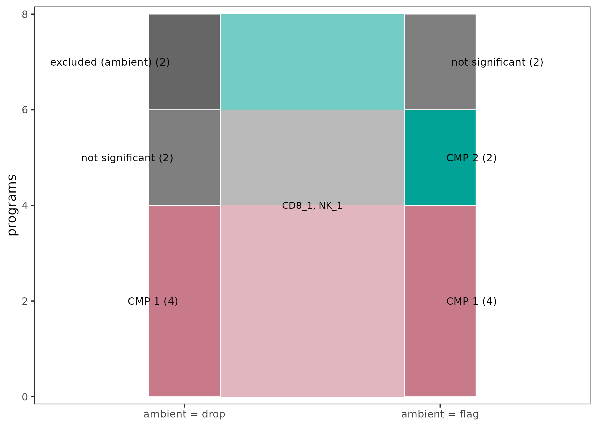
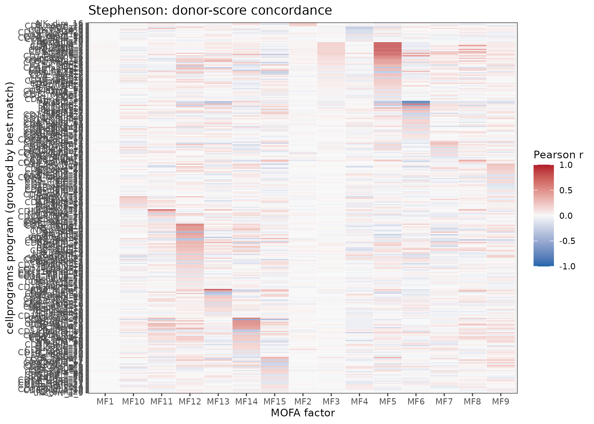
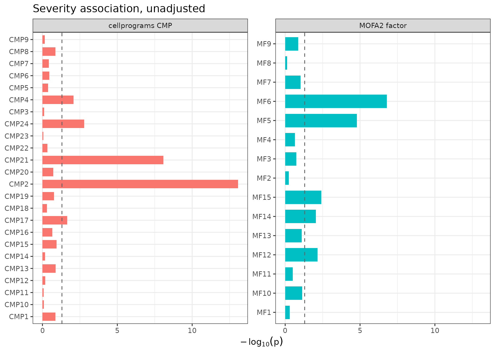
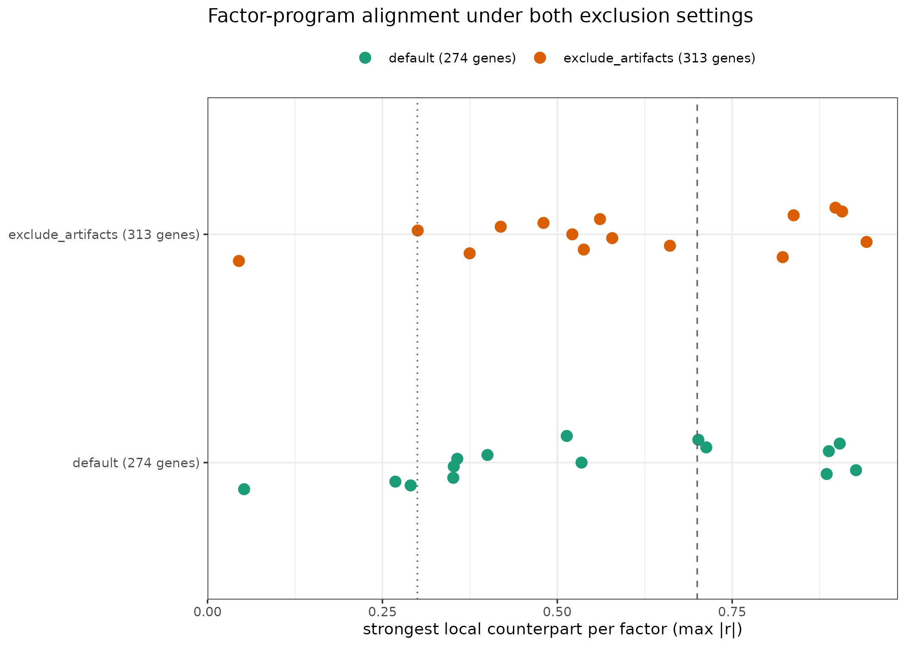

# Compared to MOFAcellulaR: local-first vs joint multicellular factor analysis

[MOFAcellulaR](https://saezlab.github.io/MOFAcellulaR/) fits a **joint**
multicellular factor analysis: the pseudobulk profiles of all cell types
are stacked as MOFA2 views (one per cell type), and MOFA estimates a
single latent space shared across views. Each factor is by construction
a *multicellular* program — a linear combination of gene weights from
every cell type.

`cellprograms` takes the **local-first** route: one empirical-Bayes
matrix factorization per cell type, with cross-cell-type coordination
(CMPs) and sharing (mashr) as separate, explicitly tested post-hoc
questions.

This vignette runs both on the **same simulated data with known ground
truth**, aligns their outputs, and states where each is expected to win.
It complements the [MOFAcellulaR get-started
tutorial](https://saezlab.github.io/MOFAcellulaR/articles/get-started.html)
and the [liana
notebook](https://liana.readthedocs.io/en/stable/tutorials/notebooks/mofacellular.html)
on metadata associations — the same questions, asked of both models.

\
[`library`](https://rdrr.io/r/base/library.html)`(``cellprograms``)`\
`if`` ``(``!`[`requireNamespace`](https://rdrr.io/r/base/ns-load.html)`(``"MOFA2"``, quietly ``=`` ``TRUE``)`` ``||`\
`    ``!`[`requireNamespace`](https://rdrr.io/r/base/ns-load.html)`(``"MOFAcellulaR"``, quietly ``=`` ``TRUE``)``)`` ``{`\
`  `[`message`](https://rdrr.io/r/base/message.html)`(``"MOFA2/MOFAcellulaR not installed; skipping the comparison sections."``)`\
`}`\
`#> MOFA2/MOFAcellulaR not installed; skipping the comparison sections.`

## The data: planted multicellular programs

`simulate_pseudobulk(scenario = "mixed")` plants three kinds of
structure whose donor scores and gene sets are known exactly:

- **`global_IFN`** — coordinated donor activity across B, CD4, NK and
  Mono (the *same* donor score vector planted in each cell type) with
  **different genes in each cell type**. A pure activity-coordination
  program: gene overlap carries no signal.
- **`CD8NK_shared`** — coordinated activity *and* identical genes across
  CD8 and NK.
- **Private programs** (`B_private`, `Mono_private`) — single-cell-type
  decoys that should *not* be called multicellular.

\
`sim`` ``<-`` `[`simulate_pseudobulk`](https://mdmanurung.github.io/cellprograms/reference/simulate_pseudobulk.md)`(``scenario ``=`` ``"mixed"``, n_samples ``=`` ``60``,`\
`                           n_genes ``=`` ``800``, program_size ``=`` ``40``, seed ``=`` ``1``)`\
`x`` ``<-`` `[`as_cell_program_data`](https://mdmanurung.github.io/cellprograms/reference/as_cell_program_data.md)`(``sim``$``pseudobulk``)`\
\
`## a donor context variable for the association analyses: high vs low`\
`## donor score of the planted global_IFN program (as "severity" would be`\
`## in a real cohort)`\
`z_ifn`` ``<-`` ``sim``$``truth``$``B``[[`[`which`](https://rdrr.io/r/base/which.html)`(`[`vapply`](https://rdrr.io/r/base/lapply.html)`(``sim``$``truth``$``B``, ``function``(``t``)`` ``t``$``label`` ``==`` ``"global_IFN"``, ``TRUE``)``)``]``]``$``z`\
`md`` ``<-`` `[`data.frame`](https://rdrr.io/r/base/data.frame.html)`(``observation_id ``=`` `[`paste0`](https://rdrr.io/r/base/paste.html)`(``"obs"``, `[`seq_along`](https://rdrr.io/r/base/seq.html)`(``z_ifn``)``)``,`\
`                 ifn_high ``=`` `[`factor`](https://rdrr.io/r/base/factor.html)`(``z_ifn`` ``>`` `[`median`](https://rdrr.io/r/stats/median.html)`(``z_ifn``)``, `[`c`](https://rdrr.io/r/base/c.html)`(``FALSE``, ``TRUE``)``, `[`c`](https://rdrr.io/r/base/c.html)`(``"low"``, ``"high"``)``)``)`\
`x`` ``<-`` `[`as_cell_program_data`](https://mdmanurung.github.io/cellprograms/reference/as_cell_program_data.md)`(``sim``$``pseudobulk``, sample_metadata ``=`` ``md``)`

## cellprograms: local fits, then explicit coordination tests

\
`fit`` ``<-`` `[`fit_celltype_programs`](https://mdmanurung.github.io/cellprograms/reference/fit_celltype_programs.md)`(``x``, loading_prior ``=`` ``"point_laplace"``,`\
`                             max_factors ``=`` ``6``, features ``=`` ``"variable"``,`\
`                             n_variable_genes ``=`` ``400``, seed ``=`` ``1``)`\
`fit`` ``<-`` `[`canonicalize_programs`](https://mdmanurung.github.io/cellprograms/reference/canonicalize_programs.md)`(``fit``)`\
[`program_summary`](https://mdmanurung.github.io/cellprograms/reference/program_summary.md)`(``fit``)`\
`#>   cell_type n_obs n_genes n_programs        R2      elbo`\
`#> 1         B    60     400          2 0.2439779 -36065.09`\
`#> 2       CD4    60     400          1 0.1707640 -35709.99`\
`#> 3       CD8    60     400          1 0.2010540 -35859.83`\
`#> 4        NK    60     400          2 0.2948849 -36081.50`\
`#> 5      Mono    60     400          2 0.2997384 -35859.12`

Coordination (score space, permutation FWER) and sharing (loading space,
mashr):

\
`cmp`` ``<-`` `[`find_coordinated_programs`](https://mdmanurung.github.io/cellprograms/reference/find_coordinated_programs.md)`(``fit``, n_perm ``=`` ``999``, seed ``=`` ``1``, min_donors ``=`` ``20``)`\
`cmp`\
`#> <cmp_result> 1 coordinated multicellular program(s) at FWER 0.05 (mode: marginal, ambient: drop)`\
`#>   CMP 1: B_1, CD4_1 (-), NK_2 (-), Mono_1 (-)`\
[`plot_cmp_network`](https://mdmanurung.github.io/cellprograms/reference/plot_cmp_network.md)`(``cmp``)`

Only one CMP is called — why not the planted CD8–NK pair? Both local
fits *did* recover it (CD8_1 and NK_1 correlate r \> 0.99 with the
planted donor scores), but the default ambient guard
(`ambient = "drop"`, threshold 0.3) removed both members before testing:
their loadings look like they track genes more highly expressed in B
cells (ambient scores 0.45 and 0.39). On simulated data there is no
ambient RNA by construction, so these are false positives of the guard.
Re-running with `ambient = "flag"` (flag, don’t drop) recovers both
planted CMPs exactly — and the CD8–NK edge turns out to be the strongest
edge in the entire analysis:

\
`amb`` ``<-`` `[`ambient_program_scores`](https://mdmanurung.github.io/cellprograms/reference/ambient_program_scores.md)`(``fit``)`\
`amb``[`[`order`](https://rdrr.io/r/base/order.html)`(``-``amb``$``ambient_score``)``, ``]``[``1``:``4``, ``]`\
`#>   cell_type program_id ambient_score source`\
`#> 4       CD8      CD8_1     0.4464663      B`\
`#> 5        NK       NK_1     0.3852758      B`\
`#> 8      Mono     Mono_2     0.2471914      B`\
`#> 7      Mono     Mono_1     0.2398713    CD8`\
`cmp_flag`` ``<-`` `[`find_coordinated_programs`](https://mdmanurung.github.io/cellprograms/reference/find_coordinated_programs.md)`(``fit``, n_perm ``=`` ``999``, seed ``=`` ``1``,`\
`                                      min_donors ``=`` ``20``, ambient ``=`` ``"flag"``)`\
`cmp_flag`\
`#> <cmp_result> 2 coordinated multicellular program(s) at FWER 0.05 (mode: marginal, ambient: flag)`\
`#>   CMP 1: CD8_1, NK_1`\
`#>   CMP 2: B_1, CD4_1 (-), NK_2 (-), Mono_1 (-)`\
[`plot_cmp_network`](https://mdmanurung.github.io/cellprograms/reference/plot_cmp_network.md)`(``cmp_flag``)`

\
[`plot_cmp_membership`](https://mdmanurung.github.io/cellprograms/reference/plot_cmp_membership.md)`(`[`list`](https://rdrr.io/r/base/list.html)`(``"ambient = drop"`` ``=`` ``cmp``, ``"ambient = flag"`` ``=`` ``cmp_flag``)``,`\
`                    label_programs ``=`` ``TRUE``)`

The practical lesson: when the contamination status of a dataset is
unknown, `ambient = "flag"` is the safer choice — the guard stays
visible (`ambient_flag` in the membership table) instead of silently
removing programs. This episode is itself part of the comparison:
explicit guards can misfire, but they are inspectable and configurable
in a way a joint model’s implicit assumptions are not.

\
`shr`` ``<-`` `[`program_sharing`](https://mdmanurung.github.io/cellprograms/reference/program_sharing.md)`(``fit``, n_perm ``=`` ``999``, seed ``=`` ``1``)`\
[`plot_sharing`](https://mdmanurung.github.io/cellprograms/reference/plot_sharing.md)`(``shr``)`

## MOFAcellulaR: one joint latent space

[`as_mofacellular_input()`](https://mdmanurung.github.io/cellprograms/reference/as_mofacellular_input.md)
exports the same pseudobulk as the `(counts, coldata)` pair
`MOFAcellulaR::create_init_exp()` expects, guaranteeing both models see
identical inputs. MOFAcellulaR’s QC chain (`filt_profiles`, `tmm_trns`,
…) targets *raw-count* pseudobulk; the simulated profiles are already
continuous, so we hand the views to MOFA2 directly (with real data, run
their full preprocessing first):

\
`mofa_in`` ``<-`` `[`as_mofacellular_input`](https://mdmanurung.github.io/cellprograms/reference/as_mofacellular_input.md)`(``x``)``          ``# counts + coldata (the interop adapter)`\
`views`` ``<-`` `[`lapply`](https://rdrr.io/r/base/lapply.html)`(``sim``$``pseudobulk``, ``t``)``           ``# genes x donors, one view per cell type`\
`mo`` ``<-`` ``MOFA2``::``create_mofa``(``views``)`\
`mo_opts`` ``<-`` ``MOFA2``::``get_default_model_options``(``mo``)`\
`mo_opts``$``num_factors`` ``<-`` ``8`\
`mo_opts``$``spikeslab_weights`` ``<-`` ``FALSE``           ``# as in the MOFAcellulaR tutorial`\
`tr_opts`` ``<-`` ``MOFA2``::``get_default_training_options``(``mo``)`\
`tr_opts``$``seed`` ``<-`` ``1`\
`mo`` ``<-`` ``MOFA2``::``prepare_mofa``(``mo``, model_options ``=`` ``mo_opts``, training_options ``=`` ``tr_opts``)`\
`mofa_model`` ``<-`` ``MOFA2``::``run_mofa``(``mo``, outfile ``=`` `[`tempfile`](https://rdrr.io/r/base/tempfile.html)`(``fileext ``=`` ``".hdf5"``)``, save_data ``=`` ``FALSE``)`\
`Z_mofa`` ``<-`` ``MOFA2``::``get_factors``(``mofa_model``)``$``group1``   ``# donors x factors`\
[`dim`](https://rdrr.io/r/base/dim.html)`(``Z_mofa``)`

## Aligning the two models

Both models return donor-level scores — cellprograms per cell type
(`fit$scores`), MOFA shared across views. The natural alignment is a
donor-score correlation between every cellprograms program and every
MOFA factor:

\
`progs`` ``<-`` `[`do.call`](https://rdrr.io/r/base/do.call.html)`(``cbind``, ``fit``$``scores``)`\
`r_mat`` ``<-`` `[`cor`](https://rdrr.io/r/stats/cor.html)`(``progs``, ``Z_mofa``)`\
`df`` ``<-`` `[`data.frame`](https://rdrr.io/r/base/data.frame.html)`(``program ``=`` `[`rep`](https://rdrr.io/r/base/rep.html)`(`[`rownames`](https://rdrr.io/r/base/colnames.html)`(``r_mat``)``, `[`ncol`](https://rdrr.io/r/base/nrow.html)`(``r_mat``)``)``,`\
`                 factor ``=`` `[`rep`](https://rdrr.io/r/base/rep.html)`(`[`colnames`](https://rdrr.io/r/base/colnames.html)`(``r_mat``)``, each ``=`` `[`nrow`](https://rdrr.io/r/base/nrow.html)`(``r_mat``)``)``,`\
`                 r ``=`` `[`as.vector`](https://rdrr.io/r/base/vector.html)`(``r_mat``)``)`\
`ggplot2``::`[`ggplot`](https://ggplot2.tidyverse.org/reference/ggplot.html)`(``df``, ``ggplot2``::`[`aes`](https://ggplot2.tidyverse.org/reference/aes.html)`(``factor``, ``program``, fill ``=`` ``r``)``)`` ``+`\
`  ``ggplot2``::`[`geom_tile`](https://ggplot2.tidyverse.org/reference/geom_tile.html)`(``color ``=`` ``"white"``)`` ``+`\
`  ``ggplot2``::`[`scale_fill_gradient2`](https://ggplot2.tidyverse.org/reference/scale_gradient.html)`(``low ``=`` ``"#2166AC"``, mid ``=`` ``"#F7F7F7"``, high ``=`` ``"#B2182B"``,`\
`                                midpoint ``=`` ``0``, limits ``=`` `[`c`](https://rdrr.io/r/base/c.html)`(``-``1``, ``1``)``, name ``=`` ``"Pearson r"``)`` ``+`\
`  ``ggplot2``::`[`labs`](https://ggplot2.tidyverse.org/reference/labs.html)`(``x ``=`` ``"MOFA factor"``, y ``=`` ``"cellprograms program"``,`\
`                title ``=`` ``"Donor-score concordance between the two models"``)`` ``+`\
`  ``ggplot2``::`[`theme_bw`](https://ggplot2.tidyverse.org/reference/ggtheme.html)`(``)`

Reading it: programs that appear in both models light up a MOFA factor;
MOFA factors with no cellprograms counterpart are typically
cell-type-specific or artifact directions that the local fits + CMP test
separated out.

## Ground-truth recovery

For each planted program and each cell type it was planted in: the best
\|correlation\| between the planted donor scores and any recovered
program (factor) of that cell type, plus gene-set recovery (Jaccard of
the top-40 \|loadings\| against the planted genes):

\
`## planted programs as (cell type, label, donor scores, planted gene names)`\
`planted`` ``<-`` `[`unlist`](https://rdrr.io/r/base/unlist.html)`(`[`lapply`](https://rdrr.io/r/base/lapply.html)`(`[`names`](https://rdrr.io/r/base/names.html)`(``sim``$``truth``)``, ``function``(``ct``)`` ``{`\
`  `[`lapply`](https://rdrr.io/r/base/lapply.html)`(`[`seq_along`](https://rdrr.io/r/base/seq.html)`(``sim``$``truth``[[``ct``]``]``)``, ``function``(``k``)`` ``{`\
`    `[`list`](https://rdrr.io/r/base/list.html)`(``ct ``=`` ``ct``, t ``=`` ``sim``$``truth``[[``ct``]``]``[[``k``]``]``,`\
`         genes ``=`` `[`colnames`](https://rdrr.io/r/base/colnames.html)`(``sim``$``pseudobulk``[[``ct``]``]``)``[``sim``$``truth``[[``ct``]``]``[[``k``]``]``$``gene_idx``]``)`\
`  ``}``)`\
`}``)``, recursive ``=`` ``FALSE``)`\
\
`## per planted program: best |cor| of donor scores against any recovered`\
`## program/factor of that cell type, and Jaccard of the top-40 |loading|`\
`## genes against the planted genes`\
`recover`` ``<-`` ``function``(``scores``, ``loadings``)`` ``{`\
`  `[`do.call`](https://rdrr.io/r/base/do.call.html)`(``rbind``, `[`lapply`](https://rdrr.io/r/base/lapply.html)`(``planted``, ``function``(``p``)`` ``{`\
`    ``S`` ``<-`` ``scores``[[``p``$``ct``]``]``; ``W`` ``<-`` ``loadings``[[``p``$``ct``]``]`\
`    ``if`` ``(`[`is.null`](https://rdrr.io/r/base/NULL.html)`(``S``)`` ``||`` `[`ncol`](https://rdrr.io/r/base/nrow.html)`(``S``)`` ``==`` ``0``)`` `[`return`](https://rdrr.io/r/base/function.html)`(``NULL``)`\
`    ``r_best`` ``<-`` `[`suppressWarnings`](https://rdrr.io/r/base/warning.html)`(`[`max`](https://rdrr.io/r/base/Extremes.html)`(`[`abs`](https://rdrr.io/r/base/MathFun.html)`(`[`cor`](https://rdrr.io/r/stats/cor.html)`(``S``, ``p``$``t``$``z``)``)``, na.rm ``=`` ``TRUE``)``)`\
`    ``top`` ``<-`` `[`apply`](https://rdrr.io/r/base/apply.html)`(`[`abs`](https://rdrr.io/r/base/MathFun.html)`(``W``)``, ``2``, ``function``(``w``)`` `[`rownames`](https://rdrr.io/r/base/colnames.html)`(``W``)``[`[`order`](https://rdrr.io/r/base/order.html)`(``-`[`abs`](https://rdrr.io/r/base/MathFun.html)`(``w``)``)``]``[`[`seq_len`](https://rdrr.io/r/base/seq.html)`(``40``)``]``)`\
`    ``j`` ``<-`` `[`apply`](https://rdrr.io/r/base/apply.html)`(`[`as.matrix`](https://rdrr.io/r/base/matrix.html)`(``top``)``, ``2``, ``function``(``g``)`` `[`length`](https://rdrr.io/r/base/length.html)`(`[`intersect`](https://rdrr.io/r/base/sets.html)`(``g``, ``p``$``genes``)``)`` ``/`` ``40``)`\
`    `[`data.frame`](https://rdrr.io/r/base/data.frame.html)`(``label ``=`` ``p``$``t``$``label``, cell_type ``=`` ``p``$``ct``, best_r ``=`` ``r_best``, gene_jaccard ``=`` `[`max`](https://rdrr.io/r/base/Extremes.html)`(``j``)``)`\
`  ``}``)``)`\
`}`\
`rec_cp`` ``<-`` `[`recover`](https://rdrr.io/r/utils/recover.html)`(``fit``$``scores``, ``fit``$``loadings``)`\
`## MOFA2 suffixes feature names with the view name when views share genes`\
`## (G1 -> G1_B); strip it before matching planted gene names`\
`w_mofa`` ``<-`` `[`lapply`](https://rdrr.io/r/base/lapply.html)`(`[`names`](https://rdrr.io/r/base/names.html)`(``sim``$``pseudobulk``)``, ``function``(``ct``)`` ``{`\
`  ``W`` ``<-`` `[`as.matrix`](https://rdrr.io/r/base/matrix.html)`(``MOFA2``::``get_weights``(``mofa_model``, views ``=`` ``ct``)``[[``1``]``]``)`\
`  `[`rownames`](https://rdrr.io/r/base/colnames.html)`(``W``)`` ``<-`` `[`sub`](https://rdrr.io/r/base/grep.html)`(`[`paste0`](https://rdrr.io/r/base/paste.html)`(``"_"``, ``ct``, ``"$"``)``, ``""``, `[`rownames`](https://rdrr.io/r/base/colnames.html)`(``W``)``)`\
`  ``W`\
`}``)`\
[`names`](https://rdrr.io/r/base/names.html)`(``w_mofa``)`` ``<-`` `[`names`](https://rdrr.io/r/base/names.html)`(``sim``$``pseudobulk``)`\
`rec_mf`` ``<-`` `[`recover`](https://rdrr.io/r/utils/recover.html)`(`[`setNames`](https://rdrr.io/r/stats/setNames.html)`(`[`rep`](https://rdrr.io/r/base/rep.html)`(`[`list`](https://rdrr.io/r/base/list.html)`(``Z_mofa``)``, `[`length`](https://rdrr.io/r/base/length.html)`(``sim``$``pseudobulk``)``)``, `[`names`](https://rdrr.io/r/base/names.html)`(``sim``$``pseudobulk``)``)``,`\
`                  ``w_mofa``)`\
`knitr``::`[`kable`](https://rdrr.io/pkg/knitr/man/kable.html)`(`[`rbind`](https://rdrr.io/r/base/cbind.html)`(`[`cbind`](https://rdrr.io/r/base/cbind.html)`(``model ``=`` ``"cellprograms"``, ``rec_cp``)``,`\
`                   `[`cbind`](https://rdrr.io/r/base/cbind.html)`(``model ``=`` ``"MOFA2"``, ``rec_mf``)``)``,`\
`             digits ``=`` ``2``, caption ``=`` ``"Best donor-score |r| and top-gene Jaccard per planted program"``)`

What to expect: the two models tie on raw recovery — every planted
program’s donor activity comes back at best \|r\| ≥ 0.9 in both, with
comparable partial gene-set recovery (top-40 Jaccard 0.7–0.85; the local
fits use the 400 most variable genes, so a few planted genes are not in
play). The differences this comparison is designed to expose are in the
*statements* each model can make about that recovery — calibrated
uncertainty, membership decisions, artifact handling — in the sections
below.

## Coordination: explicit test vs by construction

- In MOFA2, every factor is multicellular by construction; deciding
  *whether* a factor genuinely coordinates cell types (vs being driven
  by one view) is left to downstream inspection (variance decomposition
  per view, `plot_MOFA_hmap`).
- [`find_coordinated_programs()`](https://mdmanurung.github.io/cellprograms/reference/find_coordinated_programs.md)
  tests each candidate against a within-strata permutation null with
  max-T family-wise error control, and reports which programs are
  members.

On this data, with the ambient guard set to flag rather than drop,
cellprograms recovers both planted multicellular programs exactly —
membership, sign, and a calibrated per-program p-value (all node p =
0.001) — and correctly leaves both private decoys uncalled (node p = 1).
MOFA2 recovers the planted donor activity in its factors but offers no
calibrated answer to “is this factor genuinely multicellular?”: every
factor is multicellular by construction, so the private decoys also come
back as factors with weights in every view.

The default run above illustrates the flip side of the local-first
philosophy’s explicit guards: the ambient filter, doing its job on a
signal it cannot verify, silently removed a true shared program. The
guard is inspectable
([`ambient_program_scores()`](https://mdmanurung.github.io/cellprograms/reference/ambient_program_scores.md))
and configurable (`ambient = "flag"`), which is why flagging is the
recommended setting when contamination status is unknown. MOFA2 has no
analogous guard — and no analogous false positive; its risks sit
elsewhere (view-dominant factors, no FWER control on “is this shared?”).

## Metadata associations

The MOFAcellulaR tutorial associates factor scores with sample metadata
(`get_associations`: ANOVA for categorical, linear for continuous). The
cellprograms counterpart is
[`cmp_context_association()`](https://mdmanurung.github.io/cellprograms/reference/cmp_context_association.md)
on CMP consensus scores:

\
`## cellprograms: CMP scores vs the planted context`\
`ca`` ``<-`` `[`cmp_context_association`](https://mdmanurung.github.io/cellprograms/reference/cmp_context_association.md)`(``fit``, ``cmp``, ``"ifn_high"``)`\
`ca``[`[`order`](https://rdrr.io/r/base/order.html)`(``ca``$``p``)``, ``]`\
\
`## MOFAcellulaR: factor scores vs the same context`\
`md_f`` ``<-`` `[`data.frame`](https://rdrr.io/r/base/data.frame.html)`(``sample ``=`` `[`rownames`](https://rdrr.io/r/base/colnames.html)`(``Z_mofa``)``, ifn_high ``=`` ``md``$``ifn_high``[`[`match`](https://rdrr.io/r/base/match.html)`(`[`rownames`](https://rdrr.io/r/base/colnames.html)`(``Z_mofa``)``, ``md``$``observation_id``)``]``)`\
`ga`` ``<-`` ``MOFAcellulaR``::``get_associations``(``model ``=`` ``mofa_model``, metadata ``=`` ``md_f``,`\
`                                     sample_id_column ``=`` ``"sample"``,`\
`                                     test_variable ``=`` ``"ifn_high"``,`\
`                                     test_type ``=`` ``"categorical"``, group ``=`` ``FALSE``)`\
`ga``[`[`order`](https://rdrr.io/r/base/order.html)`(``ga``$``p.value``)``, ``]`

Both should flag the factors/programs aligned with the planted
`global_IFN` donor scores (the sign of the estimate is arbitrary —
program and factor directions are identified only up to sign). The
cellprograms result is restricted to permutation-validated CMPs; the
MOFA result covers all factors including view-specific ones.

## Real data: Stephenson COVID-19 PBMCs

The simulation fixes the ground truth; the [real-data case
study](https://mdmanurung.github.io/cellprograms/articles/real_data_case_study.md)
shows the masked-fit workflow on the Stephenson COVID-19 cohort. Here we
run both models on that same pseudobulk (119 donors, 12 cell types) and
ask the same two questions: do the models agree on donor-level
structure, and do they agree on the severity association?

The cellprograms side is the masked fit from the case study
(`max_factors = 30`, 2,000 variable genes per cell type, V(D)J and
genotype-marker genes excluded before feature selection, institute and
sex residualized). MOFAcellulaR gets the identical pseudobulk through
its own QC chain — profile filtering, edgeR expression filter, sample
coverage filter, TMM normalization — with two parity constraints: its
per-view gene panels are restricted to the *same* 2,000-gene panels the
local fits used (`prior_hvg`), and the *same* 274-gene blacklist is
vetoed from every view via `filt_gex_bybckgrnd()`. We train 15 factors
(`spikeslab_weights = FALSE`, seed 1, as in their tutorial):

\
`## heavy: ~15 min; cached results used below`\
`counts`` ``<-`` `[`do.call`](https://rdrr.io/r/base/do.call.html)`(``cbind``, `[`lapply`](https://rdrr.io/r/base/lapply.html)`(``cts``, ``function``(``ct``)`` `[`t`](https://rdrr.io/r/base/t.html)`(``fit``$``pseudobulk``[[``ct``]``]``[``, ``shared``, drop ``=`` ``FALSE``]``)``)``)`\
`ct_list`` ``<-`` ``MOFAcellulaR``::``create_init_exp``(``counts ``=`` ``counts``, coldata ``=`` ``coldata``)`` ``%>%`\
`  ``MOFAcellulaR``::``filt_profiles``(``pb_dat ``=`` ``.``, cts ``=`` ``cts``, ncells ``=`` ``0``,`\
`                              counts_col ``=`` ``"cell_counts"``, ct_col ``=`` ``"cell_type"``)`` ``%>%`\
`  ``MOFAcellulaR``::``filt_views_bysamples``(``pb_dat_list ``=`` ``.``, nsamples ``=`` ``2``)`` ``%>%`\
`  ``MOFAcellulaR``::``filt_gex_byexpr``(``pb_dat_list ``=`` ``.``, min.count ``=`` ``5``, min.prop ``=`` ``0.25``)`` ``%>%`\
`  ``MOFAcellulaR``::``filt_views_bygenes``(``pb_dat_list ``=`` ``.``, ngenes ``=`` ``15``)`` ``%>%`\
`  ``MOFAcellulaR``::``filt_samples_bycov``(``pb_dat_list ``=`` ``.``, prop_coverage ``=`` ``0.9``)`` ``%>%`\
`  ``MOFAcellulaR``::``tmm_trns``(``pb_dat_list ``=`` ``.``, scale_factor ``=`` ``1e6``)`` ``%>%`\
`  ``MOFAcellulaR``::``filt_gex_byhvg``(``pb_dat_list ``=`` ``.``, prior_hvg ``=`` ``fit``$``preprocessing``$``feature_sets``,`\
`                               var.threshold ``=`` ``0``)`` ``%>%`\
`  ``MOFAcellulaR``::``filt_gex_bybckgrnd``(``pb_dat_list ``=`` ``.``,`\
`                                   prior_mrks ``=`` `[`list`](https://rdrr.io/r/base/list.html)`(``phantom ``=`` ``fit``$``preprocessing``$``exclude_genes``)``)`` ``%>%`\
`  ``MOFAcellulaR``::``filt_views_bygenes``(``pb_dat_list ``=`` ``.``, ngenes ``=`` ``15``)`` ``%>%`\
`  ``MOFAcellulaR``::``pb_dat2MOFA``(``pb_dat_list ``=`` ``.``, sample_column ``=`` ``"observation_id"``)`` ``%>%`\
`  ``MOFA2``::``create_mofa``(``)`\
`## ... then prepare_mofa(num_factors = 15, spikeslab_weights = FALSE, seed = 1) and run_mofa()`

\
`cache_path`` ``<-`` ``"mofacellular_stephenson_cache.rds"`\
`if`` ``(``!`[`file.exists`](https://rdrr.io/r/base/files.html)`(``cache_path``)``)`` ``{`\
`  ``cache_path`` ``<-`` `[`file.path`](https://rdrr.io/r/base/file.path.html)`(``"vignettes"``, ``"articles"``, ``"mofacellular_stephenson_cache.rds"``)`\
`}`\
`has_cache`` ``<-`` `[`file.exists`](https://rdrr.io/r/base/files.html)`(``cache_path``)`\
`if`` ``(``!``has_cache``)`` ``{`\
`  `[`message`](https://rdrr.io/r/base/message.html)`(``"Cached Stephenson MOFA run not found; the real-data results below "``,`\
`          ``"are skipped. Re-run the previous chunk to regenerate them."``)`\
`}`` ``else`` ``{`\
`  ``cache`` ``<-`` `[`readRDS`](https://rdrr.io/r/base/readRDS.html)`(``cache_path``)`\
`}`

The QC chain retains 118 of 119 donors (their 0.9-coverage filter drops
one) and, after MOFAcellulaR’s expression filter, 259–880 genes per view
of our 2,000-gene panels — their `filt_gex_byexpr` is stricter on this
count data than our variability screen. MOFAcellulaR’s own QC flags
factors 4 and 8 as correlated with per-donor feature counts (complexity
artifacts); we keep them, as their tutorial does, and read the alignment
accordingly.

### Donor-score alignment

\
`r`` ``<-`` ``cache``$``r_mat`\
`best_f`` ``<-`` `[`max.col`](https://rdrr.io/r/base/maxCol.html)`(`[`abs`](https://rdrr.io/r/base/MathFun.html)`(``r``)``)`\
`ord`` ``<-`` `[`order`](https://rdrr.io/r/base/order.html)`(``best_f``, ``-`[`abs`](https://rdrr.io/r/base/MathFun.html)`(``r``[`[`cbind`](https://rdrr.io/r/base/cbind.html)`(`[`seq_len`](https://rdrr.io/r/base/seq.html)`(`[`nrow`](https://rdrr.io/r/base/nrow.html)`(``r``)``)``, ``best_f``)``]``)``)`\
`df`` ``<-`` `[`data.frame`](https://rdrr.io/r/base/data.frame.html)`(``program ``=`` `[`factor`](https://rdrr.io/r/base/factor.html)`(`[`rownames`](https://rdrr.io/r/base/colnames.html)`(``r``)``[``ord``]``, levels ``=`` `[`rev`](https://rdrr.io/r/base/rev.html)`(`[`rownames`](https://rdrr.io/r/base/colnames.html)`(``r``)``[``ord``]``)``)``,`\
`                 factor ``=`` `[`rep`](https://rdrr.io/r/base/rep.html)`(`[`colnames`](https://rdrr.io/r/base/colnames.html)`(``r``)``, each ``=`` `[`nrow`](https://rdrr.io/r/base/nrow.html)`(``r``)``)``,`\
`                 r ``=`` `[`as.vector`](https://rdrr.io/r/base/vector.html)`(``r``[``ord``, ``]``)``)`\
`#> Warning in data.frame(program = factor(rownames(r)[ord], levels =`\
`#> rev(rownames(r)[ord])), : row names were found from a short variable and have`\
`#> been discarded`\
`ggplot2``::`[`ggplot`](https://ggplot2.tidyverse.org/reference/ggplot.html)`(``df``, ``ggplot2``::`[`aes`](https://ggplot2.tidyverse.org/reference/aes.html)`(``factor``, ``program``, fill ``=`` ``r``)``)`` ``+`\
`  ``ggplot2``::`[`geom_tile`](https://ggplot2.tidyverse.org/reference/geom_tile.html)`(``color ``=`` ``"white"``, linewidth ``=`` ``0.1``)`` ``+`\
`  ``ggplot2``::`[`scale_fill_gradient2`](https://ggplot2.tidyverse.org/reference/scale_gradient.html)`(``low ``=`` ``"#2166AC"``, mid ``=`` ``"#F7F7F7"``, high ``=`` ``"#B2182B"``,`\
`                                midpoint ``=`` ``0``, limits ``=`` `[`c`](https://rdrr.io/r/base/c.html)`(``-``1``, ``1``)``, name ``=`` ``"Pearson r"``)`` ``+`\
`  ``ggplot2``::`[`labs`](https://ggplot2.tidyverse.org/reference/labs.html)`(``x ``=`` ``"MOFA factor"``, y ``=`` ``"cellprograms program (grouped by best match)"``,`\
`                title ``=`` ``"Stephenson: donor-score concordance"``)`` ``+`\
`  ``ggplot2``::`[`theme_bw`](https://ggplot2.tidyverse.org/reference/ggtheme.html)`(``base_size ``=`` ``9``)`

The picture: most MOFA factors are essentially one local program each —
MF13 ↔︎ CD4_mem_1 (r = 0.90), MF6 ↔︎ Plasma_1 (r = −0.93), MF5 ↔︎ NK_dim_2
and MF11 ↔︎ unconv_T_3 (r = 0.89) — while MF1 has no local counterpart
(max \|r\| = 0.05) and the two QC-flagged complexity factors align only
moderately (\|r\| ≤ 0.53). Total variance explained per view ranges from
21% (B_mem) to 63% (NK_dim). This is the expected division of labor: the
joint model spends factors on the strongest shared axes, the local fits
keep per-cell-type structure that a 15-factor joint model cannot afford
a factor for.

### Severity associations, same test both sides

\
`ca`` ``<-`` ``cache``$``cmp_assoc``   ``# unadjusted, to match get_associations (no covariates)`\
`ga`` ``<-`` ``cache``$``mofa_assoc`\
`df`` ``<-`` `[`rbind`](https://rdrr.io/r/base/cbind.html)`(`[`data.frame`](https://rdrr.io/r/base/data.frame.html)`(``model ``=`` ``"cellprograms CMP"``, label ``=`` `[`paste0`](https://rdrr.io/r/base/paste.html)`(``"CMP"``, ``ca``$``cmp``)``,`\
`                       p ``=`` ``ca``$``p``)``,`\
`            `[`data.frame`](https://rdrr.io/r/base/data.frame.html)`(``model ``=`` ``"MOFA2 factor"``, label ``=`` `[`sub`](https://rdrr.io/r/base/grep.html)`(``"Factor"``, ``"MF"``, ``ga``$``Factor``)``,`\
`                       p ``=`` ``ga``$``p.value``)``)`\
`ggplot2``::`[`ggplot`](https://ggplot2.tidyverse.org/reference/ggplot.html)`(``df``, ``ggplot2``::`[`aes`](https://ggplot2.tidyverse.org/reference/aes.html)`(``-`[`log10`](https://rdrr.io/r/base/Log.html)`(``p``)``, ``label``, fill ``=`` ``model``)``)`` ``+`\
`  ``ggplot2``::`[`geom_col`](https://ggplot2.tidyverse.org/reference/geom_bar.html)`(``width ``=`` ``0.7``)`` ``+`\
`  ``ggplot2``::`[`geom_vline`](https://ggplot2.tidyverse.org/reference/geom_abline.html)`(``xintercept ``=`` ``-`[`log10`](https://rdrr.io/r/base/Log.html)`(``0.05``)``, linetype ``=`` ``2``, color ``=`` ``"grey40"``)`` ``+`\
`  ``ggplot2``::`[`facet_wrap`](https://ggplot2.tidyverse.org/reference/facet_wrap.html)`(``~``model``, scales ``=`` ``"free_y"``)`` ``+`\
`  ``ggplot2``::`[`labs`](https://ggplot2.tidyverse.org/reference/labs.html)`(``x ``=`` `[`expression`](https://rdrr.io/r/base/expression.html)`(``-``log``[``10``]``(``p``)``)``, y ``=`` ``NULL``,`\
`                title ``=`` ``"Severity association, unadjusted"``)`` ``+`\
`  ``ggplot2``::`[`theme_bw`](https://ggplot2.tidyverse.org/reference/ggtheme.html)`(``base_size ``=`` ``9``)`` ``+`` ``ggplot2``::`[`theme`](https://ggplot2.tidyverse.org/reference/theme.html)`(``legend.position ``=`` ``"none"``)`

Both models flag severity axes: the strongest CMP (CMP2, estimate 0.30)
at p = 9e-14, with CMP21 at 8e-9; MOFA’s Factor6 at p = 1.7e-7 and
Factor5 at 1.6e-5. The comparison vignette uses unadjusted tests on both
sides for parity — `get_associations()` fits `value ~ severity` with no
covariate support — while the [case
study](https://mdmanurung.github.io/cellprograms/articles/real_data_case_study.md)
adjusts for institute and sex, which is the recommended workflow. Do not
over-read the p-value gap: CMP consensus scores pool several member
programs (denoising), whereas each MOFA factor is a single axis.

### Artifact-exclusion sensitivity

Both sides were rerun with the full artifact preset: the cellprograms
refit uses `fit_celltype_programs(..., exclude_artifacts = TRUE)`
(exclusion grows from the 274 vdj + genotype-marker genes to 313, adding
39 canonical identity markers, TCR constant genes, and sex-linked genes;
everything else identical — point-Laplace, K = 30, 2,000 HVGs,
institute + sex residualized, seed 1), and MOFAcellulaR gets the same
313-gene list vetoed across views plus the refit’s HVG panels.

\
`excl_path`` ``<-`` ``"mofacellular_stephenson_cache_excl.rds"`\
`if`` ``(``!`[`file.exists`](https://rdrr.io/r/base/files.html)`(``excl_path``)``)`` ``{`\
`  ``excl_path`` ``<-`` `[`file.path`](https://rdrr.io/r/base/file.path.html)`(``"vignettes"``, ``"articles"``, ``"mofacellular_stephenson_cache_excl.rds"``)`\
`}`\
`has_cache_excl`` ``<-`` `[`file.exists`](https://rdrr.io/r/base/files.html)`(``excl_path``)`\
`if`` ``(``!``has_cache_excl``)`` ``{`\
`  `[`message`](https://rdrr.io/r/base/message.html)`(``"mofacellular_stephenson_cache_excl.rds not found; "``,`\
`          ``"skipping the sensitivity results (see benchmarks/mofacellular_comparison/ to build it)."``)`\
`}`

\
`c1`` ``<-`` `[`readRDS`](https://rdrr.io/r/base/readRDS.html)`(``excl_path``)`\
`c0`` ``<-`` ``if`` ``(`[`exists`](https://rdrr.io/r/base/exists.html)`(``"cache"``, inherit ``=`` ``TRUE``)``)`` ``cache`` ``else`` `[`readRDS`](https://rdrr.io/r/base/readRDS.html)`(``cache_path``)`\
`df`` ``<-`` `[`rbind`](https://rdrr.io/r/base/cbind.html)`(`[`data.frame`](https://rdrr.io/r/base/data.frame.html)`(``setting ``=`` ``"default (274 genes)"``,`\
`                       max_r ``=`` `[`apply`](https://rdrr.io/r/base/apply.html)`(`[`abs`](https://rdrr.io/r/base/MathFun.html)`(``c0``$``r_mat``)``, ``2``, ``max``)``)``,`\
`            `[`data.frame`](https://rdrr.io/r/base/data.frame.html)`(``setting ``=`` ``"exclude_artifacts (313 genes)"``,`\
`                       max_r ``=`` `[`apply`](https://rdrr.io/r/base/apply.html)`(`[`abs`](https://rdrr.io/r/base/MathFun.html)`(``c1``$``r_mat``)``, ``2``, ``max``)``)``)`\
`df``$``setting`` ``<-`` `[`factor`](https://rdrr.io/r/base/factor.html)`(``df``$``setting``, levels ``=`` `[`c`](https://rdrr.io/r/base/c.html)`(``"default (274 genes)"``,`\
`                                            ``"exclude_artifacts (313 genes)"``)``)`\
`ggplot2``::`[`ggplot`](https://ggplot2.tidyverse.org/reference/ggplot.html)`(``df``, ``ggplot2``::`[`aes`](https://ggplot2.tidyverse.org/reference/aes.html)`(``max_r``, ``setting``, color ``=`` ``setting``)``)`` ``+`\
`  ``ggplot2``::`[`geom_point`](https://ggplot2.tidyverse.org/reference/geom_point.html)`(``size ``=`` ``2.6``, position ``=`` ``ggplot2``::`[`position_dodge2`](https://ggplot2.tidyverse.org/reference/position_dodge.html)`(``width ``=`` ``0.25``)``)`` ``+`\
`  ``ggplot2``::`[`geom_vline`](https://ggplot2.tidyverse.org/reference/geom_abline.html)`(``xintercept ``=`` `[`c`](https://rdrr.io/r/base/c.html)`(``0.3``, ``0.7``)``, linetype ``=`` `[`c`](https://rdrr.io/r/base/c.html)`(``3``, ``2``)``, color ``=`` ``"grey40"``)`` ``+`\
`  ``ggplot2``::`[`scale_color_manual`](https://ggplot2.tidyverse.org/reference/scale_manual.html)`(``values ``=`` `[`c`](https://rdrr.io/r/base/c.html)`(``"#1B9E77"``, ``"#D95F02"``)``, name ``=`` ``NULL``)`` ``+`\
`  ``ggplot2``::`[`labs`](https://ggplot2.tidyverse.org/reference/labs.html)`(``x ``=`` ``"strongest local counterpart per factor (max |r|)"``, y ``=`` ``NULL``,`\
`                title ``=`` ``"Factor-program alignment under both exclusion settings"``)`` ``+`\
`  ``ggplot2``::`[`theme_bw`](https://ggplot2.tidyverse.org/reference/ggtheme.html)`(``base_size ``=`` ``9``)`` ``+`` ``ggplot2``::`[`theme`](https://ggplot2.tidyverse.org/reference/theme.html)`(``legend.position ``=`` ``"top"``)`

Factor labels are not comparable across refits (each model has its own
axes), so the plot shows the 15 per-factor maxima as distributions per
setting.

The headline conclusions are insensitive to the preset. The strongest
alignments barely move (Plasma_1 at \|r\| = 0.94, CD4_mem_1 at 0.91,
CD4_mem_20 at 0.90 under the expanded exclusion, vs 0.93/0.90/0.89
default); program count drops 284 → 278, CMPs 24 → 25 with 598 → 516
edges; MOFA view sizes shrink modestly (250–874 genes vs 259–880) and
total per-view R² spans 18–60% vs 21–63%. Two differences are worth
noting. First, the number of MOFA factors with no local counterpart
falls from three to one — the survivor (MF1, max \|r\| = 0.04) is
present under both settings and unexplained by either model. Second, the
severity signal sharpens: the strongest CMP moves from estimate 0.296, p
= 9e-14 to estimate 0.313, p = 1e-16, while MOFA’s leading factor is
essentially unchanged (Factor6, p = 1.7e-7 → 4.1e-7). Removing
identity-marker and sex-linked genes from the panels makes the
coordinated disease program cleaner rather than diluting it — the preset
is a guard against artifact-driven programs, not a results-changer.
MOFAcellulaR’s complexity-artifact QC flag moves from factors 4/8 to
5/7, i.e. such factors reappear under either panel; they are a
normalization/coverage property of the data, not of the blacklist.

## When to use which

| Question | cellprograms | MOFAcellulaR |
|----|----|----|
| Programs within one cell type | per-cell-type EBMF, sparse point-Laplace loadings | factor weights per view (shared latent space) |
| Cross-cell-type coordination | CMP test: permutation null, max-T FWER, per-program p | by construction; inspect per-view variance |
| Shared gene effects | mashr layer (lfsr, shared/partial/private) | factor weights are implicitly shared |
| Artifact handling | V(D)J/genotype masking + flagging | manual gene veto (`filt_gex_bybckgrnd`) |
| Variance decomposition | per-program PVE per cell type | per-factor, per-view R2 (built in) |
| Uncertainty | loading/score posterior SDs, lfsr | none (point estimates) |
| Fit philosophy | local-first; integrate only what replicates | joint from the start |

The two are complementary:
[`as_mofacellular_input()`](https://mdmanurung.github.io/cellprograms/reference/as_mofacellular_input.md)
exists precisely so the same pseudobulk can be pushed through both, with
[`principal_angles()`](https://mdmanurung.github.io/cellprograms/reference/principal_angles.md)/[`align_programs()`](https://mdmanurung.github.io/cellprograms/reference/align_programs.md)
quantifying program-to-factor geometry when both are fit.
