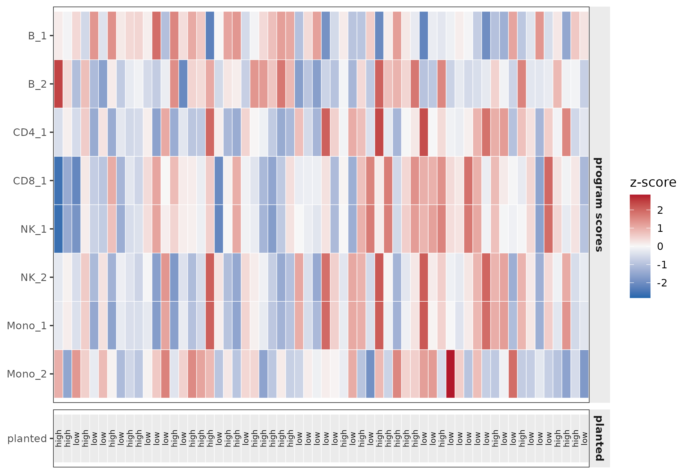
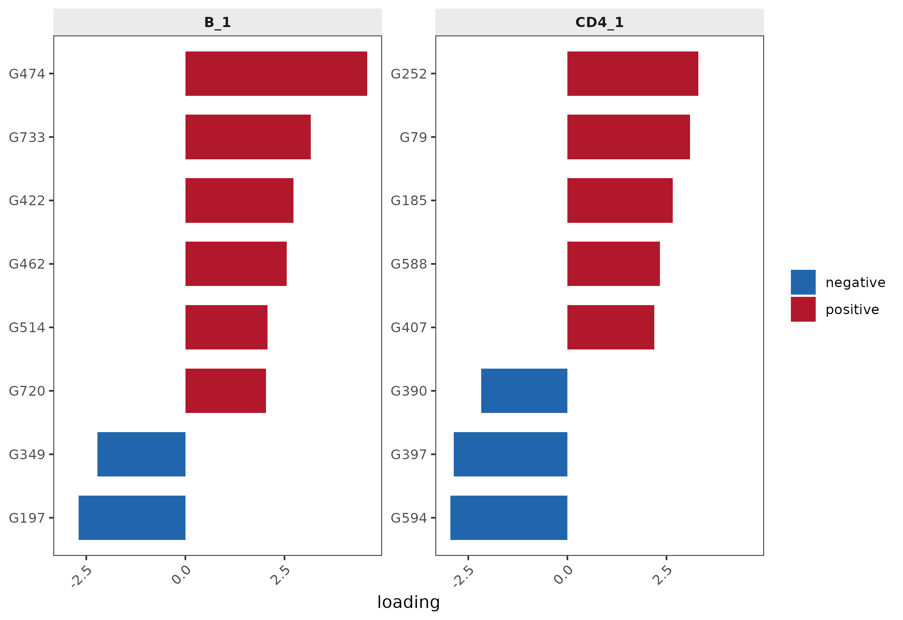
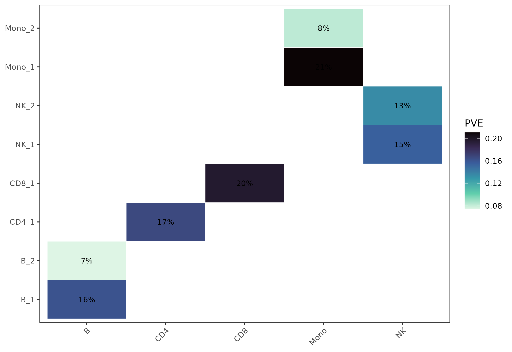
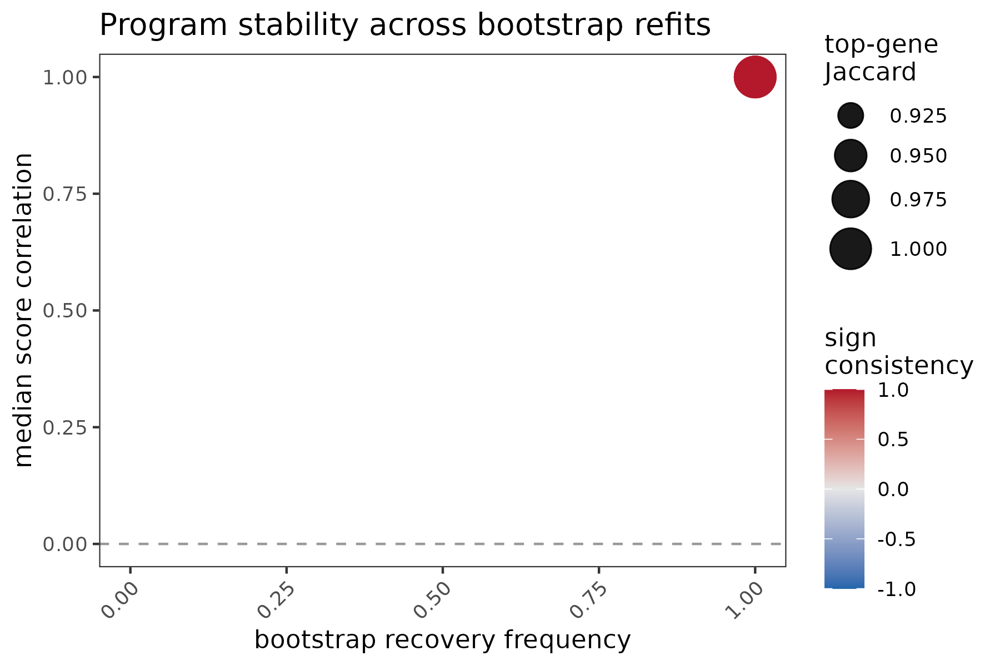
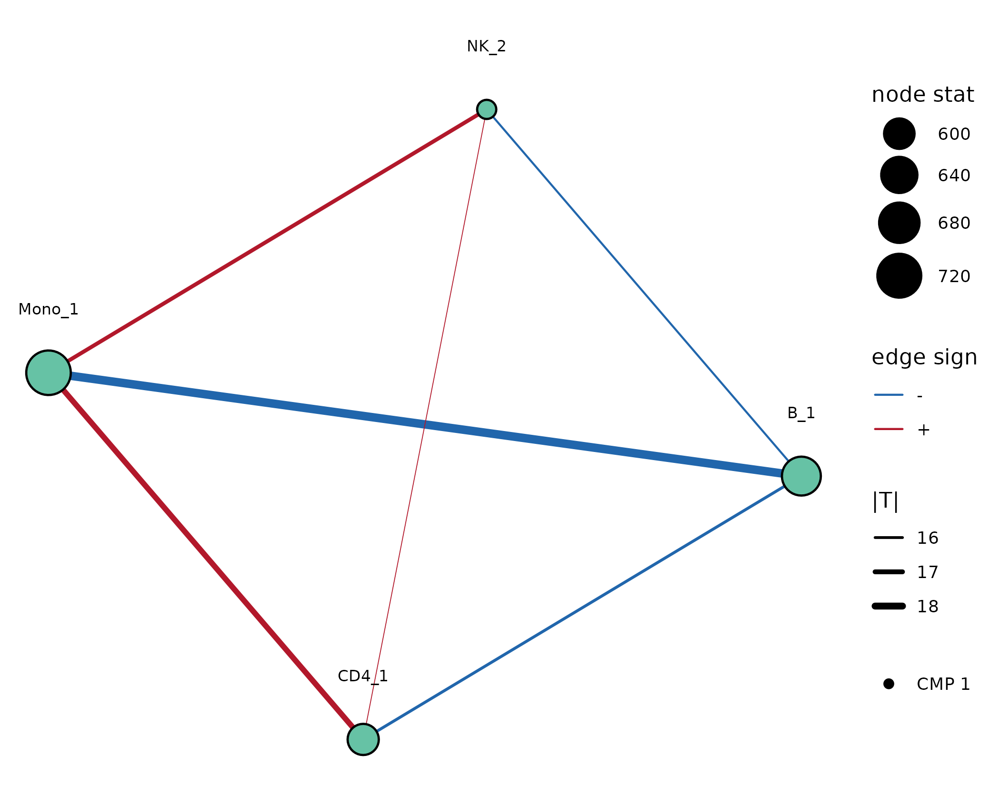
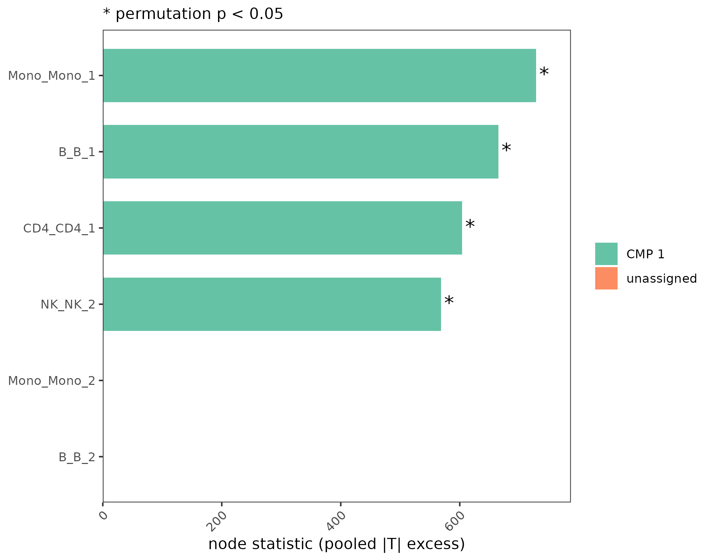
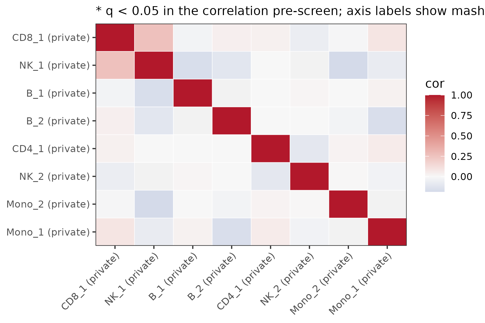
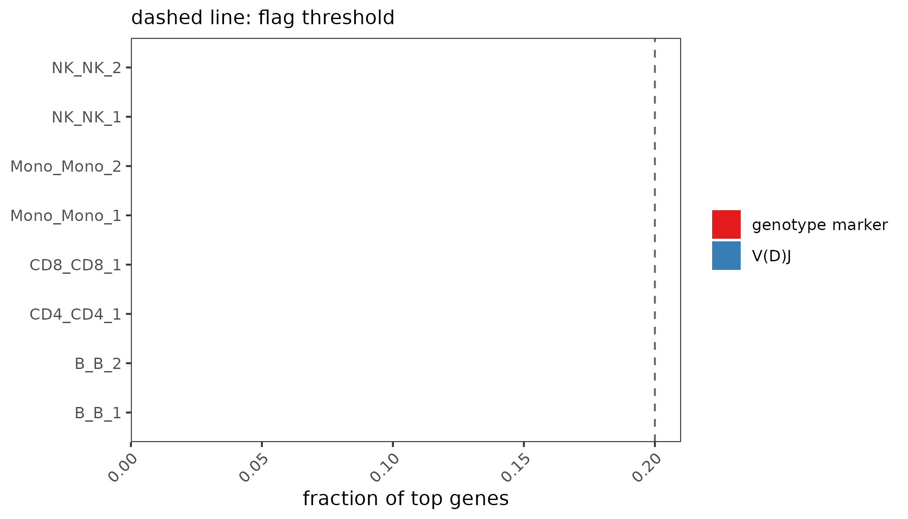

# Quick start: from pseudobulk to shared programs

`quickstart.Rmd`

`cellprograms` discovers transcriptional programs **de novo within each cell type** from pseudobulk single-cell RNA-seq, then investigates cross-cell-type coordination and sharing afterwards — never assuming it. This vignette runs the whole pipeline on a small simulated dataset.

## Simulate pseudobulk data

[`simulate_pseudobulk()`](../reference/simulate_pseudobulk.html) plants private and shared programs with known ground truth. The result is a named list of observations x genes matrices, one per cell type.

\
<a href="https://rdrr.io/r/base/library.html" class="external-link"><code class="sourceCode r R">library</code></a>`(``cellprograms``)`\
\
`sim`` ``<-`` `[`simulate_pseudobulk`](../reference/simulate_pseudobulk.html)`(``scenario ``=`` ``"mixed"``, n_samples ``=`` ``60``,`\
`                           n_genes ``=`` ``800``, program_size ``=`` ``40``, seed ``=`` ``1``)`\
<a href="https://rdrr.io/r/utils/str.html" class="external-link"><code class="sourceCode r R">str</code></a>`(``sim``$``pseudobulk``, max.level ``=`` ``1``)`\
`#> List of 5`\
`#>  $ B   : num [1:60, 1:800] 1.146 -2.403 0.573 0.375 -0.425 ...`\
`#>   ..- attr(*, "dimnames")=List of 2`\
`#>  $ CD4 : num [1:60, 1:800] -1.474 0.59 -0.13 0.372 1.452 ...`\
`#>   ..- attr(*, "dimnames")=List of 2`\
`#>  $ CD8 : num [1:60, 1:800] 0.0679 0.9149 0.8625 -1.1996 -2.2594 ...`\
`#>   ..- attr(*, "dimnames")=List of 2`\
`#>  $ NK  : num [1:60, 1:800] -0.0478 1.5893 1.175 0.0746 -0.9374 ...`\
`#>   ..- attr(*, "dimnames")=List of 2`\
`#>  $ Mono: num [1:60, 1:800] -0.7613 -0.4367 -1.4659 0.0574 -1.4384 ...`\
`#>   ..- attr(*, "dimnames")=List of 2`

## Build the data object and fit programs

\
`x`` ``<-`` `[`as_cell_program_data`](../reference/as_cell_program_data.html)`(``sim``$``pseudobulk``)`\
[`validate_cell_program_data`](../reference/validate_cell_program_data.html)`(``x``)`\
\
`fit`` ``<-`` `[`fit_celltype_programs`](../reference/fit_celltype_programs.html)`(``x``, loading_prior ``=`` ``"point_laplace"``,`\
`                             max_factors ``=`` ``6``, features ``=`` ``"variable"``,`\
`                             n_variable_genes ``=`` ``400``)`\
`fit`` ``<-`` `[`canonicalize_programs`](../reference/canonicalize_programs.html)`(``fit``)`\
`fit`\
`#> ``cell_program_data`\
`#> Cell types: 5 ``"B"``, ``"CD4"``, ``"CD8"``, ``"NK"``, and ``"Mono"`\
`#> B: 60 observations x 800 genes`\
`#> CD4: 60 observations x 800 genes`\
`#> CD8: 60 observations x 800 genes`\
`#> NK: 60 observations x 800 genes`\
`#> Mono: 60 observations x 800 genes`\
`#> Shared genes across all cell types: 800`

[`fit_celltype_programs()`](../reference/fit_celltype_programs.html) fits one empirical-Bayes matrix factorization per cell type (‘flashier’); [`canonicalize_programs()`](../reference/canonicalize_programs.html) resolves sign and scale ambiguity so programs are comparable downstream. Real-data fits should additionally pass `covariates` (e.g. `c("site", "sex")`) and use `max_factors = 30` when the goal is CMP detection (see the CMP benchmark note in `README`).

## From single cells: metacells (optional)

When the starting point is a single-cell object rather than pseudobulk profiles, [`MetacellsByGroupsSEACells()`](../reference/MetacellsByGroupsSEACells.html) aggregates cells into transcriptomically homogeneous metacells with SEACells (run in an isolated basilisk-managed Python environment, built on first use) and mcRigor QC, stratified so metacells never cross donors or cell types. The metacell counts feed [`fit_celltype_programs()`](../reference/fit_celltype_programs.html) directly:

\
`# Requires: install.packages("Seurat"); remotes::install_github("JSB-UCLA/mcRigor");`\
`# BiocManager::install("basilisk")`\
`seu`` ``<-`` `[`MetacellsByGroupsSEACells`](../reference/MetacellsByGroupsSEACells.html)`(`\
`  ``seurat_obj``,                         ``# Seurat object with raw counts + PCA`\
`  group.by ``=`` `<a href="https://rdrr.io/r/base/c.html" class="external-link"><code class="sourceCode r R">c</code></a>`(``"donor"``, ``"celltype"``)``,  ``# stratification: metacells stay within donor x cell type`\
`  cells_per_metacell ``=`` ``75``,`\
`  min_cells ``=`` ``100`\
`)`\
`res`` ``<-`` `[`GetMetacellSEACells`](../reference/GetMetacellSEACells.html)`(``seu``)`\
`mc`` ``<-`` ``res``$``metacell_object`\
<a href="https://rdrr.io/r/utils/head.html" class="external-link"><code class="sourceCode r R">head</code></a>`(``res``$``qc``)``  ``# per-metacell mcRigor QC (mcDiv, divergence threshold, dubious flag)`\
\
`# Metacell counts -> named list of metacells x genes matrices, one per cell type`\
`counts`` ``<-`` ``SeuratObject``::`<a href="https://satijalab.github.io/seurat-object/reference/Layers.html" class="external-link"><code class="sourceCode r R">LayerData</code></a>`(``mc``[[``"RNA"``]``]``, layer ``=`` ``"counts"``)``  ``# genes x metacells`\
`by_type`` ``<-`` `<a href="https://rdrr.io/r/base/split.html" class="external-link"><code class="sourceCode r R">split</code></a>`(`<a href="https://rdrr.io/r/base/colnames.html" class="external-link"><code class="sourceCode r R">colnames</code></a>`(``mc``)``, ``mc``$``celltype``)`\
`pb`` ``<-`` `<a href="https://rdrr.io/r/base/lapply.html" class="external-link"><code class="sourceCode r R">lapply</code></a>`(``by_type``, ``function``(``cells``)`` `<a href="https://rdrr.io/r/base/t.html" class="external-link"><code class="sourceCode r R">t</code></a>`(`<a href="https://rdrr.io/r/base/matrix.html" class="external-link"><code class="sourceCode r R">as.matrix</code></a>`(``counts``[``, ``cells``, drop ``=`` ``FALSE``]``)``)``)`\
\
`x`` ``<-`` `[`as_cell_program_data`](../reference/as_cell_program_data.html)`(``pb``)`\
`fit`` ``<-`` `[`fit_celltype_programs`](../reference/fit_celltype_programs.html)`(``x``, loading_prior ``=`` ``"point_laplace"``,`\
`                             max_factors ``=`` ``6``, features ``=`` ``"variable"``)`\
`fit`` ``<-`` `[`canonicalize_programs`](../reference/canonicalize_programs.html)`(``fit``)`

[`OptimizeGammaSEACells()`](../reference/OptimizeGammaSEACells.html) selects the granularity (`cells_per_metacell`) by the mcRigor score when you prefer data-driven granularity over the default.

## Inspect programs

\
[`program_summary`](../reference/program_summary.html)`(``fit``)``          ``# one row per cell type: n_programs, R2, elbo`\
`#>   cell_type n_obs n_genes n_programs        R2      elbo`\
`#> 1         B    60     400          2 0.2439779 -36065.09`\
`#> 2       CD4    60     400          1 0.1707640 -35709.99`\
`#> 3       CD8    60     400          1 0.2010540 -35859.83`\
`#> 4        NK    60     400          2 0.2948849 -36081.50`\
`#> 5      Mono    60     400          2 0.2997384 -35859.12`\
[`top_genes`](../reference/top_genes.html)`(``fit``, ``"B_1"``, n ``=`` ``8``)``  ``# top loadings of program B_1`\
`#>    gene   loading          lfsr`\
`#> 1  G474  4.582835 2.630908e-244`\
`#> 3  G733  3.164218 1.075143e-117`\
`#> 2  G422  2.724563  7.611642e-88`\
`#> 4  G197 -2.688759  0.000000e+00`\
`#> 6  G462  2.555132  1.603963e-77`\
`#> 8  G349 -2.213170  0.000000e+00`\
`#> 9  G514  2.067245  1.752200e-51`\
`#> 10 G720  2.031627  8.535883e-50`

Scores (donor x program activities) and loadings (gene x program) are one call away:

\
`Z`` ``<-`` `[`program_scores`](../reference/program_scores.html)`(``fit``)``    ``# donors x all programs (wide matrix)`\
`W`` ``<-`` `[`program_loadings`](../reference/program_loadings.html)`(``fit``)``  ``# genes x all programs`\
<a href="https://rdrr.io/r/base/dim.html" class="external-link"><code class="sourceCode r R">dim</code></a>`(``Z``)``; `<a href="https://rdrr.io/r/base/dim.html" class="external-link"><code class="sourceCode r R">dim</code></a>`(``W``)`\
`#> [1] 60  8`\
`#> NULL`

The same views as figures — donor x program score heatmap (with the planted context as an annotation strip), top loadings, and per-program variance explained:

\
`sev`` ``<-`` ``sim``$``truth``$``B``[[``1``]``]``$``z`` ``>`` `<a href="https://rdrr.io/r/stats/median.html" class="external-link"><code class="sourceCode r R">median</code></a>`(``sim``$``truth``$``B``[[``1``]``]``$``z``)`\
`md`` ``<-`` `<a href="https://rdrr.io/r/base/data.frame.html" class="external-link"><code class="sourceCode r R">data.frame</code></a>`(``observation_id ``=`` `<a href="https://rdrr.io/r/base/paste.html" class="external-link"><code class="sourceCode r R">paste0</code></a>`(``"obs"``, `<a href="https://rdrr.io/r/base/seq.html" class="external-link"><code class="sourceCode r R">seq_along</code></a>`(``sev``)``)``,`\
`                 planted ``=`` `<a href="https://rdrr.io/r/base/factor.html" class="external-link"><code class="sourceCode r R">factor</code></a>`(``sev``, `<a href="https://rdrr.io/r/base/c.html" class="external-link"><code class="sourceCode r R">c</code></a>`(``FALSE``, ``TRUE``)``, `<a href="https://rdrr.io/r/base/c.html" class="external-link"><code class="sourceCode r R">c</code></a>`(``"low"``, ``"high"``)``)``)`\
`fit_ann`` ``<-`` `[`as_cell_program_data`](../reference/as_cell_program_data.html)`(``sim``$``pseudobulk``, sample_metadata ``=`` ``md``)`\
`fit_ann`` ``<-`` `[`canonicalize_programs`](../reference/canonicalize_programs.html)`(`[`fit_celltype_programs`](../reference/fit_celltype_programs.html)`(``fit_ann``, loading_prior ``=`` ``"point_laplace"``,`\
`                                                       max_factors ``=`` ``6``, features ``=`` ``"variable"``,`\
`                                                       n_variable_genes ``=`` ``400``)``)`\
[`plot_program_scores`](../reference/plot_program_scores.html)`(``fit_ann``, annotation ``=`` ``"planted"``)`

\
[`plot_top_genes`](../reference/plot_top_genes.html)`(``fit``, `<a href="https://rdrr.io/r/base/c.html" class="external-link"><code class="sourceCode r R">c</code></a>`(``"B_1"``, ``"CD4_1"``)``, n ``=`` ``8``)`

\
[`plot_variance_explained`](../reference/plot_variance_explained.html)`(``fit``)`

## Stability

[`assess_program_stability()`](../reference/assess_program_stability.html) refits on donor subsamples and reports how often each program is recovered. Refits that fail are counted, not silently dropped: `fit$stability` carries `valid_refits`/`failed_refits` and a per-replicate `replicate_log`; `recovery_freq` keeps its legacy meaning (hits over requested iterations) while `conditional_recovery_freq` is computed over successful refits (all refits failing yields `NA`, not 0).

\
`fit`` ``<-`` `[`assess_program_stability`](../reference/assess_program_stability.html)`(``fit``, n_boot ``=`` ``4``, resample_frac ``=`` ``0.7``,`\
`                                seed ``=`` ``1``, progress ``=`` ``FALSE``)`\
`fit``$``stability``$``per_program`\
`#>   program_id cell_type n_hit n_eligible recovery_freq conditional_recovery_freq`\
`#> 1        B_1         B     4          4             1                         1`\
`#> 2        B_2         B     4          4             1                         1`\
`#> 3      CD4_1       CD4     4          4             1                         1`\
`#> 4      CD8_1       CD8     4          4             1                         1`\
`#> 5       NK_1        NK     4          4             1                         1`\
`#> 6       NK_2        NK     4          4             1                         1`\
`#> 7     Mono_1      Mono     4          4             1                         1`\
`#> 8     Mono_2      Mono     4          4             1                         1`\
`#>   median_score_cor median_loading_cos sign_consistency top_gene_jaccard`\
`#> 1        0.9999741          0.9977389                1        0.9523810`\
`#> 2        0.9997932          0.9917401                1        0.9047619`\
`#> 3        0.9999745          0.9969061                1        0.9047619`\
`#> 4        0.9999727          0.9973919                1        1.0000000`\
`#> 5        0.9999817          0.9990403                1        1.0000000`\
`#> 6        0.9999712          0.9972391                1        1.0000000`\
`#> 7        0.9999909          0.9989417                1        0.9047619`\
`#> 8        0.9998692          0.9952278                1        0.9047619`\
[`plot_stability`](../reference/plot_stability.html)`(``fit``)`

## Coordinated multicellular programs (CMPs)

[`find_coordinated_programs()`](../reference/find_coordinated_programs.html) tests whether programs from *different* cell types co-vary across donors, with family-wise error control by permutation. Gene overlap plays no role in the call.

\
`cmp`` ``<-`` `[`find_coordinated_programs`](../reference/find_coordinated_programs.html)`(``fit``, n_perm ``=`` ``199``, seed ``=`` ``1``)`\
`cmp`\
`#> <cmp_result> 1 coordinated multicellular program(s) at FWER 0.05 (mode: marginal, ambient: drop)`\
`#>   CMP 1: B_1, CD4_1 (-), NK_2 (-), Mono_1 (-)`

The coordination network (node size = pooled evidence A_v, edge width = \|T\|, color = CMP membership) and the per-program node statistics:

\
[`plot_cmp_network`](../reference/plot_cmp_network.html)`(``cmp``)`

\
[`plot_cmp_nodes`](../reference/plot_cmp_nodes.html)`(``cmp``)`

## Shared vs specific programs

[`program_sharing()`](../reference/program_sharing.html) goes the other way: it matches programs across cell types by loading correlation (permutation-calibrated), then asks with ‘mashr’ whether the matched programs share their gene *effects* — correlated loadings alone do not imply shared effects.

\
`if`` ``(`<a href="https://rdrr.io/r/base/ns-load.html" class="external-link"><code class="sourceCode r R">requireNamespace</code></a>`(``"mashr"``, quietly ``=`` ``TRUE``)``)`` ``{`\
`  ``shr`` ``<-`` `[`program_sharing`](../reference/program_sharing.html)`(``fit``, n_perm ``=`` ``99``, seed ``=`` ``1``)`\
`  ``shr`\
`  `[`plot_sharing`](../reference/plot_sharing.html)`(``shr``)``   ``# pre-screen correlations x mashr classification`\
`}`

## Artifact genes

Immunoglobulin/TCR V(D)J segments, known donor-genotype markers, and sex-chromosome genes can dominate programs for technical or genetic rather than biological reasons. Flag them in existing fits, or exclude them at fit time (exclusion happens before variable-gene selection):

\
[`plot_artifact_flags`](../reference/plot_artifact_flags.html)`(`[`flag_artifact_genes`](../reference/flag_artifact_genes.html)`(``fit``)``)`

\
[`flag_artifact_genes`](../reference/flag_artifact_genes.html)`(``fit``)`\
`#>   cell_type program_id vdj_frac vdj_flag genotype_marker_frac`\
`#> 1         B        B_1        0    FALSE                    0`\
`#> 2         B        B_2        0    FALSE                    0`\
`#> 3       CD4      CD4_1        0    FALSE                    0`\
`#> 4       CD8      CD8_1        0    FALSE                    0`\
`#> 5        NK       NK_1        0    FALSE                    0`\
`#> 6        NK       NK_2        0    FALSE                    0`\
`#> 7      Mono     Mono_1        0    FALSE                    0`\
`#> 8      Mono     Mono_2        0    FALSE                    0`\
`#>   genotype_marker_flag`\
`#> 1                FALSE`\
`#> 2                FALSE`\
`#> 3                FALSE`\
`#> 4                FALSE`\
`#> 5                FALSE`\
`#> 6                FALSE`\
`#> 7                FALSE`\
`#> 8                FALSE`\
\
`# fit-time masking:`\
`# excl <- artifact_genes(colnames(sim$pseudobulk$B))`\
`# fit_masked <- fit_celltype_programs(x, exclude_genes = excl, ...)`

## Next steps

- The real-data case-study article (pkgdown site) walks through the Stephenson and COMBAT COVID cohorts, including the artifact-masking sensitivity analysis.
- `benchmarks/` contains the pre-registered simulation benchmarks behind the default settings and the CMP caller.

