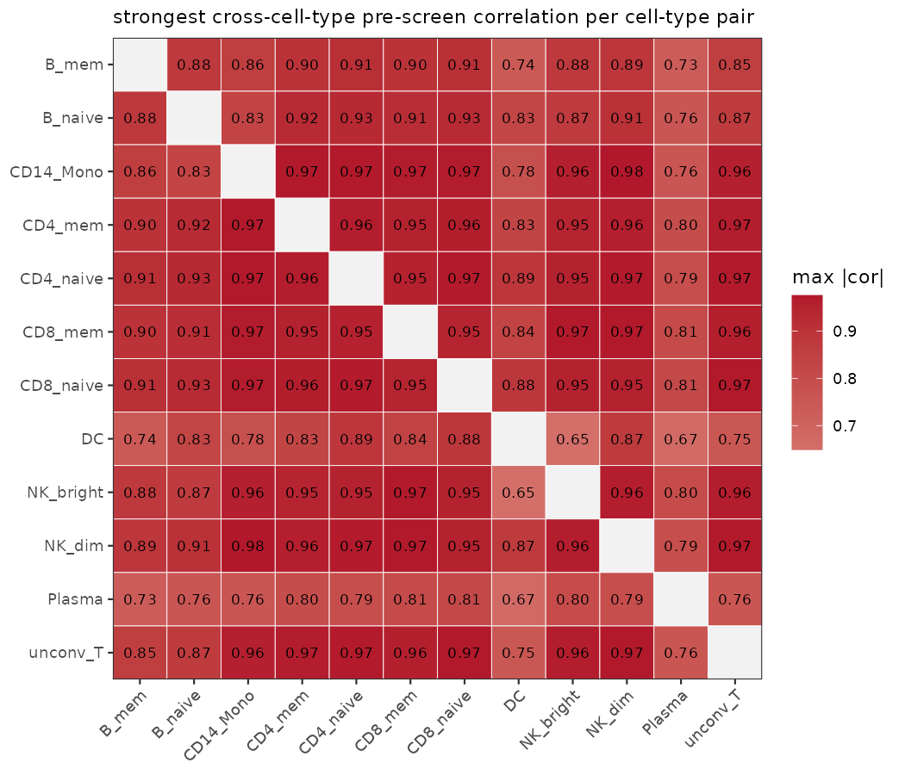
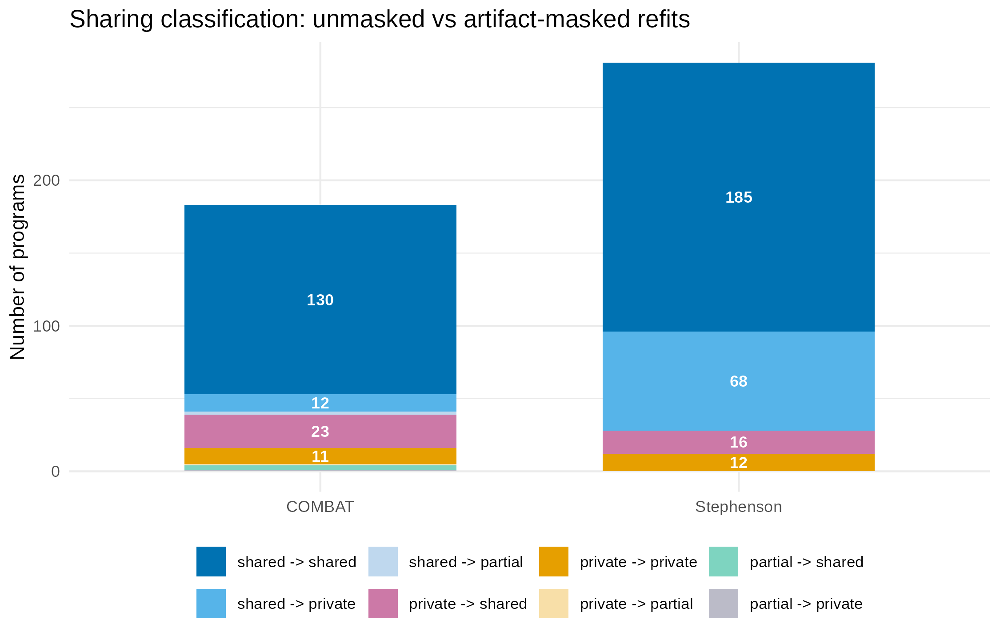
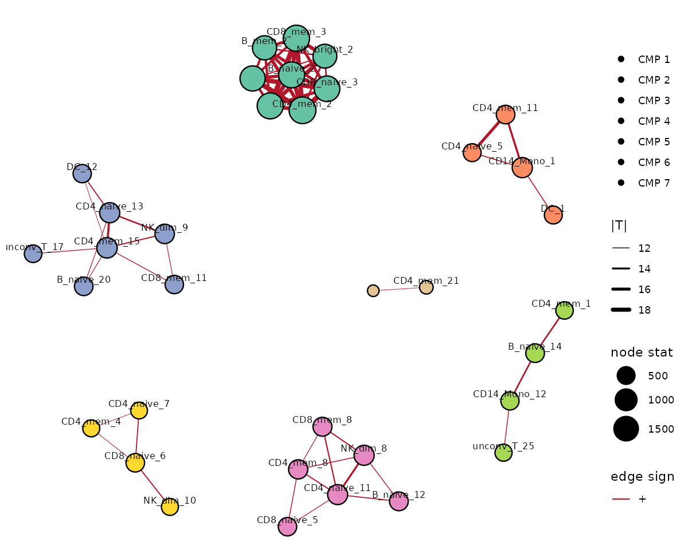
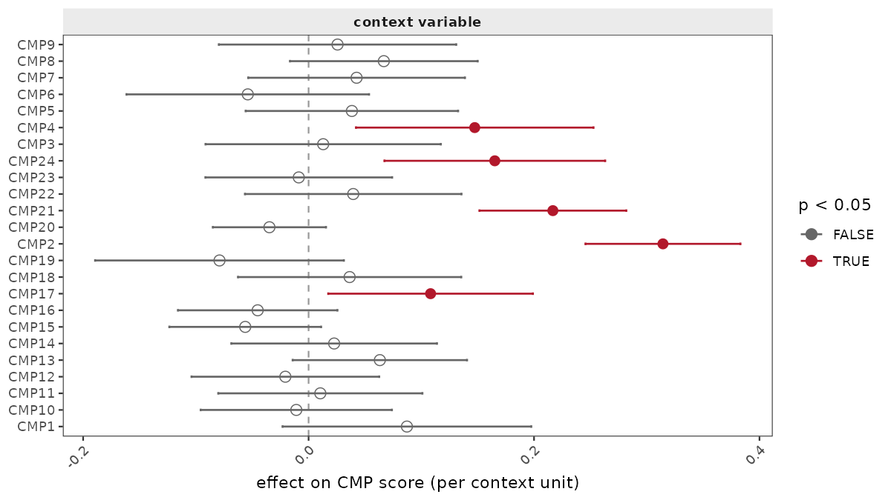

# Historical case study: cross-cell-type COVID-19 PBMC programs

`real_data_case_study.Rmd`

**Historical precomputed evidence, not a new source-verified reproduction.** Exact matrices, transformations, cohort eligibility and use/redistribution rights must be resolved before the maintained study is executed. Fixed-input node p-values and descriptive sharing labels do not certify edge/CMP-set inference.

This article preserves a past `cellprograms` analysis of two real COVID-19 PBMC single-cell cohorts (Stephenson et al. 2021; COMBAT consortium), demonstrating program discovery, cross-cell-type coordination, program sharing, and the artifact-masking workflow. All numbers and figures below are precomputed; the code chunks show exactly the historical intended recipe. This is not a claim that a clean checkout currently regenerates those results (see [Reproducing](#reproducing)).

## Data and fitting

Both cohorts are processed to a donor × gene pseudobulk matrix per cell type (donors with too few cells of a type are dropped for that type):

- **Stephenson et al. (2021)**: 12 cell types, 72–117 donors per type, 11.5k–12.9k genes per type.
- **COMBAT consortium**: 9 cell types, 89–122 donors per type, 11.6k–13.0k genes per type.

The fitting recipe uses the default EBMF machinery with a point-Laplace loading prior, K = 30 factors per cell type, and residualization of technical covariates (sequencing institute + sex):

\
<a href="https://rdrr.io/r/base/library.html" class="external-link"><code class="sourceCode r R">library</code></a>`(``cellprograms``)`\
\
`x`` ``<-`` `[`as_cell_program_data`](../reference/as_cell_program_data.html)`(``pseudobulk``, sample_metadata ``=`` ``meta``)`\
`fit`` ``<-`` `[`fit_celltype_programs`](../reference/fit_celltype_programs.html)`(`\
`  ``x``,`\
`  loading_prior ``=`` ``"point_laplace"``,`\
`  max_factors   ``=`` ``30``,`\
`  features      ``=`` ``"variable"``, n_variable_genes ``=`` ``2000``,`\
`  covariates    ``=`` `<a href="https://rdrr.io/r/base/c.html" class="external-link"><code class="sourceCode r R">c</code></a>`(``"institute"``, ``"sex"``)``, covariate_mode ``=`` ``"residualize"``,`\
`  var_type ``=`` ``1``, backfit ``=`` ``TRUE``, nullcheck ``=`` ``TRUE``,`\
`  seed ``=`` ``1`\
`)`\
`fit`` ``<-`` `[`canonicalize_programs`](../reference/canonicalize_programs.html)`(``fit``)`

This yields 318 programs in Stephenson and 222 in COMBAT (after the K = 30 cap and degenerate-factor handling).

## Program sharing across cell types

[`program_sharing()`](../reference/program_sharing.html) matches programs across cell types by loading correlation (permutation-tested), groups the matches, and scores each group with a multivariate adaptive shrinkage (mashr) model to classify every program as **shared**, **partial**, or **private**:

\
`share`` ``<-`` `[`program_sharing`](../reference/program_sharing.html)`(``fit``, n_perm ``=`` ``199``, seed ``=`` ``1``, z_thresh ``=`` ``1.5``)`\
`share``$``summary``   ``# per-program classification`\
`share``$``groups``    ``# sharing groups (lists of cell-type programs)`

The sharing structure at cohort scale — the strongest cross-cell-type pre-screen correlation per cell-type pair (per-program heatmaps become unreadable beyond a few dozen programs, hence the `level = "cell_type"` aggregate):

Strongest cross-cell-type program correlation per cell-type pair (Stephenson, unmasked)

The near-uniform dark map is the V(D)J artifact speaking: every cell-type pair has some program pair correlating at r \> 0.7, which is why the per-program classification below is dominated by artifact-driven sharing groups.

| Cohort     | Programs | Sharing groups | Shared | Partial | Private |
|------------|----------|----------------|--------|---------|---------|
| Stephenson | 318      | 39             | 284    | 0       | 34      |
| COMBAT     | 222      | 41             | 162    | 4       | 56      |

The dominant shared groups are biologically coherent: an interferon-driven program shared across essentially all immune cell types, a cell-cycle program, and lymphocyte activation programs. The single largest sharing group in each cohort, however, is the **V(D)J gene artifact** — see the next section.

## The V(D)J artifact, and masking it

Immunoglobulin and TCR receptor genes leak into scRNA-seq count matrices as a technical artifact of cell capture (10x) rather than true biology. Because the same receptor genes are “expressed” across all lymphocyte types in a sample-correlated way, they induce a strong, *spurious* cross-cell-type program that dominates the sharing analysis.

`cellprograms` ships an [`artifact_gene_sets()`](../reference/artifact_gene_sets.html) helper (V(D)J receptor genes, genotype-marker genes, sex-chromosome genes) and an `exclude_genes` argument for refitting without them. Artifact flagging before masking:

\
`flags`` ``<-`` `[`flag_artifact_genes`](../reference/flag_artifact_genes.html)`(``fit``)``   ``# per-program artifact loadings`

| Cohort     | Programs flagged (any artifact set) | Fraction |
|------------|-------------------------------------|----------|
| Stephenson | 249 / 318                           | 78%      |
| COMBAT     | 163 / 222                           | 73%      |

Refitting with V(D)J + genotype-marker genes excluded (`artifact_genes(all_genes, sets = c("vdj", "genotype_marker"))`; 274 genes in the Stephenson universe) removes **all** artifact flags and materially changes the sharing map:

\
`fit_masked`` ``<-`` `[`fit_celltype_programs`](../reference/fit_celltype_programs.html)`(`\
`  ``x``, exclude_genes ``=`` `[`artifact_genes`](../reference/artifact_genes.html)`(``all_genes``, sets ``=`` `<a href="https://rdrr.io/r/base/c.html" class="external-link"><code class="sourceCode r R">c</code></a>`(``"vdj"``, ``"genotype_marker"``)``)``,`\
`  loading_prior ``=`` ``"point_laplace"``, max_factors ``=`` ``30``,`\
`  features ``=`` ``"variable"``, n_variable_genes ``=`` ``2000``,`\
`  covariates ``=`` `<a href="https://rdrr.io/r/base/c.html" class="external-link"><code class="sourceCode r R">c</code></a>`(``"institute"``, ``"sex"``)``, covariate_mode ``=`` ``"residualize"``,`\
`  var_type ``=`` ``1``, backfit ``=`` ``TRUE``, nullcheck ``=`` ``TRUE``, seed ``=`` ``1`\
`)`\
`fit_masked`` ``<-`` `[`canonicalize_programs`](../reference/canonicalize_programs.html)`(``fit_masked``)`\
`share_masked`` ``<-`` `[`program_sharing`](../reference/program_sharing.html)`(``fit_masked``, n_perm ``=`` ``199``, seed ``=`` ``1``, z_thresh ``=`` ``1.5``)`

| Cohort     | Programs | Groups | Shared | Partial | Private | Flagged |
|------------|----------|--------|--------|---------|---------|---------|
| Stephenson | 284      | 32     | 204    | 0       | 80      | **0**   |
| COMBAT     | 185      | 35     | 158    | 3       | 24      | **0**   |

Sharing classification of matched programs before vs after artifact masking

The effect of masking is **asymmetric** across cohorts, which is the scientifically interesting part:

- In **Stephenson**, 68 programs flip shared → private: the unmasked V(D)J artifact was *creating* spurious sharing calls.
- In **COMBAT**, 23 programs flip private → shared: artifact loading contamination was *hiding* real shared biology that only becomes detectable once the artifact genes are removed.

Neither direction is the “expected” one — the artifact can both create and mask sharing, which is why refitting (rather than post-hoc filtering) is the recommended workflow.

## Sensitivity of the sharing calls

Two preregistered sensitivity analyses (see `benchmarks/cmp_detection/PREREG_cmp-bench-v1.2.md` for the framework):

**z_thresh sweep.** The V-estimation step inside [`program_sharing()`](../reference/program_sharing.html) falls back to the identity matrix when too few genes are “null” (\|z\| ≤ z_thresh in every condition of the group). Sweeping z_thresh over {1.5, 2, 2.5, 3} across all 320 group-fits (both cohorts, masked and unmasked): the null set is non-empty in 117 group-fits, off-diagonal V entries are nonzero in only 10, and **no sharing classification flips at any threshold**. The identity fallback is structural (loading posterior SDs are small relative to effect sizes) but harmless — sharing calls do not depend on it.

**Historical matching sensitivity, not calibration.** Re-running the cross-cell-type matching at n_perm = 1999 (vs 199): edge Jaccard 0.78 (Stephenson) / 0.82 (COMBAT), sharing-group ARI **0.85 / 0.89**, group counts 39 → 41 and 41 → 42. This describes sensitivity of the historical matching output, not valid sharing inference or independent calibration.

## Coordinated multi-cell-type programs

[`find_coordinated_programs()`](../reference/find_coordinated_programs.html) detects coordinated multi-cell-type programs (CMPs) — donor-level score covariation across cell types that permutation tests against donor-label shuffling. Run on the masked fits (the recommended workflow), with severity context association adjusting for institute and sex:

\
`cmp`` ``<-`` `[`find_coordinated_programs`](../reference/find_coordinated_programs.html)`(``fit_masked``, n_perm ``=`` ``999``, seed ``=`` ``1``, min_donors ``=`` ``20``)`\
`cmp``$``cmps``          ``# per-CMP member programs and consensus scores`\
[`cmp_triage`](../reference/cmp_triage.html)`(``fit_masked``, ``cmp``, context ``=`` ``"severity"``,`\
`           covariates ``=`` `<a href="https://rdrr.io/r/base/c.html" class="external-link"><code class="sourceCode r R">c</code></a>`(``"institute"``, ``"sex"``)``)`

The masked refits yield **24 CMPs** over 598 significant edges (Stephenson) and **21 CMPs** over 255 edges (COMBAT); the unmasked cap-30 fits give 27 and 25 (see `benchmarks/cmp_detection/results/real_K10_K30_K40_summary.csv` for the full cap-10/30/40 grid). The network view — node size = pooled evidence A_v, edge width = \|T\|, color = CMP membership:

Coordinated-program network, masked Stephenson fit (60 strongest edges shown)

Severity association per CMP (linear model on CMP consensus scores, adjusting for institute and sex; solid red = p \< 0.05):

CMP score association with COVID-19 severity, masked Stephenson fit

Several CMPs are significantly severity-associated (strongest around \|estimate\| ~ 0.2-0.3), while most are not — the coordination structure carries both disease-relevant and disease-irrelevant multicellular programs. CMP membership overlaps the sharing groups but is not identical: sharing (mashr) is a loading-space statement, coordination is a score-space statement. Apparent historical agreement in biological labels is descriptive; it does not validate either test or prove common mechanisms. The historical discussion emphasized (interferon, cell cycle) while disagreeing on program-level details — which motivate separately prespecified follow-up rather than a two-test scientific certificate.

## Reproducing

The full pipeline (data download through figures) is scripted in the repository:

- `benchmarks/cmp_detection/` — sharing benchmark + preregistrations
- `benchmarks/divas_comparison/` — head-to-head comparison against DIVAS on the Su et al. COVID-19 multi-omics case study
- Real-data fits are large and not bundled with the package; the scripts require verified source/units/rights before reconstruction (ArrayExpress E-MTAB-10026 for Stephenson; COMBAT via the consortium release).

