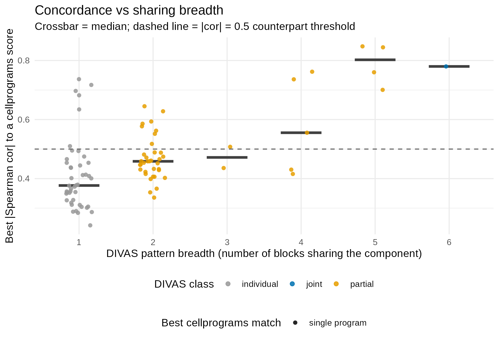
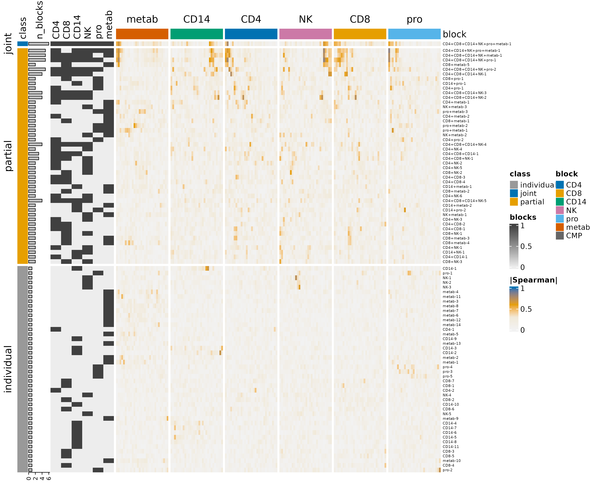
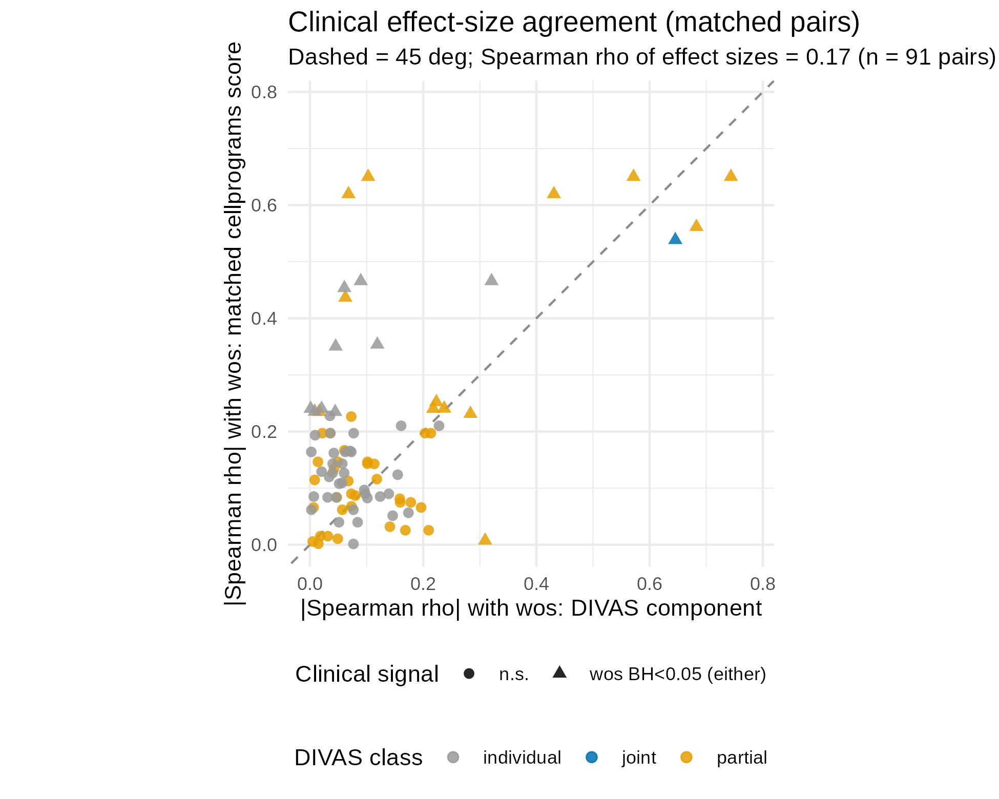

```{r, include = FALSE}
knitr::opts_chunk$set(
  collapse = TRUE,
  comment = "#>",
  eval = FALSE
)
```

This article reanalyses the DIVAS COVID-19 case study
(https://github.com/ByronSyun/DIVAS_COVID19_CaseStudy) with `cellprograms`
and compares the two pipelines' outputs program by program. DIVAS
jointly decomposes 6 data blocks (4 scRNA-seq cell types + proteomics +
metabolomics) into components tagged by which blocks they span; the
cellprograms workflow fits each block separately, then recovers
cross-block structure with coordination (CMPs) and cross-cell-type
sharing. All numbers and figures are precomputed; the code chunks show
exactly how each result was produced. The full scripts live in
`benchmarks/divas_comparison/scripts/` in the package repository.

## Data

114 samples (85 patients: 29 with paired T1/T2 samples, 56 with a single
timepoint), 40 mild / 40 moderate / 34 severe COVID-19, outcome = WHO
ordinal score (`wos`). Six blocks: CD4 T, CD8 T, CD14 monocytes, and NK
gene blocks (8,634 shared genes each), proteomics (481 proteins), and
metabolomics (763 metabolites).

DIVAS was run by the original authors (`DIVASmain(nsim = 500,
colCent = FALSE, rowCent = TRUE, seed = 123)`); its precomputed results
(Zenodo record 17430294) yield 91 components: 44 individual (1 block),
46 partial (2-5 blocks), 1 joint (all 6 blocks).

## Fitting at DIVAS parity

```{r fit, eval = FALSE}
x <- as_cell_program_data(list(
  CD4_T = read_block("Combined_CD4.csv"), CD8_T = read_block("Combined_CD8.csv"),
  CD14_Monocyte = read_block("Combined_CD14.csv"), NK = read_block("Combined_NK.csv"),
  proteomics = read_block("Combined_proteomics.csv"),
  metabolomics = read_block("Combined_metabolomics.csv")
))
fit <- fit_celltype_programs(x, loading_prior = "point_laplace",
                             max_factors = 30, center = TRUE, scale = FALSE,
                             var_type = 1, backfit = TRUE, nullcheck = TRUE,
                             seed = 1)
fit <- canonicalize_programs(fit)
```

All 6 blocks retain K = 30 programs (180 scores total).

## Coordination and sharing

```{r cmp, eval = FALSE}
cmp <- find_coordinated_programs(fit, n_perm = 999, seed = 1, min_donors = 20)
cmp_within <- find_coordinated_programs(fit, mode = "within",
                                        context = "severity",
                                        n_perm = 999, seed = 1)
gene_fit <- fit; gene_fit$cell_types <- c("CD4_T", "CD8_T", "CD14_Monocyte", "NK")
sharing <- program_sharing(gene_fit, n_perm = 199, seed = 1, z_thresh = 1.5)
```

- Marginal coordination: 148 significant cross-block edges collapse into
  6 coordinated program modules (CMPs); within-severity: 123 edges, 6
  CMPs - the structure is not a severity-composition artifact.
- Program sharing: 120 gene-block programs in 31 groups (27 groups span
  all 4 cell types); all 120 classify as shared
  (`frac_top_shared >= 0.98`). This is more permissive than DIVAS's
  taxonomy (44/46/1 individual/partial/joint): the 4 immune cell types
  are strongly correlated in this cohort, and the dominant severity axis
  is present in every cell type, so mash's lfsr-based classification
  attributes essentially all structure to shared programs.

## Concordance with DIVAS

```{r compare, eval = FALSE}
# score concordance: |Spearman| between each DIVAS component and each
# cellprograms score across the 114 samples
```

30 of 91 DIVAS components have a cellprograms counterpart at
|Spearman| > 0.5. All 30 mutual-best matched pairs land on cellprograms
programs classified as **shared** across cell types (26 from DIVAS
partial components, 4 from individual components). The single DIVAS
joint component has a strong best match (CD4_5, |rho| = 0.78) but is not
mutual-best.

Concordance rises with DIVAS pattern breadth - the median best-match
correlation increases from 0.37 (components private to 1 block) to 0.80
(components spanning 5 blocks):

```{r fig-breadth, eval = FALSE, fig.cap="Best-match concordance by DIVAS pattern breadth."}

```

The full concordance landscape (DIVAS components x cellprograms scores,
row-split by DIVAS taxonomy class):

```{r fig-heatmap, eval = FALSE, fig.cap="DIVAS component patterns vs cellprograms score concordance."}

```

## Clinical association

At BH < 0.05, 44/180 cellprograms scores associate with `wos` versus 8/91
DIVAS components. Cross-validated ridge prediction of `wos`:

| Predictors | n | R2 | RMSE |
|---|---|---|---|
| DIVAS components | 91 | 0.42 | 1.66 |
| cellprograms scores | 180 | 0.64 | 1.28 |
| severity-only baseline | 2 | 0.90 | 0.62 |

Both methods are dominated by the severity axis (`wos` is nearly
determined by the 3-level severity band); between methods, cellprograms
scores capture ~50% more `wos` variance. Effect-size agreement across the
91 matched pairs is weak overall (Spearman rho = 0.17), but pairs where
either method is significant sit mostly above the diagonal - the
cellprograms counterpart carries as much or more `wos` signal:

```{r fig-effect, eval = FALSE, fig.cap="Clinical effect-size agreement for matched pairs."}

```

## Pairing robustness

Because 29 patients contribute two timepoints, we checked the headline
coordination calls with (i) a T1-only refit (57 samples, no repeated
measures): 50/148 full-cohort edges reproduce and both runs find 6 CMPs;
and (ii) a patient-blocked permutation null (all samples of a patient
permuted together, 999 permutations): 121/148 edges (82%) remain
significant at p < 0.05. The coordination structure is largely robust to
the repeated-measures concern.

## Reproducing

Scripts, in order: `01_download_data.sh`, `02_fit_cellprograms.R`,
`03_cmp_sharing.R`, `04_extract_divas.R`, `05_compare.R`,
`06_figures_extra.R`, `07_sensitivity_pairing.R` (all under
`benchmarks/divas_comparison/scripts/` in the package repository).
