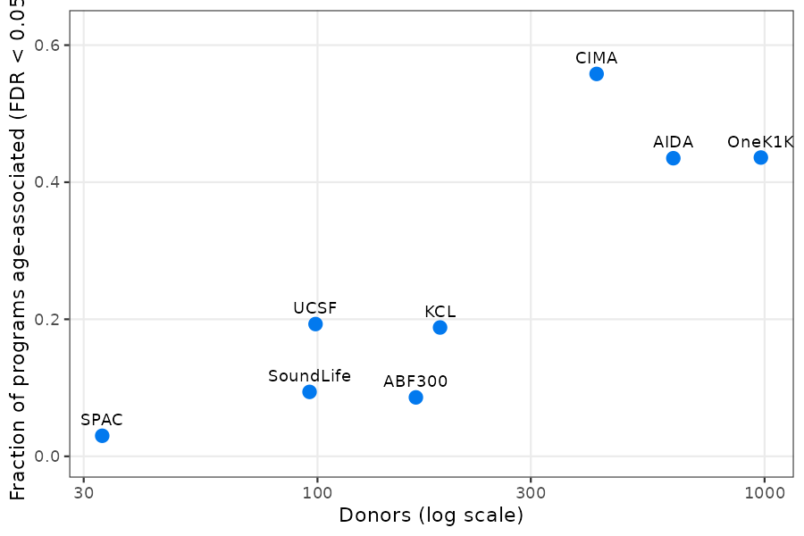
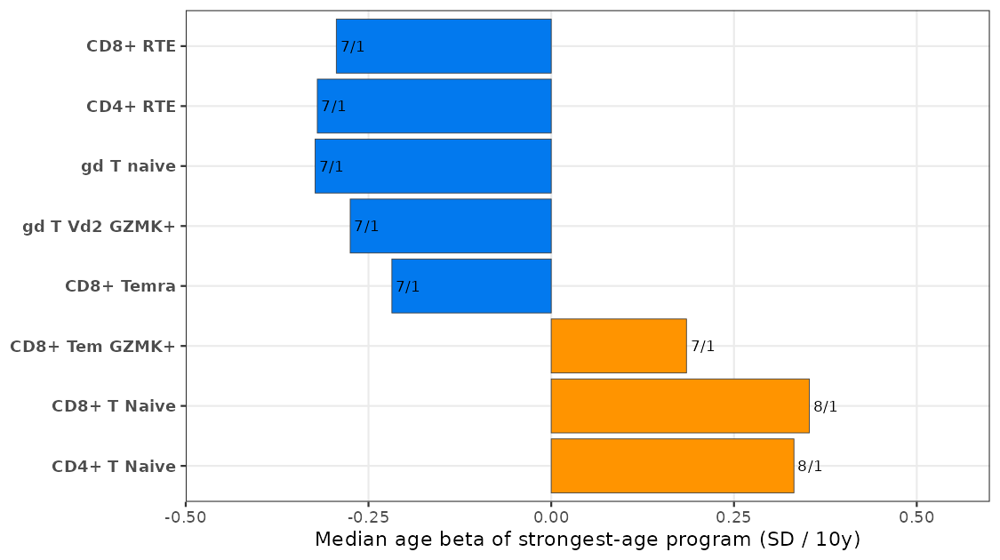
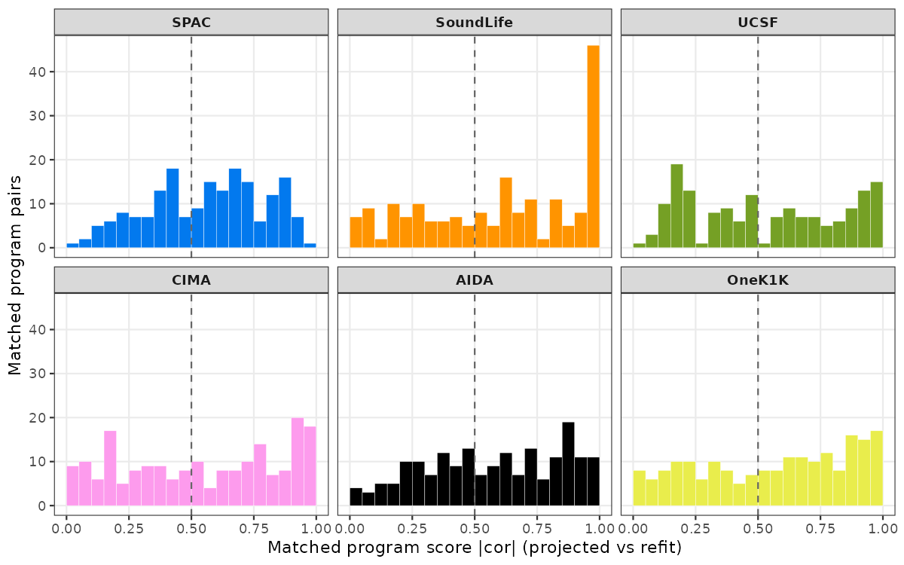
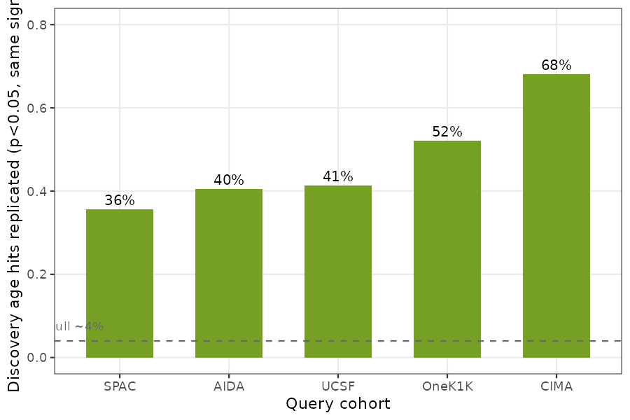
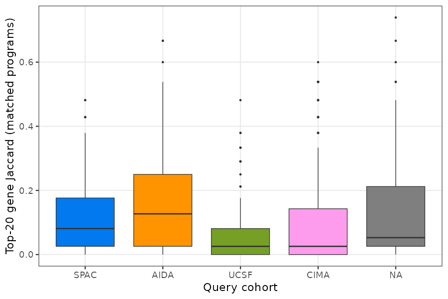
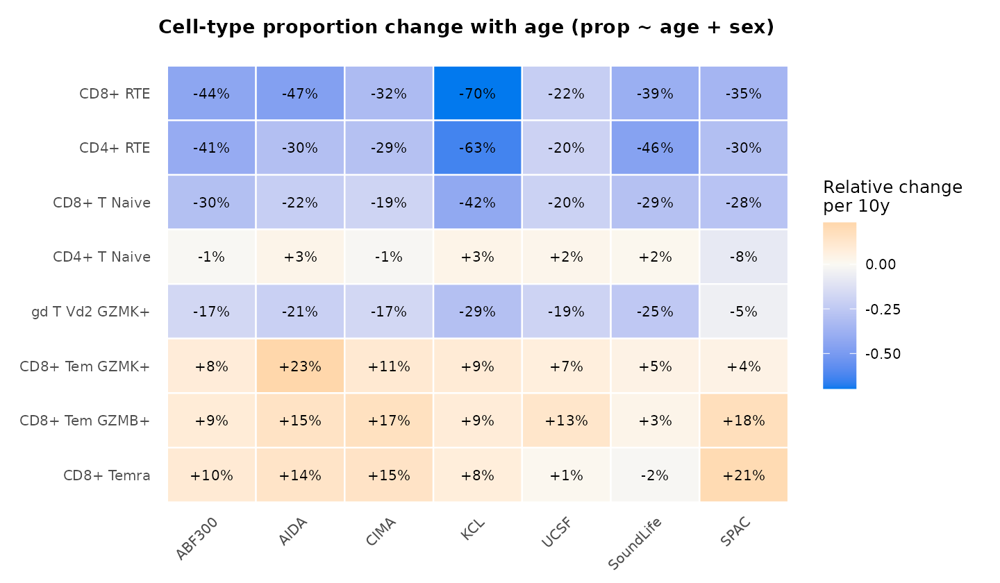
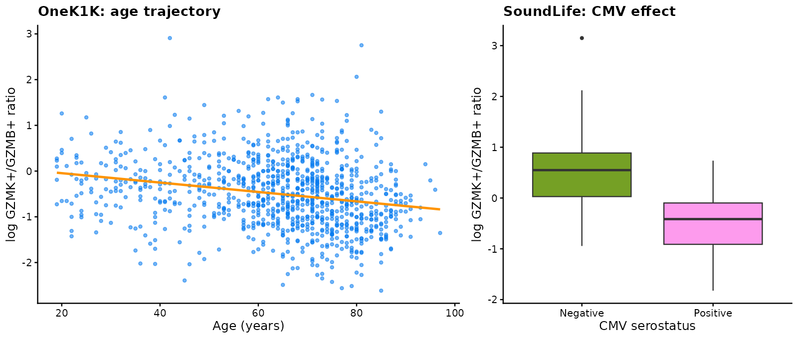

Case study: immune-aging programs across 8 global PBMC cohorts
================

This article applies the full `cellprograms` workflow — donor-level EBMF
programs per cell type, covariate association, and cross-cohort MR-0
freeze / MR-1 projection — to the 8-cohort PBMC immune-aging resource of
Terekhova et al. (Immunity 2026): **2,609 healthy donors** across ABF300
(166), OneK1K (981), AIDA (625), CIMA (421), KCL (188), UCSF (99),
SoundLife (96), and SPAC (33), with 59 harmonized cell types. All
numbers and figures are precomputed; code chunks show exactly how each
was produced and can be re-run against the open portal data (see
[Reproducing](#reproducing)).

The analysis answers three questions:

1.  Do EBMF programs discovered in one cohort **transfer** to another
    (score concordance of projected vs refit programs)?
2.  Which programs carry **age** structure, and does that structure
    replicate across cohorts?
3.  At what level is conservation observable — scores, association
    profiles, or gene lists?

## Data and pseudobulking

Each cohort is downloaded from the authors’ open portal and pseudobulked
per donor × cell type by summing raw counts over all cells (minimum 10
cells per donor-cell type; the “Bad quality” annotation group is
dropped):

``` r
# per cohort, e.g. OneK1K (see analyses/immune_aging/README.md for access)
python scripts/pseudobulk_h5ad.py OneK1K_reannotated.h5ad pseudobulk/onek1k OneK1K --min-cells 10
```

The result is a donors × genes count matrix per cell type plus
harmonized metadata (donor_id, age, sex, ethnicity, CMV, BMI). CMV is
informative only in KCL and SoundLife; all cohorts carry broad age
ranges (19–97 in OneK1K).

## Fitting programs (MR-0 discovery freeze)

Programs are fit per cell type with the default EBMF machinery
(point-Laplace loading prior), top-2000 variable genes, log1p-CP10K
scale, K up to 10, **without** covariate residualization — an amendment
adopted after a pilot showed that residualizing age inside the fit makes
program scores orthogonal to age by construction, rendering the
association test vacuous. Associations are tested post hoc instead.

``` r
# scripts/fit_pilot.R wraps this per cell type with tryCatch isolation
x <- as_cell_program_data(pseudobulk, sample_metadata = meta)
fit <- fit_celltype_programs(
  x, loading_prior = "point_laplace", max_factors = 10,
  features = "variable", n_variable_genes = 2000,
  feature_scale = "logcounts", var_type = 1, seed = 20261016
)
fit <- canonicalize_programs(fit)
```

This yields 430–573 programs per cohort (after degenerate-factor
handling; e.g. KCL’s Myeloid cDCs retains no programs). Age, sex, and
CMV associations are then tested per program with ordinary linear models
on the program scores (`scripts/assoc_programs.R`; BH-FDR within cell
type; CMV dropped where constant):

``` r
# per cell type and program, on the canonicalized scores:
fit_lm <- lm(score ~ age + sex + CMV, dd)   # dd: donors x (score, age, sex, CMV)
age_beta_per_10y <- coef(summary(fit_lm))["age", 1] / sd(dd$score) * 10
```

Age structure is widespread and scales with power: **44–56% of programs
are age-associated (FDR \< 0.05)** in the 400–1000 donor cohorts (CIMA
55.8%, OneK1K 43.6%, AIDA 43.5%) versus 3–19% in cohorts under 200
donors.

``` r
# figures/fig_aging_age_prevalence.png
```

<figure>

<figcaption aria-hidden="true">Fraction of programs age-associated per
cohort</figcaption>
</figure>

## The thymic-involution axis replicates across cohorts

Taking each cell type’s strongest-age program and asking whether it
replicates in direction across the cohorts where it is significant: the
recent-thymic-emigrant programs decline essentially everywhere.

``` r
# scripts/age_summary.R; per-cell-type table of strongest-age programs
```

| Cell type      | Cohorts significant | Sign (neg/pos) | Median beta (SD/10y) |
|----------------|---------------------|----------------|----------------------|
| CD8+ RTE       | 7                   | **7 / 0**      | −0.29                |
| CD4+ RTE       | 7                   | 6 / 1          | −0.32                |
| gd T naive     | 7                   | 6 / 1          | −0.32                |
| gd T Vd2 GZMK+ | 7                   | **7 / 0**      | −0.28                |
| CD8+ Temra     | 7                   | 5 / 2          | −0.22                |
| CD8+ Tem GZMK+ | 7                   | 3 / 4          | +0.19                |

The CD8+ RTE program’s loadings are canonical recent-emigrant biology
(SELL, CD8B, TRBC2, CD8A, CD7); the CD4+ RTE program adds SOX4 and LEF1.
This is the paper’s central mechanism — thymic involution as the driver
of immune aging — recovered de novo by the EBMF pipeline.

``` r
# figures/fig_aging_rte_consistency.png
```

<figure>

<figcaption aria-hidden="true">Cross-cohort age betas of strongest-age
programs</figcaption>
</figure>

Two interpretation notes. First, naive-compartment programs *increase*
with age (+0.32 SD/10y) — but their loadings are naive-vs-cytotoxic
contrasts (SELL/CCR7/LEF1 vs S100A4/NKG7/JUN), i.e. a shift in the naive
pool’s internal makeup, complementary to the proportion-level naive
decline the paper reports. Second, the GZMK/GZMB health axis is a
cell-type *proportion*; at program level the Tem GZMK+ age signal marks
its less-differentiated, CD27+/LTB+ pole.

## Cross-cohort transfer: projection vs refit matching

The discovery fit (ABF300) is frozen (MR-0) and projected into each
query cohort (MR-1): each discovery program’s score in the query is a
fixed linear combination of the query’s pseudobulk profiles, with the
discovery preprocessing replayed. Matching projected programs to the
query’s own refit programs by optimal assignment on \|cor\| gives the
score-level transfer rate:

``` r
proj <- project_programs_to_cells(disc_fit, expr, cell_types,
                                  donors = donors, sample_metadata = meta,
                                  min_coverage = 0.9)
```

``` r
# figures/fig_aging_concordance.png
```

<figure>

<figcaption aria-hidden="true">Matched program score concordance per
query cohort</figcaption>
</figure>

Median matched \|cor\| is 0.49–0.63 across all six pairs — moderate
transfer, with 30–39% sign flips (program orientation is arbitrary
across fits).

## Why matched association profiles do not replicate — and what does

A natural test — correlate age betas across *matched* program pairs —
fails in every cohort (Spearman −0.07 to 0.17), **including at 981
donors where beta noise is negligible**. The cause is structural, not
statistical: unsupervised EBMF decompositions distribute age-associated
variance across their K programs differently in each cohort (rotational
freedom, adaptive shrinkage, greedy factor addition). Program *identity*
is cohort-specific even when program *content* is conserved.

The projection sidesteps this: the discovery program’s identity is
pinned by the frozen loadings, so testing `projected_score ~ age` in
each query asks a well-posed question — does *this fixed gene program*
vary with age in the query? Replication of discovery age hits (FDR \<
0.05 in ABF300) on projected scores:

``` r
# scripts/projected_age_replication.R
```

| Query cohort | Discovery hits replicated (p\<0.05, same sign) |
|--------------|------------------------------------------------|
| CIMA (421)   | **68%**                                        |
| OneK1K (981) | 52%                                            |
| UCSF (99)    | 41%                                            |
| AIDA (625)   | 40%                                            |
| SPAC (33)    | 36%                                            |

Null expectation is ~4%. Replication is real but partial — a core of
biologically coherent programs (RTE, gd T naive, gd T Vd2 GZMK+)
replicates near-universally, while the bulk regresses toward the null
under winner’s-curse shrinkage and projection noise.

``` r
# figures/fig_aging_replication.png
```

<figure>

<figcaption aria-hidden="true">Projected-score replication of discovery
age hits</figcaption>
</figure>

## Gene lists are the wrong conservation unit

Finally, top-20 gene Jaccard for matched program pairs is low (median
0.03–0.13; ≥ 0.2 in only 8–36% of pairs): EBMF’s dense, shrunk loadings
make top-N gene identity unstable even when the score subspace is
conserved. Conservation should be assessed at the score/subspace level,
not by gene-set overlap.

``` r
# figures/fig_aging_jaccard.png
```

<figure>

<figcaption aria-hidden="true">Top-20 gene Jaccard of matched
programs</figcaption>
</figure>

## The composition-level aging axis

Program scores capture within-compartment transcriptional shifts; cell
**proportions** capture a second, independent aging axis. Re-running the
per-donor models at the composition level (`prop ~ age + sex`, per cell
type; scripts in `analyses/immune_aging/scripts/`) shows the
thymic-involution signature even more universally than the program
level: CD8+ RTE proportions decline with age in **8/8 cohorts**
(relative change −22% to −70% per decade), CD4+ RTE in 8/8, CD8+ T naive
in 8/8, and γδ T Vd2 GZMK+ in 7/8 — mirroring the projected RTE program
declines above.

``` r
# figures/fig_aging_composition.png
```

<figure>

<figcaption aria-hidden="true">Relative change in cell-type proportion
per decade of age</figcaption>
</figure>

The paper’s **GZMK+/GZMB+ Tem ratio** behaves differently: its age
trajectory is cohort-inconsistent (log-ratio slope per decade −0.101 in
OneK1K, −0.078 in CIMA, −0.161 in SPAC, but **+0.157 in AIDA** —
opposite sign — and null in ABF300, KCL, UCSF, SoundLife). This is
consistent with the ratio acting as a **health-trajectory stratifier**
rather than a monotonic age effect. The **CMV effect** on the ratio, by
contrast, replicates cleanly where CMV status is recorded: in SoundLife,
CMV+ serostatus shifts the log ratio by **−1.07 (p = 2.5e-11)** — CMV+
donors carry a ~66% lower GZMK+/GZMB+ ratio — exactly the paper’s claim.
(KCL’s smaller, null estimate is diluted by its No_info stratum, kept as
its own level.)

``` r
# figures/fig_aging_tem_ratio.png
```

<figure>

<figcaption aria-hidden="true">GZMK+/GZMB+ Tem ratio: age trajectory in
OneK1K and CMV effect in SoundLife</figcaption>
</figure>

## Practical guidance

- **Freeze-then-project (MR-0/MR-1) is the right design for cross-cohort
  program claims**: it fixes program identity and makes replication
  tests well-posed.
- **Matched-refit association profiles are not a valid conservation
  metric** for unsupervised decompositions; use projected scores
  instead.
- **Report program-level and composition-level age structure
  separately** — they capture different biology (within-compartment
  shifts vs proportions).
- Small cohorts (n \< 100) attenuate association replication severely;
  the per-cohort power table above is the honest caveat to carry.

## Reproducing

All scripts, committed result tables, and the exact commands (including
the portal data-access recipe and the registered operating point) live
in [`analyses/immune_aging/`](../../analyses/immune_aging/README.md).
The batch benchmark motivating the no-residualization design is in
`benchmarks/batch_adjustment/` (both the main and small-batch amendments
preregistered; neither rule fired; OLS default retained).
