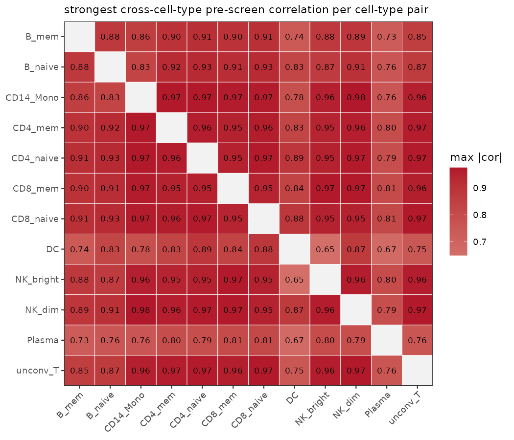
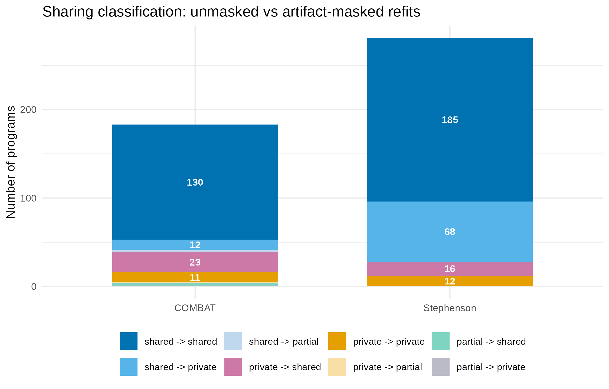
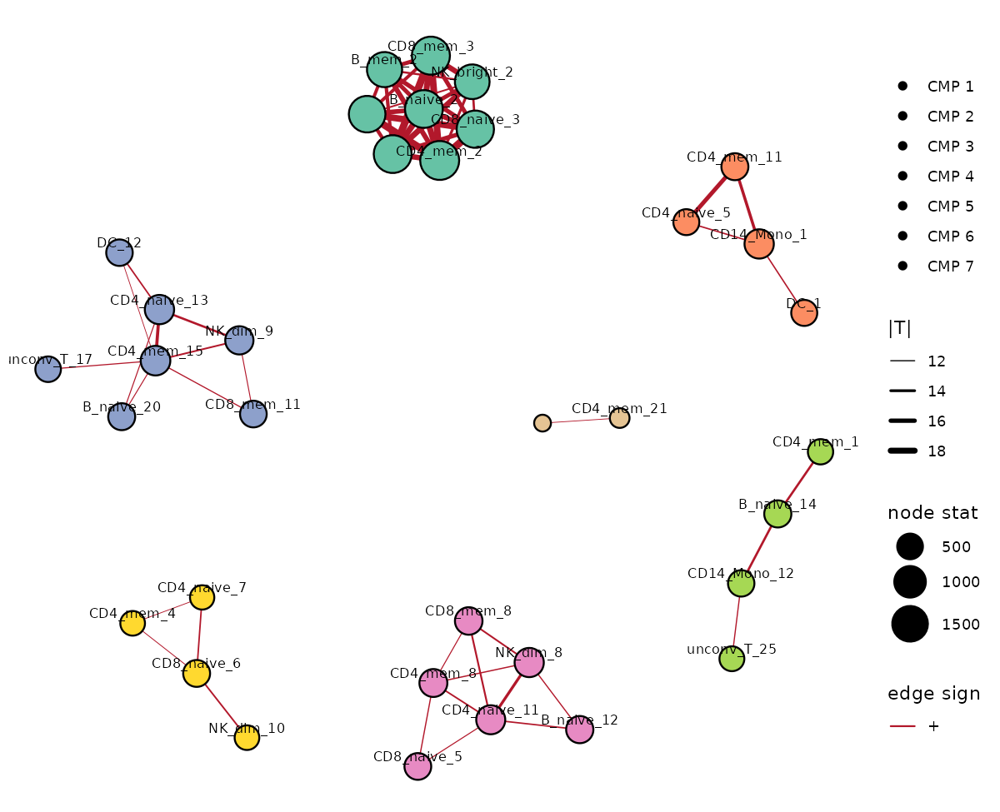
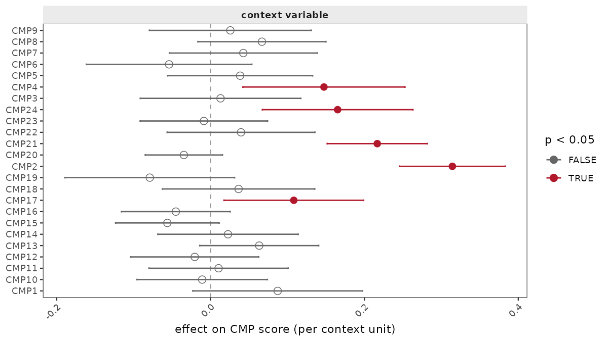

Case study: cross-cell-type programs in COVID-19 PBMC cohorts
================

This article walks through a full `cellprograms` analysis of two real
COVID-19 PBMC single-cell cohorts (Stephenson et al. 2021; COMBAT
consortium), demonstrating program discovery, cross-cell-type
coordination, program sharing, and the artifact-masking workflow. All
numbers and figures below are precomputed; the code chunks show exactly
how each result was produced and can be re-run against the public data
(see [Reproducing](#reproducing)).

## Data and fitting

Both cohorts are processed to a donor × gene pseudobulk matrix per cell
type (donors with too few cells of a type are dropped for that type):

- **Stephenson et al. (2021)**: 12 cell types, 72–117 donors per type,
  11.5k–12.9k genes per type.
- **COMBAT consortium**: 9 cell types, 89–122 donors per type,
  11.6k–13.0k genes per type.

The fitting recipe uses the default EBMF machinery with a point-Laplace
loading prior, K = 30 factors per cell type, and residualization of
technical covariates (sequencing institute + sex):

``` r
library(cellprograms)

x <- as_cell_program_data(pseudobulk, sample_metadata = meta)
fit <- fit_celltype_programs(
  x,
  loading_prior = "point_laplace",
  max_factors   = 30,
  features      = "variable", n_variable_genes = 2000,
  covariates    = c("institute", "sex"), covariate_mode = "residualize",
  var_type = 1, backfit = TRUE, nullcheck = TRUE,
  seed = 1
)
fit <- canonicalize_programs(fit)
```

This yields 318 programs in Stephenson and 222 in COMBAT (after the K =
30 cap and degenerate-factor handling).

## Program sharing across cell types

`program_sharing()` matches programs across cell types by loading
correlation (permutation-tested), groups the matches, and scores each
group with a multivariate adaptive shrinkage (mashr) model to classify
every program as **shared**, **partial**, or **private**:

``` r
share <- program_sharing(fit, n_perm = 199, seed = 1, z_thresh = 1.5)
share$summary   # per-program classification
share$groups    # sharing groups (lists of cell-type programs)
```

The sharing structure at cohort scale — the strongest cross-cell-type
pre-screen correlation per cell-type pair (per-program heatmaps become
unreadable beyond a few dozen programs, hence the `level = "cell_type"`
aggregate):

<figure>

<figcaption aria-hidden="true">Strongest cross-cell-type program
correlation per cell-type pair (Stephenson, unmasked)</figcaption>
</figure>

The near-uniform dark map is the V(D)J artifact speaking: every
cell-type pair has some program pair correlating at r \> 0.7, which is
why the per-program classification below is dominated by artifact-driven
sharing groups.

| Cohort     | Programs | Sharing groups | Shared | Partial | Private |
|------------|----------|----------------|--------|---------|---------|
| Stephenson | 318      | 39             | 284    | 0       | 34      |
| COMBAT     | 222      | 41             | 162    | 4       | 56      |

The dominant shared groups are biologically coherent: an
interferon-driven program shared across essentially all immune cell
types, a cell-cycle program, and lymphocyte activation programs. The
single largest sharing group in each cohort, however, is the **V(D)J
gene artifact** — see the next section.

## The V(D)J artifact, and masking it

Immunoglobulin and TCR receptor genes leak into scRNA-seq count matrices
as a technical artifact of cell capture (10x) rather than true biology.
Because the same receptor genes are “expressed” across all lymphocyte
types in a sample-correlated way, they induce a strong, *spurious*
cross-cell-type program that dominates the sharing analysis.

`cellprograms` ships an `artifact_gene_sets()` helper (V(D)J receptor
genes, genotype-marker genes, sex-chromosome genes) and an
`exclude_genes` argument for refitting without them. Artifact flagging
before masking:

``` r
flags <- flag_artifact_genes(fit)   # per-program artifact loadings
```

| Cohort     | Programs flagged (any artifact set) | Fraction |
|------------|-------------------------------------|----------|
| Stephenson | 249 / 318                           | 78%      |
| COMBAT     | 163 / 222                           | 73%      |

Refitting with V(D)J + genotype-marker genes excluded
(`artifact_genes(all_genes, sets = c("vdj", "genotype_marker"))`; 274
genes in the Stephenson universe) removes **all** artifact flags and
materially changes the sharing map:

``` r
fit_masked <- fit_celltype_programs(
  x, exclude_genes = artifact_genes(all_genes, sets = c("vdj", "genotype_marker")),
  loading_prior = "point_laplace", max_factors = 30,
  features = "variable", n_variable_genes = 2000,
  covariates = c("institute", "sex"), covariate_mode = "residualize",
  var_type = 1, backfit = TRUE, nullcheck = TRUE, seed = 1
)
fit_masked <- canonicalize_programs(fit_masked)
share_masked <- program_sharing(fit_masked, n_perm = 199, seed = 1, z_thresh = 1.5)
```

| Cohort     | Programs | Groups | Shared | Partial | Private | Flagged |
|------------|----------|--------|--------|---------|---------|---------|
| Stephenson | 284      | 32     | 204    | 0       | 80      | **0**   |
| COMBAT     | 185      | 35     | 158    | 3       | 24      | **0**   |

<figure>

<figcaption aria-hidden="true">Sharing classification of matched
programs before vs after artifact masking</figcaption>
</figure>

The effect of masking is **asymmetric** across cohorts, which is the
scientifically interesting part:

- In **Stephenson**, 68 programs flip shared → private: the unmasked
  V(D)J artifact was *creating* spurious sharing calls.
- In **COMBAT**, 23 programs flip private → shared: artifact loading
  contamination was *hiding* real shared biology that only becomes
  detectable once the artifact genes are removed.

Neither direction is the “expected” one — the artifact can both create
and mask sharing, which is why refitting (rather than post-hoc
filtering) is the recommended workflow.

## Sensitivity of the sharing calls

Two preregistered sensitivity analyses (see
`benchmarks/cmp_detection/PREREG_cmp-bench-v1.2.md` for the framework):

**z_thresh sweep.** The V-estimation step inside `program_sharing()`
falls back to the identity matrix when too few genes are “null” (\|z\| ≤
z_thresh in every condition of the group). Sweeping z_thresh over {1.5,
2, 2.5, 3} across all 320 group-fits (both cohorts, masked and
unmasked): the null set is non-empty in 117 group-fits, off-diagonal V
entries are nonzero in only 10, and **no sharing classification flips at
any threshold**. The identity fallback is structural (loading posterior
SDs are small relative to effect sizes) but harmless — sharing calls do
not depend on it.

**Matching calibration.** Re-running the cross-cell-type matching at
n_perm = 1999 (vs 199): edge Jaccard 0.78 (Stephenson) / 0.82 (COMBAT),
sharing-group ARI **0.85 / 0.89**, group counts 39 → 41 and 41 → 42.
Matching is stable at realistic permutation budgets.

## Coordinated multi-cell-type programs

`find_coordinated_programs()` detects coordinated multi-cell-type
programs (CMPs) — donor-level score covariation across cell types that
permutation tests against donor-label shuffling. Run on the masked fits
(the recommended workflow), with severity context association adjusting
for institute and sex:

``` r
cmp <- find_coordinated_programs(fit_masked, n_perm = 999, seed = 1, min_donors = 20)
cmp$cmps          # per-CMP member programs and consensus scores
cmp_context_association(fit_masked, cmp, "severity",
                        covariates = c("institute", "sex"))
```

The masked refits yield **24 CMPs** over 598 significant edges
(Stephenson) and **21 CMPs** over 255 edges (COMBAT); the unmasked
cap-30 fits give 27 and 25 (see
`benchmarks/cmp_detection/results/real_K10_K30_K40_summary.csv` for the
full cap-10/30/40 grid). The network view — node size = pooled evidence
A_v, edge width = \|T\|, color = CMP membership:

<figure>

<figcaption aria-hidden="true">Coordinated-program network, masked
Stephenson fit (60 strongest edges shown)</figcaption>
</figure>

Severity association per CMP (linear model on CMP consensus scores,
adjusting for institute and sex; solid red = p \< 0.05):

<figure>

<figcaption aria-hidden="true">CMP score association with COVID-19
severity, masked Stephenson fit</figcaption>
</figure>

Several CMPs are significantly severity-associated (strongest around
\|estimate\| ~ 0.2-0.3), while most are not — the coordination structure
carries both disease-relevant and disease-irrelevant multicellular
programs. CMP membership overlaps the sharing groups but is not
identical: sharing (mashr) is a loading-space statement, coordination is
a score-space statement, and the two views agree on the biology
(interferon, cell cycle) while disagreeing on program-level details —
which is precisely the information the two-test workflow is designed to
surface.

## Reproducing

The full pipeline (data download through figures) is scripted in the
repository:

- `benchmarks/cmp_detection/` — sharing benchmark + preregistrations
- `benchmarks/divas_comparison/` — head-to-head comparison against DIVAS
  on the Su et al. COVID-19 multi-omics case study
- Real-data fits are large and not bundled with the package; the scripts
  rebuild them from public data (ArrayExpress E-MTAB-8731 for
  Stephenson; COMBAT via the consortium release).
